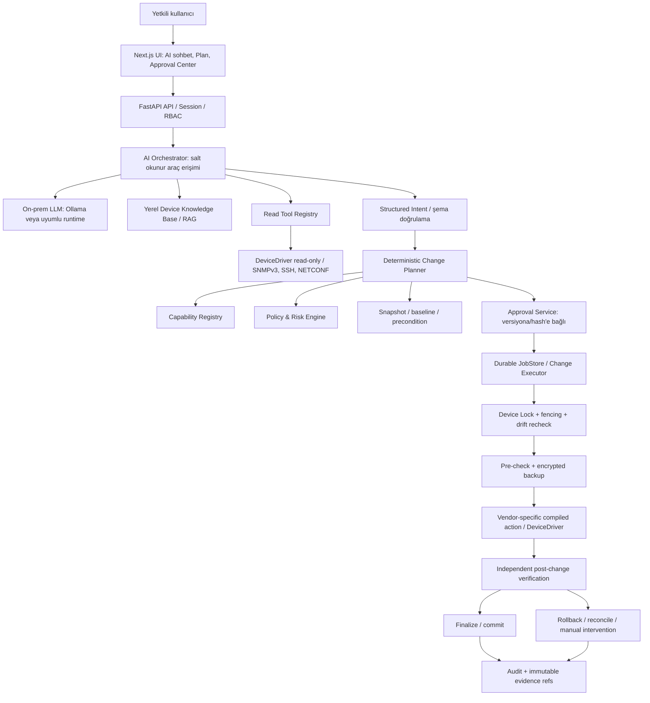
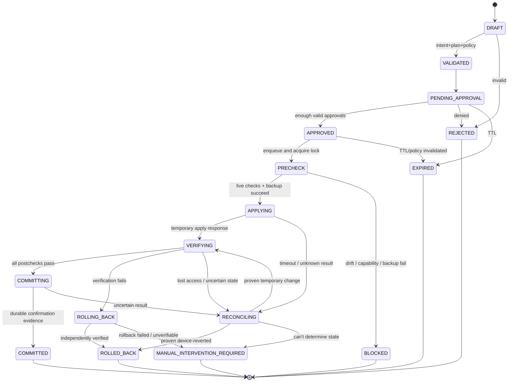

# Stocc Network Intelligence Engine (SNIE)
## Structured Intent, Capability, Approval, Execution, Verification & Rollback — Teknik Tasarım v1.0

**Durum:** Önerilen hedef mimari / ADR taslağı  
**Tarih:** 19 Ekim 2026  
**Proje:** `KES-KING/stocc-netstudio`  
**Kapsam:** Yerel LLM ile salt okunur ağ analizi ve **yalnızca insan onayından sonra** kontrollü konfigürasyon değişikliği.

> **Normatif temel:** LLM, cihaza uygulanacak CLI/RPC metninin otoritesi değildir. Yalnızca sürümlenmiş Structured Intent şemasını üretir. Yetkilendirme, onay ve cihaz üzerinde işlem yürütme modelden ayrı çalışan deterministik servislere aittir. Tanımsız, doğrulanamayan veya rollback hazırlığı olmayan işlem varsayılan olarak reddedilir.

---

## 1. Başlangıç bağlamı ve hedefler

İncelenen GitHub `main` sürümünde `frontend/` Next.js 14 + React 18 + TypeScript; `backend/` FastAPI + Pydantic + PostgreSQL/SQLAlchemy/Alembic altyapısı bulunuyordu. `backend/app/drivers.py` içinde `DeviceDriver` sınırı; `build_plan`, `precheck`, `apply`, `verify`, `persist`, `rollback` sözleşme yöntemleri; `backend/app/jobs.py` içinde `JobStore`; `backend/app/security.py` içinde RBAC ve `SecretStore` sınırı vardı. Bunların **gerçek cihaz yazma implementasyonu olduğu varsayılmamalıdır**. Kullanıcının güncel dalındaki değişiklikler ilk işlemde incelenmelidir.

### Hedefler

1. Üreticiden bağımsız, şema ile doğrulanan operasyon katalogu.
2. Gerçek cihaz/OS/firmware sürümüne dayalı, kanıtlı ve süreli capability değerlendirmesi.
3. AI'nin ürettiği niyetten deterministik, değişmez, açık diff/etki/rollback planı.
4. Site + cihaz + operasyon bazlı RBAC/ABAC ve risk tabanlı onay.
5. Plan onayıyla tam olarak **hangi byte/semantik içeriğin** uygulanacağını kriptografik olarak bağlama.
6. İyimser eşzamanlılık kontrolü ve cihaz başına tek yazma yürütücüsü.
7. Uygulamadan önce, geçici uygulama sırasında ve sonrasında ölçülebilir bağımsız doğrulama.
8. Native rollback desteklenen cihazda otomatik geri dönüş; diğerlerinde dürüstçe sınıflanan kurtarma garantisi.
9. Tam denetim izi, test edilebilir işlem sözleşmeleri, fail-closed çalışma.

### Bilinçli kapsam dışı (v1)

- Modelden gelen keyfî CLI veya shell komutunun çalıştırılması.
- İnsan onayı olmadan yazma işlemi.
- Desteklenmeyen platform için tahmini CLI komut üretimi.
- Çok cihazlı, ağ genelinde gerçek atomik transaction iddiası.
- SNMPv2c veya telnet ile konfigürasyon uygulama.
- Fixture çıktısının canlı keşif/konfigürasyon kanıtı olarak kullanılması.

## 2. Güven sınırları ve servis mimarisi



**Güvenlik sınırı:** LLM servis hesabına cihaz yazma sırrı, change executor anahtarı veya serbest terminal erişimi verilmez. LLM `read_*` araçları çağırabilir; `apply`, `commit`, `rollback`, `approve` ya da serbest komut araçlarına doğrudan erişemez. Kullanıcının onay eylemi ayrı, kimlik doğrulamalı HTTP API üzerinden gerçekleştirilir.

## 3. Structured Intent sözleşmesi

### 3.1. İki katmanlı sözleşme

**A. `AIIntentProposal` (güvenilmeyen, model çıktısı):**

```json
{
  "schema_version": "1.0",
  "operation_id": "interface.access_vlan.set",
  "target_selector": {"device_id": "sw-access-01", "interface_name": "Gi1/0/10"},
  "parameters": {"vlan_id": 30},
  "rationale": "Kullanıcının açık VLAN taşıma talebi"
}
```

`requester_user_id`, `site_scope`, `approver`, `credential_ref`, `risk_level`, `approved`, `execution_commands` ve `capability_status` gibi yetki alanları model çıktısından **asla güvenilir kabul edilmez**; yalnızca sunucu ekler.

**B. `ValidatedChangeIntent` (sunucu tarafından oluşturulur):**

```json
{
  "schema_version": "1.0",
  "intent_id": "int_01H_EXAMPLE",
  "operation_id": "interface.access_vlan.set",
  "requester_user_id": "user-128",
  "site_id": "site-01",
  "device_id": "sw-access-01",
  "target": {"interface_id": "if-402", "display_name": "Gi1/0/10"},
  "parameters": {"vlan_id": 30},
  "source": "ai_proposal",
  "created_at": "2026-10-19T15:10:00Z"
}
```

ID, kimlik, kaynak ve zaman **server-side** oluşturulur; örnek değerler kurgusaldır.

### 3.2. Operation Registry (v1 başlangıç kataloğu)

| Operation ID | Parametreler | Ön koşullar | Varsayılan risk | İlk dalga |
|---|---|---|---|---|
| `interface.description.set` | `interface_id`, `description` | Fiziksel/mantıksal interface çözülmeli; uzunluk/charset sınırı | L1 | **Evet** |
| `interface.access_vlan.set` | `interface_id`, `vlan_id: 1..4094` | Access port, VLAN mevcut, yönetim yolu etkilenmiyor, capability doğrulanmış | L2 veya daha yüksek | Laboratuvarda |
| `interface.admin_state.set` | `interface_id`, `enabled: bool` | Kritik uplink/LAG/management analizi; OOB/rollback | L2/L3 | Sonraki dalga |
| `interface.trunk_allowed_vlans.set` | Sıralı VLAN kümesi | Trunk/peer/STP/MLAG doğrulaması | L3 | **v1 engelli** |
| `device.hostname.set` | `hostname` | DNS, monitörleme, konfig yan etkileri | L2 | Sonraki dalga |
| `routing.static_route.set` | Prefix, nexthop, VRF | Uçtan uca routing analizi, OOB | L3 | **v1 engelli** |

**Operation Definition** sürümlenir: `operation_id`, `operation_version`, strict JSON schema, target types, required observation set, capability predicate, risk floor, approval policy, compiler id/version, independent verification checks ve allowed rollback strategies. Registry dışında operasyon yoktur; `additionalProperties=false` kullanılır. Port/VLAN/hostname bilgisi model çıktısında geçse bile yetkili cihaz envanterinde çözümlenip doğrulanır.

### 3.3. Pydantic sözleşme örneği

```python
from typing import Annotated, Literal
from pydantic import BaseModel, ConfigDict, Field

class StrictModel(BaseModel):
    model_config = ConfigDict(extra="forbid", strict=True)

class InterfaceAccessVlanParams(StrictModel):
    vlan_id: int = Field(ge=1, le=4094)

class AccessVlanIntent(StrictModel):
    schema_version: Literal["1.0"]
    operation_id: Literal["interface.access_vlan.set"]
    target_selector: dict[str, str]  # Backend resolves against authorized inventory
    parameters: InterfaceAccessVlanParams
    rationale: str = Field(max_length=1200)

# Üretimde: operasyon bazlı discriminated union + explicit target schema.
# Bu örnek cihaz erişimi veya CLI icrası yapmaz.
```

Validator, parse hatası/ek alan/örtük dönüştürme/tanımsız işlem durumunda reddeder. Hata nedeniyle LLM'nin son cevabı doğrudan CLI'ye çevrilmez.

## 4. Capability Model — 'bilinmiyorsa reddet'

Capability değerlendirmesi üç ayrı boyutu birleştirir:

- **Platform capability:** OS/firmware + driver sürümünde işlem teknik olarak var mı?
- **Runtime evidence:** Bağlı cihazda gerçekten algılandı/test edildi mi, gözlem ne kadar taze?
- **Effective authorization:** Kullanıcının kapsamı, risk politikası, bakım penceresi ve rollback şartları izin veriyor mu?

```json
{
  "device_id": "sw-access-01",
  "fingerprint": {
    "vendor": "Cisco",
    "platform": "iosxe",
    "model": "example-switch",
    "os_version": "example-release",
    "driver_id": "iosxe-v1",
    "driver_version": "1.2.0"
  },
  "capabilities": {
    "interface.access_vlan.set": {
      "support": "supported",
      "verification": "lab_validated",
      "observed_at": "2026-10-19T15:00:00Z",
      "expires_at": "2026-10-19T16:00:00Z",
      "transport": "ssh",
      "rollback_modes": ["config_replace_confirmed"],
      "native_rollback_confirmed": true,
      "constraints": {"max_vlan_id": 4094}
    }
  }
}
```

*Örnek şema; belirli Cisco sürümünde belirtilen yeteneklerin gerçekten bulunduğunu göstermez.*

`support`: `supported | unsupported | unknown`; `verification`: `theoretical | lab_validated | device_verified`; `effective_allowed` ayrıca policy kararıdır. `theoretical` destek, üretim yazma için tek başına yeterli olmaz. Bazı yetenekler per-port (ör. breakout, PoE, VLAN) veya per-context (VRF/stack) olduğundan yalnızca device seviyesinde cache'lenmez.

**Invalidate:** firmware değişimi, reboot/stack rol değişimi, driver upgrade, config drift, cihaz kimliği/fingerprint uyuşmazlığı ve TTL dolması capability kanıtını geçersiz yapar. Fixture destek bilgisi `fixture` kaynaklı olarak ayrılır ve üretim apply yetkisi oluşturmaz.

## 5. Change Plan — imzalanan değişmez içerik

Planın kritik alanları:

```json
{
  "plan_id": "plan-2401",
  "plan_version": 3,
  "schema_version": "1.0",
  "intent_id": "int_01H_EXAMPLE",
  "device_id": "sw-access-01",
  "operation_id": "interface.access_vlan.set",
  "operation_version": "1.0.0",
  "compiler": {"id": "iosxe-intent-compiler", "version": "1.2.0"},
  "target_interface_id": "if-402",
  "baseline": {
    "snapshot_id": "snapshot-803",
    "canonical_scope_sha256": "EXAMPLE_HASH_BASELINE",
    "collected_at": "2026-10-19T15:00:00Z",
    "source": "ssh",
    "quality": "ok"
  },
  "desired_state": {"access_vlan": 30},
  "diff": [{"path": "interfaces/if-402/access_vlan", "before": 20, "after": 30}],
  "risk": {"level": "L2", "reasons": ["Bağlı istemcide kesinti olasılığı"]},
  "preconditions": ["device_identity_match", "port_access_mode", "vlan_exists", "management_path_safe"],
  "verification_profile": "access_vlan_v1",
  "rollback_strategy": "config_replace_confirmed",
  "approval_policy_id": "two_person_l2",
  "expires_at": "2026-10-19T15:20:00Z",
  "artifact_digest": "EXAMPLE_HASH_PLAN"
}
```

Gerçek plan; **derlenmiş uygulanabilir işlem artefaktının** (ör. komut/RPC adımları, sıra, beklenen yanıtlar, parametreler, rollback/verify tanımları) hash'ini veya ayrı bağlı referansını içerir. Onaylanan plan ile executor'a ulaşan byte/semantik artefakt bağı kriptografik olarak korunur.

**Plan hash ilkesi:** Mutasyon etkileyen alanları, hedefleri, driver/compiler sürümünü, baseline, pre-/post-check, rollback planını, politika kimliğini ve executable artifact digest'ini RFC 8785 benzeri canonical JSON temsilinden SHA-256 ile hash'le. `plan_hash` alanını hash girdisinin dışında tut. Salt hash, imza/onay yerine geçmez; sunucu kimliğiyle, veri tabanında plan hash'ine bağlanan kimlik doğrulamalı ve erişim kontrollü onay kaydı tut. Gerekiyorsa KMS destekli dijital imzayla mühürle.

**Invalidation:** Süre dolması, baseline drift, capability/driver/registry/policy sürüm değişimi, approval policy değişimi, hedef/parametre değişimi, yetki kaybı, risk artışı veya yeni kritik gözlem -> yeniden plan, yeniden onay.

**Deterministik compilation:** Modelin serbest `command` alanı yoktur. `DeviceDriver.compile(operation, target, desired, baseline)` izinli platform şablonundan artefakt üretir; escape, enjeksiyon, aralık doğrulaması driver'da yapılır. İstenmeyen CLI komutları semantik plan diff'iyle ilişkili olamaz.

## 6. Risk ve Policy Engine

### 6.1. Roller (önerilen)

| Rol | Read | Intent create | Approve | Execute API |
|---|---:|---:|---:|---:|
| Viewer | ✓ | — | — | — |
| Operator | ✓ | ✓ | — | — |
| Approver | ✓ | ✓ | Yetki/risk kapsamında | — |
| Admin | ✓ | ✓ | Politika kapsamında | **Doğrudan yazma yok** |
| Executor Service | Dar teknik kapsam | — | — | Yalnızca mühürlü onaylı plan |

`config.plan`, `config.approve`, `config.apply.request`, `config.rollback.request`, `config.backup.read_sensitive`, `device.credentials.manage`, `audit.read` izinlerini ayrı tut. Her izin `site_id`, `device_id`, `interface_id`, cihaz rolü, bakım penceresi ve operation scope ile daraltılır. Gerçek kimliği backend IdP/oturumundan al; demo `X-Stocc-User` başlığı prod yetkilendirme için kabul edilmez.

### 6.2. Risk seviyesi

- **L0:** salt okunur; otomatik, uygun read yetkisiyle.
- **L1:** açıklama gibi sınırlı etki; tek ayrı yetkili onayı.
- **L2:** access VLAN, port admin state; isteği oluşturan kişiden ayrı onaylayıcı + bakım penceresi/rollback profili.
- **L3:** trunk, management, routing, ACL; iki bağımsız onay + OOB veya güçlü native rollback + zamanlı maintenance window.
- **RESTRICTED:** v1 destek dışı, belirsiz yönetim riski veya geri alma şartı yetersiz; apply yasak.

Risk yalnızca operation ID'nin etiketi değildir. Cihazın `criticality`, topoloji rolü (uplink/management), port bağlı uç bilgisi, OOB, aktif trafik, iş saati ve bilinen bağımlılıklarla **monoton artabilir**. Modelin önerdiği risk etiketi policy girdisi değildir.

**Kesin ret örnekleri:** bilinmeyen yetenek; canlı olmayan baseline; yazılabilir cihaz sırrı yok; güvenilmeyen SSH host key; write hedefi kullanıcı kapsamı dışında; uplink'i kapatmaya çalışma; onaylayanın talep sahibi olması; onaylı hash uyuşmazlığı; kritik işlem için doğrulanmış rollback/OOB bulunmaması.

OPA/Rego gelecekte politika motoru olabilir; v1 için saf ve test edilen Python policy fonksiyonlarıyla başlanabilir. Kararı `allow / deny / needs_more_evidence`, kuralları, reasons ve policy version olarak sakla.

## 7. Approval Center — onayın kapsamı

1. Kullanıcı diff, hedef, mevcut ve istenen durum, risk, kesinti etkisi, ön koşullar, verifikasyon ve rollback sınırlarını görür.
2. Sunucu, **immutable** `plan_id + version + plan_hash + artifact_digest + policy_version` değerlerini onay kaydına bağlar.
3. `approver_user_id`, gerçek oturum kimliği, MFA re-auth sonucu (L3), zaman, karar, gerekçe ve onay kapsamı kaydedilir.
4. SoD: talep sahibi kendi L2/L3 planını onaylayamaz; çoklu onayda kullanıcılar farklıdır. Admin rolü otomatik bypass sağlamaz.
5. Onay sayısı kadar politika kuralı da sunucuda yeniden değerlendirilir. Plan diff değişirse tüm eski onaylar geçersizdir.
6. Uygulama butonu ancak `APPROVED` ve güncel policy durumunda aktiftir. İşlem enqueue etme kullanıcı niyetidir; gerçek apply kararını worker son kez verir.

**Replay koruması:** plan başına tek aktif execution, opaque execution nonce/idempotency key, terminal durumuna geçmiş plan için tekrar apply reddi. Onay kaydı işlem yapma için tek başına yeterli değildir.

## 8. Transaction ve durum makinesi



**Kilit:** Aynı cihaz için tek yazma transaction'ı; PostgreSQL row-lock/advisory-lock veya atomik lease kaydı kullan. Dağıtık worker için lease expiry ve monoton `fencing_token` tut. Her kritik adım öncesi aktif lease sahibi ve token'ı kontrol et; süre dolmuş worker'a yeni yazma adımı başlatma. **Veritabanı fencing token'ı fiziksel switch üzerinde zorlayıcı bir kilit değildir:** eski bir SSH oturumunda zaten başlamış komutu geri alamaz. Bu nedenle kontrollü tek executor, komut başına zaman sınırı, yeniden başlatmada reconcile ve gerekiyorsa sürücünün cihaz üzeri config lock mekanizması birlikte kullanılmalıdır. Cihazda devam eden/sonucu belirsiz işlem varsa otomatik yeniden apply etme. Uygulama sırasında cihaz kimliği/fingerprint ve baseline yeniden kontrol edilir. İç kilit harici operatörlerin değişikliklerini engellemez, bu yüzden pre-check drift kontrolü zorunludur.

**İdempotency:** API tekrarları aynı işi ikinci kez yaratmaz. Network komutlarını genel olarak idempotent sayma; timeout sonrası **durumu öğrenmeden** aynı apply komutunu tekrar gönderme. Konfigürasyonun kısmen değişmiş olması mümkündür.

## 9. Deterministik execution pipeline

1. **Load:** mühürlü plan, plan hash ve onay kayıtlarını sunucu veri deposundan oku.
2. **Authorize:** kullanıcı isteğini, execute service principal'ı ve policy'yi yeniden değerlendir.
3. **Lock:** cihaz kilidi/fencing token al; açık çakışmaları reddet.
4. **Discover:** kimlik, host key, cihaz rolü, firmware, capability ve yönetim erişimi doğrula.
5. **Baseline:** güncel running/candidate veya operation scope'u çek; canonical hash karşılaştır; drift varsa BLOCKED.
6. **Backup:** yeterli bütünlüğe sahip şifreli snapshot al ve geri okuma/doğrulama işlemi yap; başarısızsa BLOCKED.
7. **Precheck:** VLAN varlığı, interface modu, topoloji/management riskleri ve vendor-specific sentaks/commit dry-run kontrolü.
8. **Prepare rollback:** native confirmed commit, timed revert, OOB veya onaylanan best-effort stratejinin hazır olduğunu doğrula; kritikte güçlü koruma yoksa BLOCKED.
9. **Apply temporary:** derlenmiş ve hash ile bağlanmış artefaktı uygula. Doğrudan `startup`/kalıcı commit yapılmaz.
10. **Verify:** tekrar okunan gerçek cihaz durumunu beklenen hedef değer + invariant kontrolüyle ölç. Tek `command success` veya LLM açıklaması başarı değildir.
11. **Commit:** yalnızca tüm kritik kontroller geçerse native confirmation/finalization. Son durumu ve kalıcı konfigürasyonu yeniden doğrula.
12. **On failure:** rollback tetikle veya native timeout'u kontrollü izle; ardından bağımsız doğrula. Bilinmeyen sonucu başarılı ilan etme.
13. **Audit:** her transition için bütünlük kanıtları, monoton sıra, user/approver/worker, hata kodu, kaynak ve gözlem zamanlarını yaz.

### Yürütme esnasındaki güvenlik

- SecretStore ayrı, şifreli ve sunucu tarafında; read API sırları döndürmez.
- SSH host key pinning/TOFU için ayrı idari doğrulama; fingerprint değişimi BLOCKED.
- Write hesabı yalnızca Change Executor tarafından kullanılır. Interactive SSH ekranı ayrı ve varsayılan salt okunur hesap kullanır.
- Konfigürasyon ve CLI çıktısı sır içerebilir: erişim kontrollü şifreli snapshot, redaction ve sınırlı log retansiyonu.
- WebSocket/terminal ve LLM araç katmanı bu write flow'u bypass edemez.

## 10. Verifikasyon sözleşmeleri

Üç bağımsız kontrol sınıfı:

1. **Preconditions:** değişiklik öncesi beklenen durum. Örn. port access, VLAN 30 mevcut, management uplink değil.
2. **Desired-state checks:** uygulama sonrası beklenen yapılandırma/operasyon. Örn. `if-402.access_vlan==30`.
3. **Safety invariants:** değişmemesi gereken durum. Örn. cihaz yönetim erişimi mevcut, uplink/trunk kritik ilişkileri korunmuş, kapsamdışı config değişmemiş.

Verification sonucu `pass | fail | inconclusive` olmalı; boş/veri yok/stale -> `inconclusive`, asla `pass` değil. Her check; `source`, `observed_at`, `quality`, threshold ve `expected/actual` üretir. Kritik kontrolde `inconclusive` sonucu confirmed commit'i kalıcılaştırma yetkisi vermez.

```json
{
  "check_id": "vlan-membership-check",
  "status": "pass",
  "expected": {"access_vlan": 30},
  "actual": {"access_vlan": 30},
  "source": "netconf",
  "observed_at": "2026-10-19T15:14:11Z",
  "quality": "ok"
}
```

`write_result=accepted` ve `verification=passed` kavramlarını farklı tut. Running/startup/candidate konfigürasyonu ile operasyonel state arasındaki ayrımı açıkça modelle (NETCONF/NMDA uygun olduğunda).

## 11. Rollback Strategy Registry

| Strateji | Teknik | Güvence ve sınırlama | Otomatik üretim politikası |
|---|---|---|---|
| `netconf_confirmed_commit` | RFC 6241 `:confirmed-commit:1.1`, candidate, confirm/cancel; gerekirse `persist/persist-id` | Sunucu capability'si ve zaman aşımı doğrulanır | Destek kanıtlandıysa tercih edilir |
| `junos_commit_confirmed` | Junos `commit confirmed` / ilgili NETCONF | Süre dolarsa önceki config'e döner; oturum/versiyon davranışı doğrulanır | Destek kanıtlandıysa tercih edilir |
| `iosxe_config_replace_confirmed` | `configure replace ... time <minutes>` + `configure confirm` | Genel keyfî CLI için otomatik undo değildir; archive/replace önkoşulları vardır | Cihaz/sürüm/operasyon laboratuvarda testliyse |
| `vendor_safe_mode` | Örn. RouterOS Safe Mode | Oturum davranışı, geçmiş limiti ve platform kısıtları vardır | Device-specific ve lab validated |
| `config_restore` | Eski yedeği yükleme | Bağlantı kaybolursa uygulanamayabilir; geri dönüş yan etkisi yüksek olabilir | L1/L2'de uygun risk değerlendirmesiyle |
| `inverse_operation` | Önceki state'e typed karşı işlem | Atomik değildir; haricî drift varsa yanlışlık yapabilir | Yalnızca düşük risk, kontrollü koşullar |
| `manual_only` | OOB/yerinde müdahale | Otomatik garanti yok | Kritik yazmada BLOCKED |

**Rollback planı uygulama öncesi üretilir ve onaylı planın bir parçasıdır.** Onaylı plan “kesin geri alınabilir” diyorsa, gerçek cihazda bunun native ve uygulanabilir olduğu doğrulanmadan yürütme başlamaz.

NETCONF persistent confirmed commit kullanılırsa `persist` token'ı hassas işlem verisi sayılır; uygun gizlilikte saklanır ve restart sonrası transaction rehydration ile ilişkilendirilir. Oturum kopunca timeout nedeniyle otomatik rollback olacağı körü körüne varsayılmaz; kullanılan persist modelinin semantiği test edilir.

**Rollback doğrulaması:** Rollback RPC başarı yanıtı yeterli değildir; baseline ile hedef kapsamdaki gerçek durumu yeniden karşılaştır. Korunamayan yönetim erişiminde `MANUAL_INTERVENTION_REQUIRED` veya geçici `RECONCILING` durumunu göster, otomatik tekrar deneme yapma.

### Çok cihazlı işlem

Başlangıçta transaction **tek cihazlıdır**. Çok cihazlı operasyon, `change_campaign` üst nesnesi altında bağımlılık sırasıyla yürütülen küçük dalgalara ayrılır. Her dalgada precheck/apply/verify/commit vardır; tüm ağı atomik kabul etme. Bir dalga başarısızsa sonrakileri durdur, tamamlanmış cihazlar için kontrollü compensation planı oluştur ve kalan riski görünür kıl.

## 12. API taslağı

| Method & path (önerilen) | Açıklama | Kimlik/yetki |
|---|---|---|
| `POST /api/v1/ai/intents/propose` | LLM önerisini alır, yalnızca öneri döner | `inventory.read` |
| `POST /api/v1/change-intents` | Structured Intent validate ve persist | `config.plan` |
| `POST /api/v1/change-intents/{id}/plans` | Immutable plan oluştur | `config.plan` |
| `GET /api/v1/change-plans/{id}` | Redacted plan, diff, risk, evidence | scope + `config.plan/read` |
| `POST /api/v1/change-plans/{id}/submit` | Approval süreci başlat | requester scope |
| `POST /api/v1/change-plans/{id}/approvals` | plan_hash'e bağlı onay/red | `config.approve`, step-up auth |
| `POST /api/v1/change-plans/{id}/executions` | Idempotent enqueue; server verifies approvals | `config.apply.request` |
| `GET /api/v1/change-executions/{id}` | İş ve doğrulama durumu | device scope |
| `GET /api/v1/change-executions/{id}/events` | SSE/poll ile olaylar | device scope |
| `POST /api/v1/change-executions/{id}/rollback-requests` | Kontrollü geri alma talebi; policy ile | `config.rollback.request` |
| `GET /api/v1/devices/{id}/effective-capabilities` | Platform + live capability + policy görünümü | device scope |

`approvals` ve `executions` endpoint'leri istemcinin gönderdiği `approved=true`, `risk=L1`, `cli=...` türü alanları **asla** güvenilir kabul etmez. Hata kodları kararlı olmalı: `CAPABILITY_UNKNOWN`, `PLAN_EXPIRED`, `BASELINE_DRIFT`, `APPROVAL_REQUIRED`, `APPROVAL_INVALIDATED`, `ROLLBACK_UNAVAILABLE`, `DEVICE_LOCKED`, `DEVICE_IDENTITY_CHANGED`, `VERIFICATION_INCONCLUSIVE`, `EXECUTION_STATE_UNKNOWN`.

## 13. Kalıcı veri modeli / migrations

| Tablo | Önemli alanlar |
|---|---|
| `operation_definitions` | id, version, schema_digest, compiler_id, enabled, risk_floor |
| `device_capabilities` | device_id, operation_id, fingerprint_hash, evidence_source, verified_at, expires_at, support, verification, rollback_modes |
| `change_intents` | id, requester_id, site_id, operation_id, parameters_json, device_id, created_at |
| `change_plans` | id, version, intent_id, canonical_plan_json, plan_hash, artifact_digest, baseline_hash, policy_version, expires_at, immutable |
| `change_approvals` | plan_id, plan_hash, approver_id, decision, auth_strength, approved_at, evidence |
| `change_executions` | execution_id, plan_id, status, attempt, fencing_token, idempotency_key, worker_id, started_at, finished_at |
| `change_execution_events` | sequence, execution_id, old_state, new_state, reason, evidence_ref, occurred_at |
| `config_snapshots` | device_id, scope, encrypted_blob_ref, ciphertext_hash, plaintext_integrity_digest_protected, collected_at, sensitivity |
| `change_verifications` | execution_id, phase, check_id, status, expected/actual, source, observed_at, evidence_ref |
| `rollback_records` | execution_id, strategy, trigger, started_at, outcome, verified_state, evidence_ref |
| `device_write_leases` | device_id, execution_id, fencing_token, lease_expires_at |
| `audit_events` | actor, action, object_ref, outcome, prev_event_digest, digest, timestamp, exported_ref |

Üretim ortamında audit tablosuna yazma yetkisini sınırla; hash-chain tek başına WORM değildir. Düzenli olarak haricî immutable/append-only depoya veya güvenilir imzalı checkpoint'e gönder. Schema migrasyonları Alembic üzerinden artırımlı yapılır, mevcut migration geçmişi değiştirilmez.

## 14. DeviceDriver sözleşme genişlemesi

Mevcut `DeviceDriver` protokolünü kırmadan, typed `ChangeAdapter` ile genişletmek önerilir:

```python
from typing import Protocol

class ChangeAdapter(Protocol):
    def discover_write_capabilities(self, session, device) -> dict: ...
    def collect_baseline(self, session, operation, target) -> object: ...
    def compile_intent(self, operation, target, parameters, baseline) -> object: ...
    def validate_candidate(self, session, compiled_artifact) -> object: ...
    def prepare_rollback(self, session, plan) -> object: ...
    def apply_temporary(self, session, approved_artifact, rollback_guard) -> object: ...
    def verify_independently(self, session, verification_profile) -> object: ...
    def finalize_commit(self, session, rollback_guard) -> object: ...
    def rollback_change(self, session, rollback_guard) -> object: ...
    def reconcile(self, session, execution) -> object: ...
```

`GenericReadOnlyDriver` ve `FixtureDriver` her yazma capability'si için `unsupported/unknown` döndürür ve `UnsupportedCapability` üretir. Yazma sözleşmesi farklı driver içinde implemente edilmeyen cihaz için kod yolundan dolayı otomatik destek açılmaz.

**Plugin trust:** yalnızca imzalı/kontrol edilen adapter paketleri yüklenir; driver sürümü plan hash'ine bağlanır; binary/şablon değişince bekleyen planlar yeniden derlenir/onaylanır. LLM bir Python dosyası ya da driver plugin üretemez ve canlı kuramaz.

## 15. Tehdit modeli ve güvenlik kontrolleri

| Tehdit | Güvence |
|---|---|
| LLM prompt injection (banner, interface description, RAG dokümanı) | Cihaz/RAG içeriği güvenilmeyen data; araç allowlist ve strict schema; LLM'de write credential yok |
| AI sahte kullanıcı/onay üretir | Kimlik sunucuda oturumdan; approval API'de MFA/SoD; AI mesajı onay değildir |
| Parametre/CLI enjeksiyonu | Typed schema, canonical target resolution, deterministik vendor compiler; arbitrary command alanı yok |
| Plan onaylandıktan sonra değişir | Hash ile mühürlü artefakt, versiyonlu onay, runtime drift kontrolü |
| Aynı anda iki write / worker restart | Per-device lease + fencing + reconcile; idempotency; unsafe retry yok |
| SSH MITM / credential sızıntısı | Host key pinning, SecretStore şifreleme, ayrık read/write credential, redacted logs |
| Site/tenant aşımı | Device/site scoped auth ve backend query filtering; UI filtreleri güvenlik sınırı değil |
| Cihazdan veri eksik/eskimiş | `quality/source/observed_at/TTL` kontrolleri; critical inconclusive -> block |
| Yönetim bağlantısı kopar | Native timed rollback veya manual intervention; desteklenmeyen durumda risk-temelli block |
| Beklenmedik network drift | Re-read baseline + scoped semantic diff + post invariant checks |

Network cihazlarından toplanan konfigürasyon banner/description gibi metinleri prompt injection taşıyabilir. RAG sonuçları da aynı güven sınırına tabidir. Hostname, model veya cihazdan alınan metin komut olarak yürütülmez.

## 16. Test ve kabul planı

### Birim / sözleşme testleri

- Tanımsız operation, fazla parametre, tip uyuşmazlığı -> ret.
- VLAN `0`, `4095`, string `"30"`, gömülü CLI/metakarakterler -> strict validator ret.
- Interface resolver farklı device/site interface ID'sini kabul etmez.
- Driver capability `unknown`, TTL expired, firmware mismatch -> apply ret.
- Risk L2 planı talep sahibi tarafından onaylanamaz; plan hash değişince onay geçersiz.
- Same idempotency key aynı `execution_id` döndürür.
- İşlemin ağ yanıtı kaybolursa bilinmeyen durum `RECONCILING`, kör retry yok.
- Eski worker geçersiz fencing token ile **yeni** apply adımı başlatamaz; devam eden cihaz oturumu ve crash-recovery ayrıca test edilir.
- Drift tespiti backup alınmış olsa bile uygulamayı engeller.
- Verify inconclusive -> confirmed commit finalize edilmez.
- Generic/fixture hiçbir cihaz yazma yöntemi açmaz.
- Geri alma başarısızsa `ROLLED_BACK` yazılmaz.

### Entegrasyon / fault injection

- Fake SSH/NETCONF adaptörü ve deterministik zaman/clock ile durum makinesi testleri.
- Onay sonrası config drift, capability invalidation, worker crash, DB restart, socket loss, timeout, rollback fail, partial apply senaryoları.
- Şifreli snapshot'ın read API/log ile sızmadığı; export yetkisi ve redaction testleri.
- E2E: Plan -> diff -> ayrı kullanıcı onayı -> execution -> verify -> commit; hata durumunda rollback görünümü.
- Lab: Sürümü doğrulanmış gerçek/sanal cihazlarla yalnızca `interface.description.set`, sonra risk kontrollü access VLAN.

### Üretim kapısı (go/no-go)

1. Gerçek device write credential'ları SecretStore içinde ve read-only AI'den ayrılmış.
2. Kimlik sağlayıcı ve site scoped RBAC gerçek; demo header prod kapalı.
3. Operation + platform/OS sürümü `lab_validated` veya `device_verified`.
4. Baseline ve config backup doğrulanmış.
5. Onaylayan farklı kişi, plan tam olarak imzalı hash'e bağlı.
6. Native rollback veya risk için yeterli doğrulanmış kurtarma yöntemi var.
7. Verify independent checks ve audit çalışıyor.
8. Fail closed, unknown state ve manual intervention UX uygulanmış.

## 17. Aşamalı uygulama planı

**Sprint 1 — Foundation (write disabled):** OperationRegistry + strict Pydantic schemas; live capability keşfi; typed driver error; politika motoru; testler; fixture write fail-closed.

**Sprint 2 — Planner & Approval (write disabled):** Baseline snapshot, deterministic plan compilation, plan digest, risk, approval records/SoD, API ve Approval Center UI.

**Sprint 3 — Lab execution (feature-flagged):** Ayrık executor, lease/fencing, yalnız `interface.description.set`; encrypted backup, independent verify, rollback/reconcile ve fault injection.

**Sprint 4 — Restricted production canary:** Tek vendor/model/OS + test edilmiş rollback; bakım penceresi, gözlem, audit exports ve kontrollü rollout. Access VLAN ancak ayrı risk/rollback kanıtıyla açılır.

Her sprintin çıktısı test edildiği platform ve operasyonla sınırlı olarak `supported` şeklinde işaretlenir. Feature flag olmadan kritik write özelliği açılmaz.

## 18. Mimari karar kayıtları (ADR)

- **ADR-SNIE-001:** Structured Intent; LLM yalnızca allowlist niyet üretebilir.
- **ADR-SNIE-002:** Yazma yetkisi sadece deterministic Change Executor'da.
- **ADR-SNIE-003:** Capability unknown/default → deny; platform/OS kanıtı gerekli.
- **ADR-SNIE-004:** Immutable plan hash + artifact binding + separation of duties.
- **ADR-SNIE-005:** Apply öncesi fresh baseline / backup / precheck; drift → block.
- **ADR-SNIE-006:** Native transactional/confirmed rollback preferred; aksi halde risk bazlı deny.
- **ADR-SNIE-007:** Verify ve commit iki ayrı aşama; inconclusive → finalization yok.
- **ADR-SNIE-008:** Single-device first; multi-device eventual saga/compensation.
- **ADR-SNIE-009:** LLM, interactive SSH ve write service credential ayrımı.

## 19. Dış teknik referanslar

- NETCONF ve confirmed commit: https://www.rfc-editor.org/rfc/rfc6241
- Network Management Datastore Architecture (running/candidate/operational): https://www.rfc-editor.org/rfc/rfc8342
- Cisco IOS XE Configuration Rollback Confirmed Change: https://www.cisco.com/c/en/us/td/docs/routers/ios-xe/system-management/system-management/m_cm-config-rollback-confirmed-change.html
- Junos `commit confirmed`: https://www.juniper.net/documentation/us/en/software/junos/cli/topics/topic-map/junos-configuration-commit.html
- NAPALM platform capability caveats: https://napalm.readthedocs.io/en/latest/support/
- OPA/Rego policy language: https://www.openpolicyagent.org/docs/policy-language
- OWASP LLM Excessive Agency: https://genai.owasp.org/llmrisk/llm062025-excessive-agency/

---

**Sonuç:** SNIE, "AI tarafından üretilmiş komutları çalıştıran terminal" değil, **kanıtlı capability + deterministik plan + risk politikası + tam plan onayı + kontrollü execution + doğrulanabilir rollback** üzerine kurulu bir ağ operasyonu kontrol düzlemi olacaktır.
