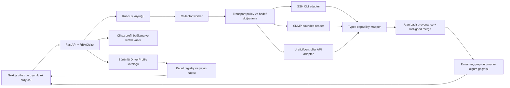

# NetStudio switch OS, SSH ve SNMP uyumluluk implementasyon raporu

| Belge alanı | Değer |
|---|---|
| Belge kimliği | `NETSTUDIO-COMPAT-IMPL-001` |
| Tarih | 23 Ekim 2026 |
| İncelenen kaynak tabanı | `fa1a40f` |
| Kaynak kapsamı | Backend, frontend, migration, testler ve mevcut teknik belgeler |
| Girdi matrisi | [`NetStudio_Switch_OS_SSH_SNMP_Uyumluluk_Matrisi.md`](../NetStudio_Switch_OS_SSH_SNMP_Uyumluluk_Matrisi.md) |
| Çalışan ürün sözleşmesi | [`collection-automation.md`](../collection-automation.md) |
| Belge durumu | `fa1a40f` başlangıç analizi ve hedef tasarım; güncel uygulama S00–S11 teslim raporlarında izlenir |
| Takvim | `REQUIRES ESTIMATION` |
| Kapasite iddiaları | `REQUIRES BENCHMARK` |

> **Tarihsel snapshot sınırı:** Bölüm 1–4'teki “mevcut” ifadeleri `fa1a40f`
> başlangıç durumunu anlatır; çalışan güncel kapsam için sprint teslim raporları,
> sürücü izlenebilirlik matrisi ve `docs/collection-automation.md` esastır.

## 1. Yönetici özeti

Uyumluluk matrisi, 13 üretici altında 38 ayrı hedef profil tanımlar. Mevcut kaynak
kod ise aynı kapsamda değildir:

- Çalışabilir katalog girdileri `cisco_ios`, `cisco_iosxe`, `huawei_vrp`,
  `juniper_junos`, `cisco_nxos` ve `linux_ssh` ile sınırlıdır.
- Cisco IOS ve Huawei VRP yalnız temizlenmiş fixture kanıtıyla
  `fixture_tested`; IOS-XE, Junos ve NX-OS `experimental`; Linux kolektörü izole
  SSH laboratuvarıyla `lab_validated` durumundadır.
- SNMP yolu yalnız SNMPv3 `authPriv`, sayısal IF-MIB/IF-X-MIB alanları ve `fast`
  veri grubu için uygulanmıştır. Sistem kimliği, FDB, VLAN, LLDP, ENTITY-MIB ve
  üretici MIB kapsamı SNMP üzerinden genel olarak uygulanmış değildir.
- S01 ile typed, kod sahipli profil registry'si ve additive katalog v2
  uygulanmıştır. Cihaz yazma sözleşmesindeki `Collector` ve frontend seçimleri
  S02 öncesinde geriye uyumluluk için sabit kalır.
- Eski katalog kimlikleri facade içinde korunur; kanonik alias politikaları ayrı
  yayımlanır. `fortinet` girdisi doğrudan FortiSwitchOS sayılmaz ve
  `manual_resolution_required` olarak güvenli biçimde kapanır.

Bu nedenle uygun çözüm, 38 parser'ı doğrudan eklemek değildir. Önce sürücü
profili, taşıma yeteneği, veri capability'si ve kabul kanıtını birbirinden ayıran
sürümlü bir çekirdek kurulmalıdır. Ardından mevcut sürücüler bu sözleşmeye
taşınmalı ve üretici dalgaları kanıt kapılarıyla eklenmelidir.

Bu raporda “tam uyumluluk” şu dört koşulun birlikte sağlanmasıdır:

1. Kaynak matristeki her satır kanonik bir profil veya açık bir
   `unsupported_by_protocol` sonucu olarak sistemde izlenir.
2. Bir profil, yalnız gerçekten uygulanan taşıma ve veri capability'lerini sunar;
   bilinmeyen alanlar destekleniyor gibi gösterilmez.
3. Model, OS sürümü ve yönetim modu kapsamı fixture/lab/fiziksel kanıtla
   sınırlandırılır.
4. Eski kayıtlar ve API istemcileri veri kaybetmeden yeni sözleşmeye geçer.

Bu tanım bütün üretici/model/firmware kombinasyonlarının koşulsuz destekleneceği
anlamına gelmez. Kanıt bulunmayan kombinasyon `unknown`, `experimental` veya
`not_tested` kalır.

## 2. Belge dili ve kanıt sınıfları

Bu raporda aşağıdaki işaretler kullanılır:

| İşaret | Anlam |
|---|---|
| **MEVCUT** | İncelenen kaynak tabanında çalışan veya sözleşmeye bağlanmış davranış |
| **HEDEF** | Sprintlerde uygulanması önerilen yeni davranış |
| **KAPI** | Sağlanmadan daha yüksek destek seviyesi verilemeyecek kabul koşulu |
| **KARAR** | Kodlamadan önce ADR/güvenlik onayı gereken konu |
| **HARİÇ** | Bu programın bilinçli olarak kapsamadığı yetenek |

Kanıt güven sırası:

```text
production_accepted
  > physical_validated
  > transport_lab_validated
  > fixture_verified
  > unit_verified
  > implemented
  > catalog_only
  > not_implemented / unsupported_by_protocol
```

Bir alt seviye üst seviyenin yerine geçmez. Özellikle fixture testi fiziksel cihaz
kabulü, fiziksel tek model testi de bütün OS ailesi desteği değildir.

## 3. İncelenen kaynaklar ve mevcut sistem gerçeği

### 3.1. Kaynak izleri

| Alan | Mevcut kaynak | Kanıtlanan durum |
|---|---|---|
| Sürücü kimlikleri | `backend/app/contracts.py` | Collector sabit `Literal`; S02'ye kadar eski yazma sözleşmesi korunur |
| Profil registry'si | `backend/app/driver_profiles.py` | 38 kanonik profil, alias/transport/capability/acceptance özeti ve fail-closed doğrulama |
| Katalog/komutlar | `backend/app/driver_catalog.py` | Altı çalışabilir + on planlı legacy facade; additive v2 ve değişmeyen komut/süre/çıktı sınırları |
| Ortak SSH okuma | `backend/app/drivers.py` | Allowlist komutları, banner tabanlı sınırlı tanıma, Cisco/Huawei/structured parser dağıtımı |
| Cisco IOS | `backend/app/cisco.py`, `backend/tests/test_cisco.py` | 2960-X biçimli fixture ve izole legacy SSH/PTY kanıtı; fiziksel kabul yok |
| Huawei VRP | `backend/app/huawei.py`, `backend/tests/test_huawei.py` | S5700/VRP V200 biçimli fixture ve izole legacy SSH/PTY kanıtı; fiziksel kabul yok |
| Junos/NX-OS | `backend/app/structured_parsers.py`, `backend/tests/test_automation.py` | Sınırlı XML/JSON parser birim testi; test edilmiş sürüm/model listesi boş |
| SNMP | `backend/app/snmp.py`, `backend/tests/test_snmp_transport.py` | v3 SHA-256/SHA-1 + AES-128 authPriv; IF/IF-X sayacı; loopback gerçek UDP testi |
| Kalıcı toplama | `backend/app/automation_schema_v1.py`, `backend/app/worker.py` | Grup son-doğru verisi, capability cache, kuyruk/lease ve worker |
| Cihaz modeli | `backend/app/models.py`, `backend/app/contracts.py` | Vendor, platform, model, OS sürümü var; OS ailesi/yönetim modu ayrı değil |
| API | `backend/app/api.py`, `backend/app/automation_api.py` | Katalog, bağlantı ayarı, SNMPv3 sırrı, polling ve ölçüm API'leri |
| Arayüz | `frontend/components/DeviceForms.tsx`, `CollectionControls.tsx` | Çalışabilir sürücü seçenekleri sabit; SNMPv3 authPriv formu; katalogdan dinamik profil seçimi yok |
| Migration | `backend/migrations/versions/0006_collection_automation.py` | Mevcut envanteri/sırları yeniden yazmayan eklemeli otomasyon şeması |
| Güvenlik | `SECURITY.md`, `backend/app/ssh.py`, `ssh_profiles.py`, `snmp_policy.py` | Kayıtlı hedef, site/rol, host-key pinning, cihaz bazlı legacy izni; SNMPv1/SET yasak, SwOS v2c yalnız çift opt-in ile |

### 3.2. Mevcut destek tabanı

| Mevcut kimlik | Uygulanma | Doğrulama | Önemli sınır |
|---|---|---|---|
| `cisco_ios` | Çalışabilir SSH sürücüsü | `fixture_tested` | 2960-X/IOS 15.2 biçimine dayalı; fiziksel kabul yok |
| `cisco_iosxe` | IOS komut planını yeniden kullanır | `experimental` | IOS ile capability eşitliği şu an varsayılmış; ayrı fixture/model kabulü yok |
| `huawei_vrp` | Çalışabilir SSH sürücüsü | `fixture_tested` | V200/S5700 biçimi; V600 kapsamı sayılamaz |
| `juniper_junos` | Sınırlı XML parser | `experimental` | FDB/ARP/environment komutlarının tümü eşlenmiş değil |
| `cisco_nxos` | Sınırlı JSON parser | `experimental` | Network komutları katalogda olsa da eşlenmeyen tablolar parse hatasıdır |
| `linux_ssh` | Genel iproute2 kolektörü | `lab_validated` | Cumulus/SONiC/NVUE/ASIC switch özelliği anlamına gelmez |

### 3.3. Mevcut SNMP tabanı

**MEVCUT:** `SNMPCredentials` yalnız kullanıcı, context, auth protokolü ve AES-128
privacy bilgisi kabul eder. Hedef kayıtlı cihaz IP'sidir; en fazla 128 istek, 25
saniye toplam timeout ve 4096 satır sınırı uygulanır. Raw hata ayrıntıları dışarı
verilmez. `ifName` mevcut kalıcı arayüz adına eşlenmeden `ifIndex` yeni kimlik
olarak kullanılmaz. Uptime/ifCounterDiscontinuity ve kanal değişimi hız hesabını
sıfırlar.

**AÇIK:** Aşağıdakiler uygulanmış sayılmaz:

- `sysObjectID`, `sysDescr`, `sysName` ile kimlik doğrulama,
- BRIDGE-MIB/Q-BRIDGE-MIB FDB ve VLAN/FID eşlemesi,
- LLDP-MIB komşuluk,
- ENTITY-MIB / ENTITY-SENSOR-MIB,
- STP, LAG, PoE, DOM ve üretici MIB'leri,
- trap/inform alımı,
- SNMPv2c veya SNMPv1,
- SNMP ile ilk arayüz envanteri oluşturma.

## 4. Boşluk analizi

| No | Boşluk | Etki | Zorunlu çözüm |
|---:|---|---|---|
| G-01 | Profil kimliği, taşıma ve capability aynı “collector” kavramına sıkışmış | SSH'siz/API tabanlı veya SNMP-only cihazlar doğru temsil edilemez | Sürümlü `DriverProfile` sözleşmesi ve ayrı transport/capability alanları |
| G-02 | `os_family` ve `management_mode` ayrı değil | FortiLink, UniFi controller, Instant On cloud/local ayrımı kaybolur | Cihaz bağlama sözleşmesine kanonik OS ailesi ve yönetim modu ekleme |
| G-03 | Katalog ve UI kimlikleri sabit ve farklı yerlerde | Yeni sürücüde backend/frontend sapması | UI seçeneklerini `/driver-catalog` üzerinden üretme; backend doğrulaması korunur |
| G-04 | Eski kimlikler hedef matrisle uyuşmuyor | Mevcut kayıtlar kırılabilir veya yanlış aileye taşınabilir | Alias + belirsiz kimlik karantinası + veri koruyan migration |
| G-05 | Tek `validation_level` bütün capability'lere uygulanıyor | Bir modelde port sayacı testli iken LLDP de testli sanılabilir | Transport ve capability bazlı kanıt durumu |
| G-06 | SNMP yalnız IF-MIB hızlı ölçüm | Kimlik, FDB, VLAN, LLDP ve donanım kapsamı eksik | Bounded generic MIB reader ve typed mapper'lar |
| G-07 | `auto` tanıma yalnız sınırlı sürüm çıktısı regex'i | Benzer CLI ailelerinde yanlış eşleşme riski | İki aşamalı fingerprint + confidence + çelişkide fail-closed |
| G-08 | Parser hatası ve gerçekten desteklenmeyen alanın ayrımı her alanda yok | Yanlış “desteklenmiyor” önbelleği veya veri kaybı | Capability durum sözlüğü ve kanıt süre sonu |
| G-09 | API/controller adaptör sözleşmesi yok | Meraki/UniFi/FortiLink gibi profiller SSH sürücüsüne zorlanır | Ayrı HTTP API transport/adaptör sınırı |
| G-10 | Fiziksel kabul kayıt modeli yok | “Test edildi” iddiası model/sürüm/özellik bağından kopar | Redakte, hash'li kabul kaydı ve yayın kapısı |
| G-11 | SNMPv2c hedefi mevcut güvenlik politikasıyla çelişiyor | Sessiz ekleme güvenlik gerilemesi olur | Ayrı ADR, varsayılan kapalı kurulum ve cihaz bazlı risk onayı |
| G-12 | Gerçek çok cihaz yük kanıtı yok | Polling aralığı/SLA sözü verilemez | İzole uzun süreli benchmark; `REQUIRES BENCHMARK` |

## 5. Hedef fonksiyonel gereksinimler

### 5.1. Profil ve kimlik gereksinimleri

- **FR-PROFILE-001:** Her matris satırı tek, kararlı, kanonik `profile_id` ile
  temsil edilmelidir.
- **FR-PROFILE-002:** Profil; `vendor`, `os_family`, sürüm kısıtı, model kısıtı,
  `management_mode`, transport ve capability bilgilerini ayrı alanlarda taşımalıdır.
- **FR-PROFILE-003:** `catalog_only`, `implemented`, `blocked` ve
  `unsupported_by_protocol` uygulama durumları birbirinden ayrılmalıdır.
- **FR-PROFILE-004:** Profil sürümü değiştiğinde negatif komut/capability cache'i
  geçersiz olmalıdır.
- **FR-PROFILE-005:** Eski kimlik alias'ları okuma uyumluluğu sağlamalı; belirsiz
  alias otomatik ve geri dönülmez biçimde yeniden sınıflandırılmamalıdır.
- **FR-PROFILE-006:** Otomatik tanıma sonucu gerekçe, gözlenen kimlik alanları,
  confidence ve çelişki durumu içermelidir; sır veya ham çıktı içermemelidir.

### 5.2. Toplama gereksinimleri

- **FR-COLLECT-001:** Bütün kolektörler mevcut `fast`, `health`, `network`,
  `inventory` atomik grup sözleşmesini kullanmalıdır.
- **FR-COLLECT-002:** Serbest kullanıcı komutu çalıştırılmamalı; her CLI komutu
  sürümlü allowlist içinde olmalıdır.
- **FR-COLLECT-003:** Raw CLI/SNMP/API cevabı log, audit, iş sonucu veya kalıcı
  üretim tablosuna yazılmamalıdır.
- **FR-COLLECT-004:** Kısmi/başarısız okuma son doğru veriyi ve özgün gözlem
  zamanını korumalıdır.
- **FR-COLLECT-005:** Fiziksel port, mantıksal arayüz ve breakout kimliği ayrı
  kalmalıdır; model isminden eksik port üretilmemelidir.
- **FR-COLLECT-006:** Kaynak birleştirme alan bazında deterministik olmalı;
  başarısız SNMP verisi SSH verisini SNMP etiketiyle yazmamalıdır.
- **FR-COLLECT-007:** Her capability `ok`, `partial`, `unsupported`,
  `permission_denied`, `parse_error`, `timeout`, `unknown` veya `error` sonucu
  üretmelidir.

### 5.3. Güvenlik gereksinimleri

- **FR-SEC-001:** SSHv2, kayıtlı hedef, site/rol, origin/CSRF ve host-key pinning
  mevcut biçimde korunmalıdır.
- **FR-SEC-002:** Legacy SSH yalnız cihaz bazlı açık izinle; yanlış parola, host
  key değişimi veya yetki hatasında profil deneme döngüsü olmadan çalışmalıdır.
- **FR-SEC-003:** SNMPv3 `authPriv` varsayılan ve önerilen yöntem kalmalıdır.
- **FR-SEC-004:** SNMP `SET`, serbest OID, konfigürasyon yazma ve otomatik cihaz
  ayarı bu programın dışında kalmalıdır.
- **FR-SEC-005:** SNMPv2c ancak ADR onayı, kurulum geneli feature flag, cihaz bazlı
  risk kabulü, salt-okunur community, yönetim ağı/ACL yönlendirmesi ve audit ile
  açılabilir. SNMPv1 ilk yayın kapsamı dışında kalmalıdır.
- **FR-SEC-006:** HTTP API token'ları protokol ayrımlı AAD ile şifrelenmeli;
  redirect, proxy, DNS ve egress hedefi serbest kullanıcı URL'sinden türememelidir.
- **FR-SEC-007:** Sırlar hiçbir GET cevabında, frontend kalıcı deposunda, logda,
  fixture'da veya kabul paketinde bulunmamalıdır.

## 6. Hedef mimari



Metin alternatifi: API yalnız yetkili cihazın profilini ve sır referansını yönetir.
Worker, katalogdaki transport politikasını uygular. SSH, SNMP ve üretici API
adaptörleri typed capability çıktısı üretir. Birleştirme katmanı kaynak/zaman/
kalite bilgisini koruyarak mevcut depolama sözleşmesine yazar. Katalogdaki destek
etiketi ayrı kabul kayıtlarından türetilir.

### 6.1. Sorumluluk sınırları

| Bileşen | Yapacağı iş | Yapmayacağı iş |
|---|---|---|
| `DriverProfileRegistry` | Manifest doğrulama, alias çözme, katalog cevabı | Cihaza bağlanma, sır okuma |
| `ProfileResolver` | Gözlenen kimliği aday profille karşılaştırma | Parola deneme, bilinmeyen profili zorla seçme |
| `TransportAdapter` | Deadline, boyut/istek sınırı, güvenli bağlantı | Parser mantığı veya envanter uydurma |
| `CapabilityMapper` | Cevabı typed sözleşmeye dönüştürme | Ham cevabı kalıcılaştırma |
| `EvidenceMerger` | Alan bazlı kaynak/kalite/last-good kararı | Eksik alanı sıfır/sağlıklı yapma |
| `AcceptanceRegistry` | Profil/model/sürüm/capability kanıtını yayımlama | Fixture'ı fiziksel kabul sayma |
| UI | Destek/koşul/hata/kanıt düzeyini açıklama | Frontend'de yetki veya profil doğrulama |

## 7. Sürücü profil sözleşmesi

### 7.1. Önerilen typed manifest

Aşağıdaki örnek hedef sözleşmedir; mevcut şema değildir:

```yaml
schema_version: 1
id: cisco_ios
profile_revision: 1
label: Cisco IOS
aliases: []
implementation_status: implemented
release_status: experimental
identity:
  vendors: [Cisco]
  os_families: [IOS]
  management_modes: [standalone]
  model_patterns: ["WS-C2960X-*"]
  version_constraints: ["15.2(*)E"]
  fingerprints:
    - source: ssh
      field: version_banner
      matcher_id: cisco_ios_banner_v1
transports:
  ssh:
    state: implemented
    required_security: host_key_pinning
  snmp:
    state: implemented
    versions: [v3_authpriv]
  api:
    state: unsupported
capabilities:
  interfaces:
    state: fixture_verified
    sources: [ssh, snmp]
  fdb:
    state: fixture_verified
    sources: [ssh]
  lldp:
    state: fixture_verified
    sources: [ssh]
  configuration_write:
    state: unsupported_by_policy
acceptance:
  production_accepted: false
  tested_tuples:
    - model_family: WS-C2960X
      os_version: 15.2(7)E
      level: fixture_verified
```

Manifest kuralları:

1. `id` değişmezdir; görünen etiket değişebilir.
2. `profile_revision` parser/komut/capability anlamı değiştiğinde artar.
3. `aliases` tek yönlüdür ve döngü içeremez.
4. `implementation_status=implemented` en az bir gerçek transport adapter ve
   typed parser gerektirir.
5. `release_status=supported`, fiziksel kabul olmadan kullanılamaz.
6. Capability durumu profil genelinde değil, capability + transport bazında
   hesaplanır.
7. Model/version pattern'i güvenlik sınırı değil, eşleşme kanıtıdır. Çelişen
   cihaz fail-closed biçimde `identity_conflict` olur.

### 7.2. Durum sözlükleri

**Uygulama durumu**

- `catalog_only`: Metadata var, çalışan adapter yok.
- `implemented`: Kod yolu ve negatif testleri var.
- `blocked`: Dış bağımlılık/lab/lisans kararı olmadan ilerleyemez.
- `unsupported_by_protocol`: Matris kapsamındaki yerel SSH/SNMP yolu mümkün değil.
- `unsupported_by_policy`: Üretici sunsa bile NetStudio güvenlik politikası kapatır.
- `retired`: Yeni seçime kapalı; eski kayıt için salt okuma alias'ı tutulur.

**Doğrulama durumu**

- `not_tested`, `unit_verified`, `fixture_verified`,
  `transport_lab_validated`, `physical_validated`.

**Yayın durumu**

- `hidden`, `experimental`, `candidate`, `supported`.

Bu üç eksen tek bir boolean'a indirgenmez.

## 8. Kimlik çözümleme ve güvenli otomatik seçim

### 8.1. Çözümleme sırası

1. Kullanıcının açıkça seçtiği kanonik profil varsa yalnız o profil denenir.
2. Eski alias varsa kanonik adaya dönüştürülür; belirsiz alias
   `manual_resolution_required` üretir.
3. `auto` için kimlik bilgisi göndermeden erişilebilir transport/host key durumu
   belirlenir.
4. Onaylı SSH bağlantısında yalnız düşük maliyetli sürüm komutu; SNMP'de yalnız
   sistem kimliği OID'leri; controller API'de sabit vendor endpoint'i okunur.
5. Vendor, OS ailesi, sürüm, model ve yönetim modu kanıtları adaylarla puanlanır.
6. Tek ve eşik üstü aday yoksa toplama başlamaz; UI kanıt çelişkisini gösterir.
7. Çözüm başarılıysa profil revizyonu ve redakte kimlik özeti kaydedilir.

### 8.2. Yasak davranışlar

- Aynı parola ile çok sayıda sürücüyü körlemesine denemek,
- host key veya TLS sertifika doğrulamasını profile göre gevşetmek,
- cihaz modeli adına bakıp port/fan/PSU/stack üretmek,
- yalnız SSH portu açık diye Cisco benzeri CLI varsaymak,
- bir `sysObjectID` prefix'ini bütün firmware/model ailesi kabulü saymak,
- başarısız otomatik tanımayı `generic supported` olarak göstermek.

## 9. Veri modeli ve migration tasarımı

### 9.1. Mevcut veriyle uyumluluk ilkesi

Mevcut cihazlar `devices.payload` içinde `collector`, `resolved_collector`,
`driver_version`, `validation_level`, vendor/model/OS alanlarını taşır. SSH sırları,
host key'ler ve SNMP sırları ayrı tablolardadır. Geçiş eklemeli olmalı; cihaz,
envanter, sır, host key, ölçüm veya job geçmişini yeniden oluşturmamalıdır.

Önerilen ilk migration revision kimliği, geliştirme başındaki güncel Alembic head
yeniden kontrol edilmek koşuluyla, `0010_driver_acceptance`dır. `revision` değeri
mevcut Alembic sürüm tablosundaki 32 karakter sınırını aşmamalıdır; dosya adı daha
açıklayıcı olsa bile revision kimliği kısa tutulur.

### 9.2. Önerilen tablolar

#### `device_driver_bindings`

| Alan | Tip/ilke | Amaç |
|---|---|---|
| `device_id` | FK, PK | Mevcut cihazla bire bir |
| `configured_profile_id` | varchar, nullable | Kullanıcının kanonik seçimi; `auto` için null |
| `legacy_collector_id` | varchar, nullable | Geriye dönük okuma ve audit |
| `resolved_profile_id` | varchar, nullable | Kanıtla çözülen profil |
| `profile_revision` | integer, nullable | Çözümün bağlı olduğu manifest sürümü |
| `management_mode` | enum/string | `standalone`, `controller_managed`, `cloud_managed`, `unknown` |
| `resolution_status` | enum/string | `unresolved`, `matched`, `conflict`, `unsupported` |
| `identity_evidence` | JSON | Redakte vendor/OS/model/sysObjectID özeti; ham çıktı yok |
| `resolved_at` | timestamptz | Kanıt zamanı |

#### `device_capability_observations_v2`

Mevcut komut capability cache'i korunur; yeni tablo transport ve veri yeteneği
durumunu taşır.

| Alan | Amaç |
|---|---|
| `device_id`, `profile_id`, `profile_revision` | Kimlik ve sürüm bağı |
| `transport`, `capability_id` | Örn. `ssh/interfaces`, `snmp/fdb` |
| `status`, `reason_code` | Typed sonuç; serbest/ham cihaz hatası yok |
| `checked_at`, `expires_at` | Negatif kanıtın sonsuza kadar kalmaması |
| `evidence_digest` | Redakte test/çıktı özetinin hash'i |

#### `driver_acceptance_records`

| Alan | Amaç |
|---|---|
| `id`, `profile_id`, `profile_revision` | Kabul edilen kod sözleşmesi |
| `model_family`, `os_version`, `management_mode` | Kabul kapsamı; wildcard açıkça sınırlı |
| `transport`, `capability_id` | Kabul edilen yüzey |
| `validation_level`, `result` | Kanıt sınıfı ve pass/fail/blocked |
| `evidence_ref`, `evidence_sha256` | CI/lab paketine değişmez referans |
| `recorded_at`, `expires_at` | Zaman ve yeniden doğrulama |
| `reviewed_by` | Kullanıcı kimliği veya release süreci; sır değil |

Public katalog yalnız redakte özeti döndürür. Donanım seri numarası, yönetim IP'si,
community, token, kullanıcı adı, host key veya ham çıktı bu tabloda tutulmaz.

### 9.3. Geriye uyumlu kimlik geçişi

| Eski kimlik | Hedef davranış |
|---|---|
| `huawei_vrp` | Alias olarak korunur; doğrulanmış V200 cihazı `huawei_vrp_v200`, V600 ayrı profil olur |
| `hp_procurve` | `aruba_aoss` alias'ına dönüşür; eski değer cevapta uyumluluk alanında korunur |
| `hp_comware` | `hpe_comware` alias'ına dönüşür |
| `dell_force10` | Yalnız kanıt OS9/FTOS gösterirse `dell_os9`; aksi halde manuel çözüm gerekir |
| `extreme_vsp` | `extreme_fabric_engine` alias adayı; kimlik doğrulaması gerekir |
| `fortinet` | **Otomatik FortiSwitchOS'a çevrilmez**; FortiOS/FortiSwitchOS belirsizliği nedeniyle `manual_resolution_required` |
| `external`, `auto`, `linux_ssh` | Profil değil toplama seçim modu/altyapı adaptörü olarak geriye uyumlu kalır |

### 9.4. Migration kabulü

- 0001→güncel head ve 0009→yeni head geçişleri ayrı, boş PostgreSQL'de çalışmalıdır.
- En az bir eski kimlikten örnek cihaz; payload, şifreli sır, host key, arayüz ID,
  fiziksel port ID, job ve ölçüm hash'leri migration öncesi/sonrası eşit olmalıdır.
- Downgrade veri silerek rollback yöntemi değildir. Uygulama rollback'i yeni
  tabloları görmezden gelen önceki imajla yapılmalı; ek tablolar yerinde kalmalıdır.
- Belirsiz alias migration'ı cihazı değiştirmez; UI yönetici kararı ister.

## 10. Backend modül planı

| Kaynak | Değişiklik türü | Hedef |
|---|---|---|
| `backend/app/contracts.py` | Geriye uyumlu genişletme | Kanonik profil, management mode, yeni transport/capability durumları |
| `backend/app/driver_catalog.py` | Facade olarak korunur | Typed registry'yi API formatına dönüştürür; eski import'ları kırmaz |
| `backend/app/driver_profiles.py` | Yeni | Manifest modelleri, alias doğrulama, durum kuralları |
| `backend/app/profile_resolution.py` | Yeni | Kimlik kanıtı, confidence, çelişki ve fail-closed çözümleme |
| `backend/app/drivers.py` | Aşamalı refactor | Registry üzerinden plan/adapter seçimi; mevcut grup semantiği korunur |
| `backend/app/snmp.py` | Parçalanarak genişletme | Ortak bounded walker ve capability mapper çağrıları |
| `backend/app/snmp_mappers/` | Yeni paket | System, interfaces, bridge/Q-bridge, LLDP, entity ve vendor mapper'ları |
| `backend/app/api_adapters/` | Yeni paket | Meraki/UniFi/FortiLink gibi controller/cloud yolları |
| `backend/app/collection.py` | Genişletme | Alan bazlı provenance/kalite merge; last-good korunur |
| `backend/app/automation_api.py` | Additive API | Katalog v2 alanları, profil çözüm/kanıt görünümü, transport ayarları |
| `backend/app/worker.py` | Transport orchestration | Profil politikasına göre SSH/SNMP/API seçimi ve kanal bazlı pause |
| `backend/app/vault.py` | Protokol genişletme | SNMPv2c onaylanırsa community, API token/OAuth secret türleri; AAD ayrımı |
| `backend/migrations/versions/` | Yeni additive revision | Binding/capability/acceptance tabloları |

Her üretici sürücüsü aşağıdaki arayüzü karşılamalıdır:

```python
class DriverAdapter(Protocol):
    profile_id: str
    profile_revision: int

    async def fingerprint(context) -> IdentityEvidence: ...
    async def collect(context, groups: set[CollectionGroup]) -> ReadResult: ...
    def declared_capabilities(self) -> CapabilityDeclaration: ...
```

Bu örnek hedef tasarımdır. Adapter, kullanıcıdan serbest komut alamaz; transport
bağlantısını kendi başına güvenlik politikası dışında oluşturamaz.

## 11. Transport mimarisi ve güvenlik

### 11.1. SSH

Mevcut `ssh.py` ve `ssh_profiles.py` ortak güven sınırı korunur. Her profil:

- yalnız sabit, salt-okunur operational komutlar,
- komut başına timeout ve byte sınırı,
- toplam oturum deadline'ı,
- pager cevap sayısı sınırı,
- cihaz RBAC yetki hatasının typed sonucu,
- host key değişiminde anında durma,
- legacy algoritma için cihaz bazlı açık onay

tanımlamalıdır. `terminal` ve `collector` farklı host-key veya hedef politikası
kullanamaz.

### 11.2. SNMPv3

Ortak SNMP çekirdeği:

- sayısal OID allowlist,
- GET/GETNEXT/GETBULK,
- istek, varbind, satır, byte ve zaman sınırı,
- engine/uptime/discontinuity takibi,
- context/VRF ayrımı,
- aynı yanıtta tekrar eden veya artmayan OID reddi,
- büyük tablo kırpmasını `partial` olarak gösterme,
- sır ve agent hata ayrıntısını redakte etme

özelliklerini korumalıdır.

### 11.3. SNMPv2c karar kapısı

`ADR-COMPAT-003`, S10'da yalnız `mikrotik_swos` için kontrollü kabul olarak
sonuçlandırılmış ve aşağıdaki minimum kontroller birlikte uygulanmıştır:

1. `NETSTUDIO_ALLOW_SNMP_V2C=0` varsayılanı,
2. superadmin tarafından cihaz bazlı risk onayı,
3. community'nin secret store'da protokol ayrımlı AAD ile şifrelenmesi,
4. cevap/API/UI'de community'nin hiçbir zaman geri verilmemesi,
5. kaynak IP ACL ve yönetim VLAN/VRF operatör kontrol listesi,
6. salt-okunur OID allowlist ve SET yasağı,
7. audit olayı ve görünür “şifrelenmemiş protokol” uyarısı,
8. v3 sunan profile otomatik v2c downgrade yasağı.

SNMPv1, ilk tamlık programında `unsupported_by_policy` kalır. Açılması ayrı tehdit
modeli ve ayrı ADR gerektirir.

### 11.4. Üretici/controller API'leri

- Base URL kullanıcıdan serbest SSRF hedefi olarak alınmaz; kayıtlı controller
  envanteri ve izinli şema/port/CIDR politikasından çözülür.
- TLS doğrulaması varsayılan zorunludur; sertifika pin/kurumsal CA yönetimi açık
  bir sözleşme olmalıdır.
- Redirect, DNS rebinding, link-local/metadata adresi ve proxy env davranışı
  negatif test edilmelidir.
- Token scope read-only olmalı; rate limit ve retry bütçesi vendor profiline göre
  sınırlanmalıdır.
- Cloud/controller kimliği fiziksel switch kimliğiyle ayrı tutulmalı; tek token
  birden fazla siteye körlemesine yetki vermemelidir.

## 12. Veri capability modeli

### 12.1. Kanonik capability kimlikleri

| Grup | Capability örnekleri | Öncelikli kaynak |
|---|---|---|
| Identity | `system.vendor`, `system.os_family`, `system.os_version`, `system.model`, `system.serial`, `system.sys_object_id`, `system.uptime` | SNMP system + CLI/API çapraz kontrol |
| Fast | `interface.state`, `interface.capacity`, `counter.octets`, `counter.errors`, `counter.discards` | IF/IF-X MIB veya güvenilir structured CLI/API |
| Network | `interface.address`, `vlan.membership`, `fdb.entry`, `arp.entry`, `ndp.entry`, `lldp.neighbor`, `lag.membership`, `stp.state` | Standart MIB + CLI/API |
| Inventory | `chassis`, `stack`, `module`, `physical_port`, `transceiver`, `psu`, `fan` | ENTITY/vendor MIB + CLI/API |
| Health | `cpu`, `memory`, `temperature`, `fan.status`, `psu.status`, `poe` | Vendor MIB/CLI/API |

Her capability aşağıdaki bilgiyi taşımalıdır:

```text
value + source + observed_at + received_at + quality
+ profile_id + profile_revision + parser_version
+ evidence_kind + stale_after_seconds + reason_code
```

### 12.2. Kaynak birleştirme kuralları

1. Öncelik global değildir; capability başına profil manifestinde tanımlanır.
2. Daha yeni ama hatalı/kısmi kaynak, eski tamamlanmış alanı silmez.
3. Kaynak değişimi counter epoch'u sıfırlar; ilk örnekten hız üretilmez.
4. 64-bit sayaç varsa 32-bit tercih edilmez; wrap/discontinuity kanıtsız oran
   üretilmez.
5. `ifIndex` kalıcı kimlik değildir. Ad + cihaz kimliği + açık vendor kanıtı
   üzerinden mevcut arayüz ID korunur; çelişki fail-closed olur.
6. FDB MAC'i doğrudan IP veya fiziksel kablo değildir. ARP/NDP/LLDP ilişkileri
   mevcut NetStudio semantiğiyle ayrı tutulur.
7. SNMP/CLI tarafından doğrulanmayan connector, slot, stack, PoE veya transceiver
   bilgisi `unknown` kalır.
8. Controller gözlemi, cihazdan doğrudan gözlemle aynı provenance etiketiyle
   kaydedilmez.

## 13. API sözleşmesi

### 13.1. Katalog v2 — additive cevap

Mevcut `GET /api/v1/driver-catalog` yolu korunur. Cevaba geriye uyumlu biçimde
şunlar eklenir:

```json
{
  "schema_version": 2,
  "catalog_revision": "...",
  "drivers": [{
    "id": "huawei_vrp_v200",
    "aliases": ["huawei_vrp"],
    "implementation_status": "implemented",
    "release_status": "experimental",
    "identity": {"os_family": "VRP V200", "management_modes": ["standalone"]},
    "transports": {"ssh": {"state": "implemented"}, "snmp": {"state": "implemented"}},
    "capabilities": {},
    "acceptance": {"highest_level": "fixture_verified", "production_accepted": false}
  }]
}
```

Eski `available`, `validation_level`, `tested_versions`, `commands` alanları en az
bir geçiş dönemi korunur ve yeni alanlardan deterministik türetilir.

### 13.2. Cihaz yazma/okuma uyumluluğu

- `POST /api/v1/devices` yeni istemcide `driver_profile_id` ve
  `management_mode` kabul eder.
- Eski `collector` alanı geçiş boyunca kabul edilir. İkisi gönderilip çelişirse
  `driver_profile_conflict` döner.
- Cihaz cevabı `configured_profile_id`, `resolved_profile_id`,
  `resolution_status`, `identity_evidence_summary` ve compatibility için eski
  `collector` alanını içerir.
- Profil değiştirme, connection revision'ı artırır; açık SSH oturumunu, cache'i
  ve eski job yazma yetkisini geçersiz kılar.
- API hiçbir kabul veya capability durumunu istemci girdisinden doğrudan kabul
  etmez.

### 13.3. Önerilen yeni read-only uçlar

| Yol | Yetki | Amaç |
|---|---|---|
| `GET /api/v1/driver-catalog/{id}` | Oturum | Profil, koşul, capability ve redakte kabul özeti |
| `GET /api/v1/devices/{id}/compatibility` | Site okuma | Çözülmüş kimlik, transport readiness, capability sonuçları |
| `POST /api/v1/devices/{id}/profile-resolutions` | Envanter yönetimi | Açık fingerprint/çözümleme işi; mutation değil |
| `PUT /api/v1/devices/{id}/driver-profile` | Envanter + credential yetkisi | Kanonik profili açıkça seçme/çelişkiyi çözme |
| `GET /api/v1/compatibility/acceptance` | Superadmin | Redakte kabul kapsamı ve süresi geçen kayıtlar |

Kanıt yükleme/yayınlama ilk sürümde genel HTTP endpoint'i olmamalıdır; CI/release
sürecinden imzalı veya hash'li artefaktla yapılmalıdır.

## 14. Frontend ve kullanıcı deneyimi

### 14.1. Cihaz ekleme/düzenleme

`DeviceForms.tsx` içindeki sabit seçenekler katalogdan üretilmelidir. Form sırası:

1. Üretici (arama/seçim),
2. OS ailesi/profil,
3. yönetim modu,
4. uygulanabilir transport seçenekleri,
5. SSH/SNMP/API kimlik bilgisi bölümleri,
6. destek ve kabul açıklaması.

Seçenek etiketleri:

- **Destekleniyor:** yalnız `release_status=supported` ve kapsam eşleşiyorsa,
- **Deneysel:** kod var, fiziksel kapsam sınırlı,
- **Planlı:** katalogda var, seçilemez,
- **Protokol kapsamı dışında:** neden görünür, seçilemez,
- **Manuel doğrulama gerekli:** eski/belirsiz kayıt.

Frontend yalnız görünümü sınırlar; backend aynı profil/transport/izin kurallarını
tekrar doğrular.

### 14.2. Cihaz detayı

Yeni “Uyumluluk” bölümü şunları göstermelidir:

- configured/resolved profil ve çözüm kanıtı,
- model/OS/yönetim modu eşleşme durumu,
- SSH, SNMP ve API readiness durumları,
- capability bazında destek/son deneme/son doğru gözlem,
- fixture/lab/fiziksel kabul rozeti ve kapsamı,
- `partial`, `unsupported`, `permission_denied`, `parse_error`, `timeout`,
  `stale` ayrımı,
- operatörün uygulayabileceği, sır içermeyen iyileştirme adımı.

“Destekleniyor” rozeti yalnız katalog reklamı olmamalı; cihaz tuple'ı ile kabul
kaydının kesişiminden türetilmelidir.

### 14.3. Erişilebilirlik ve hata durumu

- Renk tek anlam taşımaz; metin ve ikon birlikte kullanılır.
- Planlı/disabled seçenekler klavye ile açıklanabilir olmalıdır.
- Uzun model/sürüm/hata metni konteyner dışına taşmamalıdır.
- Sır alanları hiçbir zaman mevcut değeri doldurmaz.
- Mobil formda yalnız ilgili panel kayar; sayfa yatay taşmaz.
- `prefers-reduced-motion` uyumluluk durum geçişlerinde korunur.

## 15. Test ve kabul stratejisi

### 15.1. Test piramidi

| Katman | Zorunlu kanıt | Destek seviyesi |
|---|---|---|
| Schema/unit | Manifest, alias, parser, sınır ve negatif testler | `unit_verified` |
| Sanitized fixture | Sürüm/model bağlamlı CLI/SNMP/API örnekleri ve beklenen typed çıktı | `fixture_verified` |
| Transport lab | Gerçek SSH/SNMPv3/HTTPS protokolü, auth/timeout/limit/host-key/TLS hataları | `transport_lab_validated` |
| Disposable PostgreSQL | Migration, kuyruk, lease, last-good, rollback uyumluluğu | Yayın ön koşulu |
| Browser E2E | Katalog, cihaz ekleme, sırların geri gelmemesi, durum/hata/overflow | Yayın ön koşulu |
| Physical device | Model + kesin OS sürümü + management mode + capability kontrolü | `physical_validated` |
| Soak/performance | Gerçek/izinli hedeflerle uzun süre, kaynak ve hata bütçesi | `REQUIRES BENCHMARK` |

### 15.2. Her profil için zorunlu negatif testler

- yanlış profil ve kimlik çelişkisi,
- yanlış parola/token/community,
- host key veya TLS sertifika değişimi,
- yetkisiz komut/OID/API scope,
- desteklenmeyen opsiyonel komut,
- gerekli komutun bozuk/kısmi çıktısı,
- aşırı çıktı, sonsuz pager, artmayan OID, pagination/rate-limit döngüsü,
- duplicate arayüz/port/ifIndex,
- sayaç wrap, reboot ve discontinuity,
- job lease/revision/yetki kaybı,
- eksik veriyle son envanterin korunması,
- log/API/audit/artefaktta sır ve ham çıktı sızıntısı.

### 15.3. Fiziksel cihaz kabul tuple'ı

Kabul tek “marka geçti” kaydı değildir:

```text
profile_id + profile_revision
+ vendor + model_family + exact_model
+ os_family + exact_os_version
+ management_mode
+ transport + auth/security profile
+ capability_id
+ test_suite_revision + evidence_sha256
```

Bir modelin bir sürümünde yalnız interface sayaçlarının geçmesi, aynı modelde FDB,
LLDP, stack, PoE veya yeni firmware kabulü değildir.

### 15.4. Performans ölçümü

Ölçülmesi gerekenler:

- cihaz başına ve grup başına p50/p95/p99 süre,
- SSH/SNMP/API istek/byte sayısı,
- worker CPU/RSS ve PostgreSQL büyümesi,
- scheduler gecikmesi, retry/backoff ve queue depth,
- cihaz CPU etkisi ve rate-limit yanıtı,
- 24 saat hata/başarı/partial oranı,
- restart sonrası lease/recovery ve veri sürekliliği.

100 cihaz veya belirli polling SLA'sı, bu ölçümler gerçekçi cihaz/latency dağılımı
ile tamamlanmadan destek beyanı olamaz: **REQUIRES BENCHMARK**.

## 16. Gözlemlenebilirlik ve audit

Önerilen metrikler düşük kardinaliteli olmalıdır:

```text
netstudio_collection_attempts_total{profile,transport,group,outcome}
netstudio_collection_duration_seconds{profile,transport,group}
netstudio_collection_payload_bytes{profile,transport,group}
netstudio_profile_resolution_total{outcome}
netstudio_capability_state_total{profile,capability,state}
netstudio_transport_pause_total{transport,reason}
netstudio_worker_queue_depth
netstudio_acceptance_expired_total{profile}
```

Device ID, IP, kullanıcı adı, model seri numarası, OID değeri veya hata metni metric
label'ı olmaz. Audit olayları en az şunları içermelidir:

- profil seçildi/değişti/otomatik çözüldü/çelişti,
- legacy SSH veya SNMPv2c riski onaylandı/geri çekildi,
- transport sırrı eklendi/değiştirildi/silindi,
- acceptance kaydı yayımlandı/süresi doldu/geri çekildi,
- capability cache'i profil revizyonuyla geçersizleşti.

## 17. Yayın, geçiş ve rollback

### 17.1. Aşamalı yayın

1. Katalog v2 alanları feature flag arkasında, eski cevapla birlikte yayımlanır.
2. Additive migration uygulanır; mevcut cihazlar legacy bağlama kaydıyla çalışır.
3. UI katalogdan okur fakat eski `collector` yazma yolu korunur.
4. P0 profilleri kanonik kimliklere geçirilir; alias telemetry izlenir.
5. Yeni üretici profilleri `hidden` → `experimental` → `candidate` → `supported`
   kapılarından geçirilir.
6. Eski alanların kaldırılması ayrı major API kararıdır; bu program içinde hemen
   kaldırılmaz.

### 17.2. Rollback

- Önce yeni profil seçimlerini ve ilgili worker feature flag'lerini durdurun.
- Önceki API/worker/web imajına dönün; volume veya yeni tablo silmeyin.
- Önceki sürümün okuyamadığı yeni profiller `external`a zorla çevrilmez; worker
  durdurulur ve kayıt korunur.
- Şifreli sırları yeniden yazmayın veya `.env` dosyasını örnekle değiştirmeyin.
- Migration downgrade ancak disposable testte denenir; üretim geri dönüşünün ana
  yolu eski imaj + ileri uyumlu ek tablolardır.

## 18. ADR ve karar kayıtları

| ADR | Karar | Durum | Sprint kapısı |
|---|---|---|---|
| [ADR-COMPAT-001](adr/ADR-COMPAT-001-kanonik-profil-ve-durum-modeli.md) | Kanonik profil ID, alias ve üç eksenli durum modeli | Kabul edildi | S01 |
| [ADR-COMPAT-002](adr/ADR-COMPAT-002-provenance-ve-last-good.md) | Capability/provenance ve alan bazlı last-good | Kabul edildi | S02/S04 |
| [ADR-COMPAT-003](adr/ADR-COMPAT-003-snmpv2c-karar-kapisi.md) | SNMPv2c açık opt-in kabul/reddetme kararı | Kabul edildi ve S10 ile uygulandı | Kurulum+cihaz opt-in, SwOS-only, v1/SET/downgrade yok |
| [ADR-COMPAT-004](adr/ADR-COMPAT-004-controller-api-guven-modeli.md) | Controller/cloud API hedef ve TLS güven modeli | Kabul edildi ve S08 ile uygulandı | URL'siz hedef, TLS/CA, scope, site ve secret sınırı |
| [ADR-COMPAT-005](adr/ADR-COMPAT-005-fiziksel-kabul-ve-yayin-kapisi.md) | Fiziksel kabul tuple'ı, expiry ve release statüsü | Kabul edildi ve S11 ile uygulandı | Bütün destek yayınları |
| [ADR-COMPAT-006](adr/ADR-COMPAT-006-kod-sahipli-manifest.md) | İlk sürümde kod sahipli manifest | Kabul edildi | S01 |

S00 kararı gereği ilk sürüm manifestleri kod içinde review/test ile dağıtılır;
runtime'da imzasız dosya veya kullanıcı yüklemeli parser kabul edilmez.

## 19. Risk kaydı

| Risk | Olasılık/etki | Azaltım | Kapanış kanıtı |
|---|---|---|---|
| Yanlış OS/profil tespiti | Orta/Yüksek | Çoklu kimlik kanıtı, confidence, çelişkide durma | Negatif fixture + fiziksel yanlış eşleşme testi |
| Eski alias veri kaybı | Orta/Yüksek | Additive binding, eski alanı koruma, belirsizliği otomatik taşımama | Migration hash karşılaştırması |
| SNMPv2c sırrı/sızıntı | Orta/Yüksek | Varsayılan kapalı, secret store, ACL rehberi, audit | Güvenlik testi ve ADR |
| Parser firmware değişiminde bozulur | Yüksek/Orta | Sürüm bağlı fixture, partial/last-good, profil revizyonu | Regresyon corpus'u |
| Cihaz yükü/rate limit | Orta/Yüksek | Bounded komut/OID, scheduler jitter/backoff | Fiziksel soak benchmark |
| Controller API SSRF/scope taşması | Orta/Yüksek | Kayıtlı controller, TLS, egress ve site scope | Negatif entegrasyon testi |
| Fixture'da müşteri/sır verisi | Orta/Yüksek | Sanitization checklist, secret scan, review | Artefakt tarama raporu |
| UI katalogdan farklı destek gösterir | Orta/Orta | Tek API kaynağı, contract test | E2E ve schema snapshot |
| “Supported” kapsamının aşırı genellenmesi | Yüksek/Yüksek | Tuple bazlı acceptance, expiry, görünür kapsam | Release gate raporu |
| Çok cihaz kapasite yetersizliği | Bilinmiyor/Yüksek | Benchmark öncesi iddia yok, kontrollü rollout | `REQUIRES BENCHMARK` sonucu |

## 20. Program tamamlanma ölçütü

Program ancak aşağıdakilerin tümü sağlandığında bu matris açısından tamamlanmış
sayılır:

- 38 hedef profil izlenebilirlik matrisinde bir sonuca bağlanmıştır.
- Eski kimliklerin veri koruyan uyumluluk yolu migration testleriyle kanıtlanmıştır.
- Uygulanmış her profil için komut/OID/API allowlist, typed parser, negatif test,
  sır güvenliği ve last-good davranışı vardır.
- UI yalnız katalog sözleşmesini kullanır ve gerçek kabul kapsamını gösterir.
- `supported` görünen her model/OS/mode/capability tuple'ı fiziksel kabul kaydına
  sahiptir; süresi geçmiş kanıt destek etiketi üretmez.
- Protokol sunmayan veya politika gereği reddedilen hedefler doğru gerekçeyle
  `unsupported_by_protocol` / `unsupported_by_policy` görünür.
- SNMPv2c ancak onaylı ADR ve bütün güvenlik kontrolleriyle mevcuttur; SNMP SET
  ve konfigürasyon yazma yoktur.
- Migration/rollback, Docker dağıtımı, tarayıcı akışı ve secret scanning geçmiştir.
- Kapasite iddiası yapılacaksa gerçek benchmark raporu vardır.

## 21. Bilinçli kapsam dışı alanlar

- Switch konfigürasyonu yazma, SNMP SET, firmware yükleme veya otomatik upgrade,
- Telnet, SSH-1 veya şifrelemesiz yönetim,
- model adından fiziksel donanım/port üretme,
- bütün vendor MIB'lerini dinamik olarak indirip çalıştırma,
- bilinmeyen API URL'sine serbest istek/redirect,
- tek fiziksel testten bütün marka/OS ailesi desteği çıkarma,
- bu raporla takvim, ekip büyüklüğü veya 100 cihaz SLA'sı taahhüt etme.

Bu alanlar ayrıca onaylanmış bir program olmadan sprint kapsamına eklenmemelidir.
