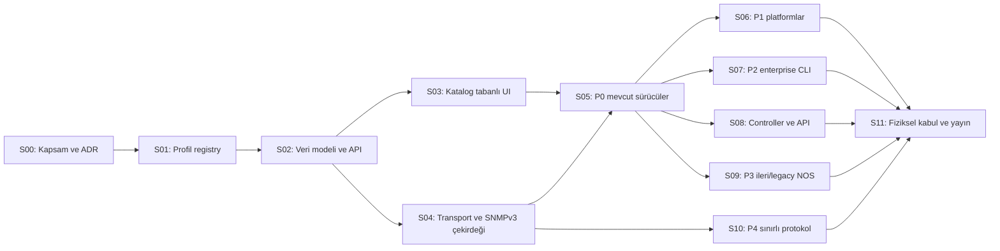

# NetStudio uyumluluk programı sprint planı

| Alan | Değer |
|---|---|
| Plan kimliği | `NETSTUDIO-COMPAT-SPRINTS-001` |
| Bağlı rapor | [Implementasyon raporu](IMPLEMENTASYON_RAPORU.md) |
| Başlangıç kaynak tabanı | `fa1a40f` |
| Plan tipi | Bağımlılık sıralı, yayınlanabilir teknik increment'ler |
| Sprint süresi | `REQUIRES ESTIMATION` — ekip kapasitesi ve cihaz laboratuvarı bilinmiyor |
| Performans kabulü | `REQUIRES BENCHMARK` |

## 1. Planlama ilkeleri

Bu dosyadaki “sprint”, otomatik olarak iki hafta anlamına gelmez. Her sprint,
tek başına incelenebilen ve geri alınabilen bir ürün increment'idir. Takvim;
backend/frontend/QA kapasitesi, üretici cihazı erişimi ve fixture lisans/temizleme
süreci belirlendikten sonra tahmin edilmelidir.

Temel kurallar:

1. Altyapı sprintleri (`S00`–`S04`) tamamlanmadan üretici sürücüleri ayrı ve
   uyumsuz sözleşmelerle eklenmez.
2. Her üretici işi parser + transport + negatif test + UI durumu + dokümantasyon
   içerir; yalnız katalog satırı eklemek tamamlanma değildir.
3. Fiziksel cihaz kanıtı yoksa sprint başarılı olsa bile profil en fazla
   `experimental` yayımlanır.
4. “Desteklenmiyor” sonucu da kanıtlı bir ürün sonucudur; sahte generic destekten
   daha doğrudur.
5. Mevcut cihazlar, sırlar, host key'ler, arayüz/port ID'leri, ölçümler ve job
   geçmişi korunur.
6. Yeni protokol desteği mevcut site/rol, kayıtlı hedef, secret store, host-key/TLS
   ve audit sınırlarını gevşetmez.
7. Ana dala alınan her sprint bağımsız feature flag veya yayın durumu ile güvenli
   biçimde kapatılabilir olmalıdır.

## 2. Bağımlılık görünümü



`S06`–`S10`, yeterli ekip ve ayrı cihaz laboratuvarı varsa paralel yürüyebilir;
aynı registry/migration dosyalarında değişiklik çatışmasını önlemek için profil
manifestleri ve parser modülleri önceden ayrıştırılmalıdır. `S11` tek seferlik son
test değildir: her profile ait fiziksel kabul geldikçe ilgili satır kademeli
olarak kapanabilir.

## 3. Global Definition of Ready

Bir üretici/profil işi sprint'e alınmadan önce:

- kanonik `profile_id`, OS ailesi ve management mode kararı verilmiş,
- hedef model ve kesin firmware/OS sürümü tanımlanmış,
- yalnız test yetkisi bulunan cihaz/lab sahibi belirlenmiş,
- SSH/SNMP/API erişim yöntemi ve read-only kullanıcı/scope hazırlanmış,
- host key/TLS sertifika doğrulama yöntemi belirlenmiş,
- üretici komut/OID/API dokümanı ve kullanım/lisans sınırı gözden geçirilmiş,
- fixture alınacaksa sanitization yöntemi ve review sorumlusu belirlenmiş,
- kabul edilecek capability listesi ile açıkça kapsam dışı alanlar yazılmış,
- test ortamının üretim/müşteri verisinden izole olduğu doğrulanmış

olmalıdır. Bunlardan biri yoksa iş `blocked` olur; varsayımla destek eklenmez.

## 4. Global Definition of Done

Her sprint için ortak kapanış şartları:

- ilgili kod, migration, UI ve doküman değişiklikleri aynı sözleşmeyi kullanır,
- parser/manifest/alias ve negatif güvenlik testleri geçer,
- fixture'lar sır ve müşteri kimliği taramasından geçer,
- eksik/kısmi/hatalı veri son doğru envanteri silmez,
- sırlar GET cevabı, log, audit, frontend storage veya test artefaktında görünmez,
- PostgreSQL migration eski veriyi korur; uygulama rollback yolu denenir,
- frontend değişmişse gerçek tarayıcıda masaüstü/mobil, klavye ve taşma kontrolü
  yapılır,
- Docker Compose yapı doğrulaması ve ilgili backend/frontend testleri geçer,
- profil/kabiliyet statüsü kanıt seviyesini aşmaz,
- [sürücü izlenebilirlik matrisi](SURUCU_IZLENEBILIRLIK_MATRISI.md) güncellenir,
- [kabul şablonuna](KABUL_VE_KANIT_SABLONU.md) göre redakte kanıt üretilir,
- PR/teslim açıklaması migration, rollback, çalıştırılan/atlanmış testler ve
  `Ana tasarım etkisi: var/yok — gerekçe` bilgisini içerir.

## 5. Sprint özeti

| Sprint | Sonuç | Ana bağımlılık | En yüksek çıkış statüsü |
|---|---|---|---|
| S00 | Kapsam, durum sözlüğü, ADR ve fixture politikası | Yok | Tasarım onayı |
| S01 | Typed profil registry, alias ve katalog v2 | S00 | Unit/contract verified |
| S02 | Additive veri modeli, API ve acceptance registry | S01 | Migration verified |
| S03 | Katalog tabanlı cihaz/uyumluluk UI | S02 | Browser verified |
| S04 | Ortak transport katmanı ve geniş SNMPv3 okuma çekirdeği | S02 | Transport lab validated |
| S05 | P0 sürücülerinin ayrıştırılması ve sertleştirilmesi | S03, S04 | Fixture/lab; fiziksel varsa candidate |
| S06 | P1: AOS-CX/AOS-Switch, EOS, Comware 7, RouterOS | S05 | Experimental/candidate |
| S07 | P2 enterprise CLI: Dell, Extreme, FortiSwitch standalone | S05 | Experimental/candidate |
| S08 | Controller/API ve kampüs ekosistemi | S05, ADR-COMPAT-004 | Experimental/candidate |
| S09 | P3 ileri/legacy NOS profilleri | S05 | Experimental/candidate |
| S10 | P4 SNMPv2c kararı ve protokol dışı profiller | S04, ADR-COMPAT-003 | Koşullu/unsupported |
| S11 | Fiziksel kabul, benchmark, rollout ve destek yayını | İlgili sürücü sprintleri | Supported/production accepted |

---

## S00 — Kapsam dondurma, karar kayıtları ve kanıt politikası

### Amaç

Kod yazımı başlamadan kanonik kimlikleri, destek durumlarını, kabul kapsamını ve
güvenlik kararlarını tek anlamlı hale getirmek.

### İş paketleri

| ID | İş | Çıktı |
|---|---|---|
| S00-01 | Mevcut `/driver-catalog`, `Collector` literal, frontend seçenekleri ve migration head'ini snapshot olarak kaydet | Başlangıç uyumluluk raporu |
| S00-02 | 38 hedef profil ve `linux_ssh` altyapı adaptörü için ID/alias kararını incele | Onaylı kimlik listesi |
| S00-03 | `catalog_only/implemented/...`, doğrulama ve yayın durum sözlüklerini onayla | `ADR-COMPAT-001` |
| S00-04 | Alan bazlı provenance ve last-good semantiğini onayla | `ADR-COMPAT-002` |
| S00-05 | Fiziksel kabul tuple'ı, kanıt geçerlilik süresi ve release kapısını onayla | `ADR-COMPAT-005` |
| S00-06 | Manifestlerin kod içi/signed paket sahipliğini seç | `ADR-COMPAT-006` |
| S00-07 | Fixture temizleme, ham veri saklama ve secret scan politikasını yaz | Fixture contribution checklist |
| S00-08 | `fortinet`, `dell_force10`, `extreme_vsp`, `huawei_vrp` belirsiz/eski kayıt davranışını kararlaştır | Alias migration kararı |

### Kaynak yüzeyleri

`backend/app/contracts.py`, `driver_catalog.py`, `drivers.py`,
`frontend/components/DeviceForms.tsx`, `backend/migrations/versions/`,
`SECURITY.md`, `docs/collection-automation.md`.

### Doğrulama

- Katalog kimlikleri ile izlenebilirlik tablosu arasında eksik/fazla satır testi.
- Alias grafiğinde döngü/çoklu kanonik hedef kontrolü.
- Her “supported” durumunun kabul kaydı gerektirdiğini gösteren karar testi.
- Doküman relative link ve Markdown kontrolü.

### Çıkış kapısı

- Altı ADR'den S01'i engelleyen dördü (`001`, `002`, `005`, `006`) onaylanmıştır.
- 38 matris profili eksiksiz sınıflandırılmıştır.
- SNMPv2c ve API güven kararlarının sahipleri/son tarihleri belirlenmiştir; karar
  verilmemiş olması P4/API sprintini bloklar ama S01'i bloklamaz.

### Uygulama durumu

**Tamamlandı — 23 Ekim 2026.** S00-01–S00-08 teslimleri
[`S00_TESLIM_RAPORU.md`](S00_TESLIM_RAPORU.md) içinde, makinece doğrulanabilir
kapsam ve kapılar [`S00_KAPSAM_KARARLARI.json`](S00_KAPSAM_KARARLARI.json)
içinde kaydedildi. S00 teslim tarihinde `ADR-COMPAT-003` ve `ADR-COMPAT-004`
karar bekliyordu ve sırasıyla S10/S08'i blokluyordu; daha sonra ilgili
sprintlerde kabul edilip uygulandı. Bu tarihsel kapı S01'i bloklamadı.

### Kapsam dışı

Parser veya migration uygulamak; bir profile destek statüsü vermek.

---

## S01 — Typed sürücü profili registry'si ve katalog v2

### Amaç

Statik dağınık kimlikleri tek typed registry altında toplamak ve mevcut istemciyi
kırmadan daha zengin katalog sözleşmesi yayımlamak.

### İş paketleri

| ID | İş | Beklenen değişiklik |
|---|---|---|
| S01-01 | `DriverProfile`, identity, transport, capability ve acceptance özet modellerini ekle | `backend/app/driver_profiles.py` |
| S01-02 | Manifest doğrulaması: ID biçimi, alias döngüsü, capability/transport tutarlılığı, supported kabul kapısı | Unit validation |
| S01-03 | Altı mevcut driver ve on eski planned kaydı registry'ye taşı | Davranış değiştirmeyen ilk adapter |
| S01-04 | 38 hedef profili `catalog_only`/mevcut gerçek durumla ekle | Tam katalog kapsamı |
| S01-05 | `driver_catalog.py`yi geriye uyumlu facade yap | Eski `DRIVERS`, `GROUPS`, `catalog()` import'ları çalışır |
| S01-06 | Katalog v2 alanlarını additive API cevabına ekle | `schema_version`, alias, identity, transports, capabilities, acceptance |
| S01-07 | Fortinet belirsiz alias'ını güvenli biçimde reddet | `manual_resolution_required` |
| S01-08 | Catalog JSON snapshot/contract testi ve frontend TypeScript tipleri | Backend/frontend parity |

### Testler

- Yeni `backend/tests/test_driver_profiles.py`:
  - 38 kanonik kimlik,
  - tekil ID ve alias,
  - alias döngüsü/çakışma reddi,
  - implemented ama adapter/command planı olmayan profil reddi,
  - supported ama fiziksel kabul özeti olmayan profil reddi,
  - eski katalog alanlarının eşdeğerliği.
- `backend/tests/test_automation.py`: mevcut katalog tüketicilerinin regresyonu.
- Frontend contract unit testi: unknown additive alanlara dayanıklı okuma.

### Çıkış kapısı

- Mevcut cihaz toplama davranışı değişmeden katalog v2 döner.
- Eski frontend yeni backend'le, yeni frontend eski/additive alanlarla kontrollü
  biçimde çalışır.
- Katalogdaki hiçbir `catalog_only` profil seçilebilir/available değildir.

### Uygulama durumu

**Tamamlandı — 23 Ekim 2026.** S01-01–S01-08 uygulaması ve doğrulama sonuçları
[`S01_TESLIM_RAPORU.md`](S01_TESLIM_RAPORU.md) içindedir. Typed registry 38
kanonik profili yayımlar; mevcut 6 çalışan + 10 planlı `drivers` cevabı değer
olarak korunur. Bu sprint yeni parser, migration veya fiziksel destek eklememiştir.

### Rollback

Yeni registry facade arkasında kalır; eski katalog cevabı feature flag ile
üretilebilir. Persisted cihaz verisi bu sprintte değiştirilmez.

---

## S02 — Additive veri modeli, profil çözümü ve API geçişi

### Amaç

Cihazın configured/resolved profilini, management mode'unu, capability kanıtını
ve acceptance kaydını veri kaybetmeden kalıcılaştırmak.

### İş paketleri

| ID | İş | Beklenen değişiklik |
|---|---|---|
| S02-01 | Güncel Alembic head'i doğrula ve additive migration oluştur | `device_driver_bindings`, capability v2, acceptance tabloları |
| S02-02 | Eski cihazlar için legacy binding backfill'i | Payload/sır/ID değiştirmeyen migration |
| S02-03 | Belirsiz alias'ı `manual_resolution_required` olarak sakla | Fortinet ve kanıtsız OS9/VSP güvenliği |
| S02-04 | Device create/update/read sözleşmesine kanonik profil ve mode ekle | Eski `collector` uyumluluğu |
| S02-05 | Profil çözüm servisinin typed sonucu ve confidence/çelişki modeli | `profile_resolution.py` |
| S02-06 | Connection revision/cache/job fencing'i profil değişimine bağla | Eski iş sonucu yazamaz |
| S02-07 | Redakte acceptance registry read modeli | Catalog/UI tüketimi |
| S02-08 | `/compatibility` ve manuel profil çözme uçlarını ekle | Site/RBAC kontrollü API |
| S02-09 | Audit olaylarını ekle | Profil çözümü/değişimi/kabul durumu |

### Migration test matrisi

| Başlangıç | Veri | Beklenti |
|---|---|---|
| 0001 | Fixture olmayan minimal cihaz/job | Head'e yükselir, kayıt korunur |
| 0006 | SSH/SNMP sırları, host key, grup geçmişi | Ciphertext ve fingerprint byte eşit |
| 0009 | Probe tabloları + eski collector ID'leri | Yeni binding oluşur; probe verisi değişmez |
| Güncel head | Boş veritabanı | Tüm tablolar/indeksler oluşur |
| Güncel head | Rollback uygulaması | Önceki imaj ek tablolar varken başlar; yeni profilli işler durdurulur |

### Güvenlik testleri

- Viewer başka site cihazının compatibility kaydını göremez.
- İstemci `validation_level`, acceptance veya identity evidence yazarak destek
  yükseltemez.
- Profil değişimi açık terminali kapatır ve bekleyen eski işi fence eder.
- Acceptance public özetinde cihaz IP/seri/kullanıcı/secret/evidence path sızmaz.

### Çıkış kapısı

- Disposable PostgreSQL migration ve geri dönüş senaryosu geçer.
- Eski cihaz, sır, host key, port/interface ID ve telemetri hash'leri korunur.
- Eski API payload'ı en az bir uyumluluk dönemi çalışır.

### Uygulama durumu

**Tamamlandı — 23 Ekim 2026.** S02-01–S02-09 uygulaması, migration ve
rollback kanıtı [`S02_TESLIM_RAPORU.md`](S02_TESLIM_RAPORU.md) içindedir.
`0010_driver_acceptance` yalnız additive tablolar ekler; legacy payload, sır,
host key, envanter/telemetri, job ve probe verisini yeniden yazmaz. Bu sprint
yeni parser, fiziksel destek veya production acceptance eklememiştir.

---

## S03 — Katalog tabanlı cihaz ve uyumluluk arayüzü

### Amaç

Frontend'deki sabit sürücü seçeneklerini kaldırmak; kullanıcıya gerçek uygulama,
transport ve kabul düzeyini doğru göstermek.

### İş paketleri

| ID | İş | UI sonucu |
|---|---|---|
| S03-01 | `DriverCatalogEntry` TypeScript modelini v2 sözleşmesine genişlet | Typed catalog client |
| S03-02 | Cihaz ekleme formunu vendor → OS profile → management mode akışına çevir | Dinamik seçenekler |
| S03-03 | `catalog_only` ve unsupported profilleri açıklamalı disabled göster | Yanlış destek seçimi yok |
| S03-04 | Legacy/belirsiz cihaz için migration uyarısı ve açık profil seçimi | Sessiz yeniden sınıflandırma yok |
| S03-05 | SSH/SNMP/API credential panelini seçili transporta göre göster | İlgisiz sır alanı yok |
| S03-06 | Cihaz detayına “Uyumluluk” paneli ekle | Profil, mode, transport, capability, evidence düzeyi |
| S03-07 | Partial/unsupported/permission/parse/timeout/stale durumlarını ayrı sun | Veri doğruluğu |
| S03-08 | Mobil/klavye/ekran okuyucu/uzun metin ve reduced-motion düzeni | Erişilebilir ve taşmasız UI |

### Testler

- Vitest:
  - katalog filtreleme ve disabled durumlar,
  - alias/legacy uyarısı,
  - acceptance scope eşleşmeyince supported gösterilmemesi,
  - secret alanının API cevabından doldurulmaması.
- Playwright:
  - supported/experimental/planned/unsupported profil akışı,
  - eski cihazı açık onayla kanonik profile taşıma,
  - viewer/superadmin yetki farkı,
  - masaüstü, 700 px altı mobil ve kısa viewport overflow,
  - klavye odağı ve form hata özeti,
  - console/framework error bulunmaması.

### Çıkış kapısı

- Cihaz formunda profile ait seçenekler yalnız API kataloğundan gelir.
- Backend seçilemez profili istemci manipülasyonunda da reddeder.
- UI hiçbir fixture/lab kanıtını fiziksel/production destek olarak etiketlemez.

### Tasarım etkisi kararı

Bu sprint cihaz ekleme ve detay kompozisyonunu maddi değiştirirse
`Ana tasarım etkisi: var` olabilir ve `rule.md` uyarınca üç README görüntüsü
yenilenmelidir. Yalnız mevcut dialog içinde küçük etiket/durum eklenirse `yok`
gerekçesiyle geçici tarayıcı kanıtı yeterlidir; karar gerçek diff üzerinden verilir.

### Uygulama durumu

**Tamamlandı — 23 Ekim 2026.** S03-01–S03-08 uygulaması, backend seçim
kapıları, erişilebilir/responsive tarayıcı kanıtı ve doğrulama sınırları
[`S03_TESLIM_RAPORU.md`](S03_TESLIM_RAPORU.md) içindedir. Gerçek diff cihaz
ekleme, bağlantı ve detay kompozisyonunu maddi değiştirdiği için
`Ana tasarım etkisi: var`; üç kanonik README görüntüsü aynı çalışma ağacından
yenilenmiştir. Fixture/izole SSH kanıtı fiziksel veya production kabulü değildir.

---

## S04 — Ortak transport katmanı ve geniş SNMPv3 çekirdeği

### Amaç

Üretici sürücülerinin tekrar güvenlik/limit uygulamasını önlemek ve standard MIB
verilerini typed capability olarak sunmak.

### İş paketleri

| ID | İş | Kabul |
|---|---|---|
| S04-01 | SSH/SNMP/API adapter protokolünü ve ortak context/deadline/fencing'i ekle | Mevcut SSH davranışı regresyonsuz |
| S04-02 | SNMP bounded walker'ı IF parser'dan ayır | GET/GETNEXT/GETBULK limitleri merkezi |
| S04-03 | SNMPv2-MIB system identity mapper | sysObjectID/sysDescr/sysName/sysUpTime typed |
| S04-04 | IF/IF-X mapper'ı identity/discontinuity kurallarıyla koru | Mevcut testler geçer |
| S04-05 | BRIDGE/Q-BRIDGE mapper | VLAN/FID + bridge port→ifIndex; eksikte partial |
| S04-06 | LLDP-MIB mapper | Yerel port/uzak chassis/port kanıtı; kablo tahmini yok |
| S04-07 | ENTITY/ENTITY-SENSOR temel mapper | Modül/fan/PSU/sensör yalnız explicit kanıtla |
| S04-08 | Capability başına kaynak önceliği ve field-level merge | Kaynak/clock/last-good korunur |
| S04-09 | SNMP kanalına özel pause/recovery | SSH kimlik hatası SNMP'yi gereksiz durdurmaz ve tersi |
| S04-10 | Loopback gerçek SNMPv3 agent entegrasyon testlerini genişlet | Auth, context, büyük tablo, timeout, malformed OID |

### Sınırlar

- Yalnız SNMPv3 authPriv.
- SNMP SET, trap receiver, runtime MIB indirme ve SNMPv2c yok.
- MIB isim çözümü yerine denetlenmiş sayısal OID sabitleri.

### Zorunlu negatif testler

- bilinmeyen kullanıcı/wrong digest/decryption error,
- context uyuşmazlığı,
- artmayan/tekrarlanan OID,
- 4096+ satır ve 128+ request,
- response timeout/cancel/job lease kaybı,
- duplicate ifName/ifIndex ve bridge port map çelişkisi,
- Counter32 wrap, Counter64 reset, sysUpTime reboot,
- bilinmeyen ENTITY class/connector'ın `unknown` kalması,
- hata metninde kullanıcı/engine ayrıntısının redaksiyonu.

### Çıkış kapısı

- Loopback gerçek UDP SNMPv3 testi tüm standard mapper'lar için geçer.
- Başarısız/kısmi MIB tablosu CLI'dan gelen son doğru alanı silmez.
- Fiziksel vendor MIB desteği iddia edilmez; generic SNMP en fazla
  `transport_lab_validated` olur.

### Uygulama durumu

**Tamamlandı — 23 Ekim 2026.** S04-01–S04-10 ortak transport context'i,
bounded SNMPv3 reader, standard MIB mapper'ları, alan-bazlı provenance/last-good
birleştirmesi ve kanal bazlı pause/recovery ile uygulanmıştır. Gerçek loopback
UDP ve tam backend regresyon sonuçları
[`S04_TESLIM_RAPORU.md`](S04_TESLIM_RAPORU.md) içindedir. Kanıt düzeyi generic
transport laboratuvarıyla sınırlıdır; fiziksel vendor veya production kabulü
değildir. `Ana tasarım etkisi: yok`; README ekran görüntüleri yenilenmemiştir.

---

## S05 — P0: Mevcut sürücüleri kanonik profillere ayırma ve sertleştirme

### Kapsam

`cisco_ios`, `cisco_iosxe`, `cisco_nxos`, `huawei_vrp_v200`,
`juniper_junos` ve altyapı adaptörü `linux_ssh`.

### İş paketleri

| ID | İş | Özel kabul |
|---|---|---|
| S05-01 | `huawei_vrp` davranışını `huawei_vrp_v200` kanoniğine bağla | Eski ID alias; envanter/secret korunur |
| S05-02 | IOS ve IOS-XE komut/capability manifestlerini ayır | IOS-XE artık IOS capability listesini otomatik miras almaz |
| S05-03 | IOS-XE için en az iki sürüm/model sanitized fixture'ı | Yoksa `experimental/not_tested` kalır |
| S05-04 | NX-OS katalogdaki network komutlarını gerçekten parse et veya capability'yi unsupported yap | Katalog-parser tutarlılığı |
| S05-05 | Junos FDB/ARP/environment eşlemesini tamamla veya açık unsupported göster | Sessiz parser gap yok |
| S05-06 | P0 profillerine SNMP system/IF/FDB/LLDP eşlemesi ekle | CLI/SNMP cross-check |
| S05-07 | Reboot/OS değişimi/model çelişkisi profil re-resolution tetikler | Eski cache geçersiz |
| S05-08 | Cisco/Huawei mevcut parser regresyon corpus'unu koru | Port/kimlik/fiziksel doğruluk bozulmaz |
| S05-09 | Her profil için kullanıcı ve operatör dokümanı | Komutlar, minimum RBAC, bilinen boşluklar |

### Fiziksel pilot matrisi

En az aşağıdaki tuple'lar erişilebildiği ölçüde ayrı kabul edilir:

- Cisco WS-C2960X ailesi + kesin IOS 15.2 sürümü,
- en az bir IOS-XE Catalyst modeli + kesin sürüm,
- en az bir Nexus/NX-OS modeli + kesin sürüm,
- Huawei S5700 + VRP V200 kesin sürümü,
- en az bir Juniper EX/QFX + kesin Junos sürümü.

Cihaz yoksa sprint kod/fixture açısından kapanabilir ancak profil
`physical_validated` veya `supported` olamaz.

### Çıkış kapısı

- P0 manifesti ile gerçek parser kapsamı birebir uyumludur.
- IOS/IOS-XE, VRP V200/V600, Junos/Junos Evolved ve NX-OS birbirine varsayımla
  eşitlenmez.
- Mevcut Cisco/Huawei cihaz kayıtları geriye uyumlu çalışır.

### Uygulama durumu

**Tamamlandı — 23 Ekim 2026.** S05-01–S05-09; profil başına bağımsız
manifestler, iki proje-sentetik IOS-XE fixture'ı, NX-OS/Junos typed eşlemeleri,
Q-BRIDGE FDB ve kimlik/reboot tabanlı yeniden çözümleme ile uygulanmıştır.
Kaynak ve doğrulama sınırları [`S05_TESLIM_RAPORU.md`](S05_TESLIM_RAPORU.md),
operatör sözleşmesi [`P0_SURUCU_PROFILLERI.md`](P0_SURUCU_PROFILLERI.md)
içindedir. Bütün P0 release değerleri `experimental` kalır; fiziksel cihaz ve
production kabulü yapılmamıştır. `Ana tasarım etkisi: yok`; README ekran
görüntüleri yenilenmemiştir.

---

## S06 — P1: Yaygın kurumsal platformlar

### Kapsam

`aruba_aoscx`, `aruba_aoss`, `arista_eos`, `hpe_comware`,
`h3c_comware7`, `mikrotik_routeros`.

### Uygulama sırası

Her profil aşağıdaki mini-dikey dilimi ayrı tamamlar:

1. kimlik/fingerprint fixture'ı,
2. read-only komut/API allowlist'i,
3. interfaces + 64-bit counters,
4. system identity/version/model,
5. VLAN/FDB/ARP/LLDP,
6. inventory/health mevcutsa açık capability,
7. SNMPv3 fallback/cross-check,
8. negatif parser/permission/timeout testleri,
9. UI ve operatör dokümanı,
10. fiziksel tuple kabulü.

### İş paketleri

| ID | Profil | Ayrım zorunluluğu |
|---|---|---|
| S06-01 | `aruba_aoscx` | AOS-CX structured/REST yetenekleri AOS-Switch CLI ile karışmaz |
| S06-02 | `aruba_aoss` | Eski `hp_procurve` alias'ı veri koruyarak çözülür |
| S06-03 | `arista_eos` | eAPI/JSON seçilirse ADR-COMPAT-004 güven sınırı uygulanır |
| S06-04 | `hpe_comware` | HPE marka bağlamı H3C OS sürüm kanıtından ayrı tutulur |
| S06-05 | `h3c_comware7` | V5/V9 ile parser eşitliği varsayılmaz |
| S06-06 | `mikrotik_routeros` | RouterOS terminal dili Cisco parser'ına yönlendirilmez |
| S06-07 | Ortak fixture/lab ve catalog/UI sözleşmesi | Altı profil bağımsız statü taşır |

### Çıkış kapısı

- En az interface/system capability'si olmayan profil `implemented` yapılmaz.
- Her profil için kesin model+sürüm fixture'ı vardır.
- Fiziksel kanıtı olmayan profil `experimental` kalır.
- HPE Comware ve H3C Comware ortak kod paylaşsa bile farklı identity/acceptance
  tuple'ları kullanır.

### Uygulama durumu

**Tamamlandı — 24 Ekim 2026.** S06-01–S06-07; altı bağımsız manifest,
profil-bazlı text/JSON CLI parser'ları, standard SNMPv3 kaynak alanları, exact
model+sürüm proje-sentetik fixture'ları ve negatif identity/permission/timeout
testleriyle uygulanmıştır. Ayrıntılar [`S06_TESLIM_RAPORU.md`](S06_TESLIM_RAPORU.md),
operatör sözleşmesi [`P1_SURUCU_PROFILLERI.md`](P1_SURUCU_PROFILLERI.md)
içindedir. Fiziksel cihaz kanıtı bulunmadığı için altı profil de
`experimental`, production kabulü `false` kalır. REST/eAPI seçilmemiş ve
ADR-COMPAT-004 kapısı korunmuştur. `Ana tasarım etkisi: yok`; README ekran
görüntüleri yenilenmemiştir.

---

## S07 — P2: Dell, Extreme ve FortiSwitch standalone

### Kapsam

`dell_os10`, `dell_os9`, `dell_os6`, `extreme_exos`,
`extreme_fabric_engine`, `extreme_slxos`, `fortinet_fortiswitchos`.

### İş paketleri

| ID | İş | Kritik sınır |
|---|---|---|
| S07-01 | OS10 adapter/fixture | OS9 komutlarıyla ortak sayılmaz |
| S07-02 | OS9/FTOS adapter ve `dell_force10` alias çözümü | Banner/model kanıtı yoksa manuel çözüm |
| S07-03 | OS6/N-series adapter | OS9/10 parser reuse yalnız kanıtlı alt fonksiyonlarda |
| S07-04 | EXOS/Switch Engine adapter | OS adı alias'ı açık metadata olur |
| S07-05 | Fabric Engine/VOSS adapter ve `extreme_vsp` geçişi | Güvenlik modu SNMP durumunu etkileyebilir |
| S07-06 | SLX-OS adapter | EXOS/VOSS komut ailesinden ayrı |
| S07-07 | FortiSwitchOS standalone adapter | `fortinet`/FortiOS otomatik alias değildir |
| S07-08 | Ortak SNMPv3, UI, fixture ve negatif test seti | Capability bazlı statü |

### Özel kabul senaryoları

- Dell OS sürümleri arasında aynı model adıyla yanlış sürücü seçimi,
- VOSS güvenli SSH modunda SNMP erişim değişimi,
- FortiSwitch standalone cihazın FortiLink-managed olarak yanlış sınıflanması,
- stack/virtual chassis satırlarının fiziksel port kimliğini bozmaması,
- unsupported fan/PSU/PoE alanlarının uydurulmaması.

### Çıkış kapısı

Her OS ailesi ayrı manifest, parser fixture ve acceptance tuple'ına sahiptir.
FortiSwitchOS etiketi FortiOS'tan açıkça ayrıdır.

### Uygulama durumu (24 Ekim 2026)

S07-01–S07-08 tamamlandı. Yedi profil ayrı manifest, parser kimlik/interface
grameri ve SHA-256 sabitli proje-sentetik exact-tuple fixture ile
`fixture_verified/experimental` olarak katalogda seçilebilir durumdadır.
`dell_force10` ve `extreme_vsp` runtime kimlikleri kanıtlı kanonik çözümle
korunur; `fortinet` otomatik alias değildir. Fabric Engine secure mode SNMP
kısıtı, Dell OS/SONiC ayrımı ve standalone/FortiLink/FortiOS ayrımı negatif
testlerle sabitlenmiştir. Ayrıntılı kanıt
[`S07_TESLIM_RAPORU.md`](S07_TESLIM_RAPORU.md), çalışma sözleşmesi
[`P2_SURUCU_PROFILLERI.md`](P2_SURUCU_PROFILLERI.md) içindedir.

Fiziksel cihaz kabulü çalıştırılmadı ve bütün acceptance kayıtları
`production_accepted=false` kalır. FortiLink/controller yolu S08, gerçek cihaz
exact-tuple ve benchmark kapıları S11 kapsamındadır. Ana yerleşim, tema,
tipografi, navigasyon veya genel kabuk değişmediği için README ekran görüntüleri
yenilenmemiştir.

---

## S08 — Controller/cloud API ve kampüs ekosistemi

### Kapsam

`cisco_meraki_ms`, `aruba_instant_on`,
`fortinet_fortiswitch_fortilink`, `ubiquiti_unifi_switch`,
`ubiquiti_unifi_no_snmp`, `ubiquiti_edgeswitch`,
`tplink_omada_managed`, `tplink_omada_pro`.

### Ön koşul

`ADR-COMPAT-004` tamamlanmalıdır: controller kaydı, TLS/CA, token scope, site
eşlemesi, egress, redirect/DNS, rate limit ve secret lifecycle.

### İş paketleri

| ID | İş | Kritik sınır |
|---|---|---|
| S08-01 | Controller/API transport adapter ve kayıt modeli | Serbest URL/SSRF yok; token read-only |
| S08-02 | Meraki MS Dashboard API/SNMP profili | Klasik SSH sürücüsü yok |
| S08-03 | Aruba Instant On local/cloud mode ayrımı | Aynı modelde management mode capability'yi değiştirir |
| S08-04 | FortiLink-managed FortiSwitch profili | FortiGate/controller kimliği switch kimliğinden ayrı |
| S08-05 | UniFi switch API/SNMP profili | Debug SSH sürekli yönetim kanalı sayılmaz |
| S08-06 | UniFi Flex/Ultra no-SNMP istisna profili | Genel UniFi SNMP profiline eşleşmez |
| S08-07 | EdgeSwitch SSH/SNMP profili | UniFi firmware ile ortak sayılmaz |
| S08-08 | Omada/JetStream managed profili | Controller ve standalone mode ayrı kanıt |
| S08-09 | Omada Pro profili | Klasik Omada parser eşitliği varsayılmaz |
| S08-10 | Rate-limit, pagination, TLS, scope ve multi-site negatif testleri | Güvenli API davranışı |

### Testler

- Sahte/izole HTTPS controller ile TLS doğru/yanlış CA, redirect ve timeout.
- Token scope yetersiz/expired/revoked; token hiçbir hata/logda görünmez.
- Pagination loop, 429 Retry-After üst sınırı ve response byte sınırı.
- Controller'daki iki site arasında cihaz verisi karışmaması.
- Aynı fiziksel cihazın controller ID'si değiştiğinde duplicate identity kontrolü.
- API verisi ile cihaz SNMP verisi çeliştiğinde provenance ve partial durumu.

### Çıkış kapısı

- API profilinin SSH profili gibi davranmadığı katalog/UI'da açıktır.
- Controller credential'ı cihaz credential'ından ayrı secret türüdür.
- Üretici sandbox/simülatörü fiziksel switch kabulü sayılmaz.

### Uygulama durumu

**Tamamlandı — 24 Ekim 2026.** ADR-COMPAT-004 kabul edilerek URL'siz
controller kayıt modeli, controller'a özel şifreli secret, TLS doğrulamalı ve
bounded API transportu, site/vendor/device binding'i, worker/provenance
birleştirmesi ve katalog/UI akışı uygulanmıştır. Meraki, FortiLink, UniFi,
UniFi no-SNMP, Omada ve Omada Pro profilleri `experimental` ve
`fixture_verified`; EdgeSwitch ayrı SSH/SNMP profili olarak aynı seviyededir.
Aruba Instant On, belgelenmiş genel yönetim API'si kanıtlanmadığından
`vendor_public_api_unavailable` ile fail-closed kalır. Ayrıntılar
[`S08_TESLIM_RAPORU.md`](S08_TESLIM_RAPORU.md), operatör sözleşmesi
[`CONTROLLER_API_PROFILLERI.md`](CONTROLLER_API_PROFILLERI.md) ve kabul edilen
[`ADR-COMPAT-004`](adr/ADR-COMPAT-004-controller-api-guven-modeli.md) içindedir.
Fiziksel cihaz ve production kabulü yapılmamıştır. `Ana tasarım etkisi: yok`;
README ekran görüntüleri yenilenmemiştir.

---

## S09 — P3: İleri, legacy ve Linux tabanlı NOS profilleri

### Kapsam

`h3c_comware5`, `h3c_comware9`, `huawei_vrp_v600`,
`juniper_junos_evolved`, `dell_sonic`, `nvidia_cumulus_linux`,
`nvidia_onyx`, `sonic_nos`, `cisco_business`.

### İş paketleri

| ID | Profil | Kritik kabul |
|---|---|---|
| S09-01 | Comware V5 | Legacy SSH yalnız açık cihaz izni; V7 parser eşitliği yok |
| S09-02 | Comware V9 | V7 fixture'ı destek kanıtı değildir |
| S09-03 | VRP V600 | V200 alias/parser'ından ayrı sürüm profili |
| S09-04 | Junos Evolved | Klasik Junos ile output/RPC farkı fixture ile kanıtlı |
| S09-05 | Dell Enterprise SONiC | Dağıtım/vendor farkı genel SONiC'ten ayrı |
| S09-06 | NVIDIA Cumulus Linux | `linux_ssh` yalnız temel fallback; NVUE/FRR/ASIC port mapper ayrı |
| S09-07 | NVIDIA Onyx | Cumulus komutlarıyla karışmaz |
| S09-08 | Genel/dağıtım bağlı SONiC | Distribution/image kimliği zorunlu, vendor belirsizliği görünür |
| S09-09 | Cisco Business | IOS/Meraki profiline eşleşmez |
| S09-10 | Cross-profile yanlış eşleşme corpus'u | Benzer banner/komut ailelerinde fail-closed |

### Özel veri doğruluğu kontrolleri

- Linux kernel arayüz adı, ASIC front-panel portu ve breakout portu aynı kimlik
  sayılmaz.
- SONiC dağıtımı bilinmiyorsa vendor-specific capability `unknown` kalır.
- Cumulus bridge/bond/VRF nesneleri fiziksel port gibi çizilmez.
- V200 legacy SSH izni V600 cihazına otomatik taşınmaz.
- Cisco Business model adı IOS komut planını otomatik açmaz.

### Çıkış kapısı

`linux_ssh` fallback'i “tam NOS desteği” olarak sunulmaz. Her ileri/legacy profil
kesin dağıtım/sürüm kanıtına bağlıdır.

### Uygulama durumu

**Tamamlandı — 24 Ekim 2026.** Dokuz P3 profili ayrı runtime, manifest,
kimlik/interface grameri ve SHA-256 sabitli proje-sentetik fixture ile
`fixture_verified/experimental` olarak uygulanmıştır. Comware V5 legacy SSH
fallback'i cihaz opt-in'ine bağlıdır; VRP V600 ve Junos Evolved klasik ailelere
alias olmaz; Dell/genel SONiC distribution sınırı fail-closed'dur. Cumulus NVUE
mapper'ı kernel interface, front-panel ve breakout kimliklerini ayırır; bond,
bridge ve VRF fiziksel port sayılmaz. Ayrıntılar
[`S09_TESLIM_RAPORU.md`](S09_TESLIM_RAPORU.md) ve
[`P3_SURUCU_PROFILLERI.md`](P3_SURUCU_PROFILLERI.md) içindedir. Fiziksel cihaz,
transport laboratuvarı ve production kabulü yapılmamıştır. `Ana tasarım etkisi:
yok`; README ekran görüntüleri yenilenmemiştir.

---

## S10 — P4: SNMPv2c opt-in ve protokol kapsamı dışı cihazlar

### Kapsam

`mikrotik_swos`, `tplink_easy_smart`, `unmanaged_switch` ve protokolü olmayan
model/mode istisnaları. `ubiquiti_unifi_no_snmp` ve `aruba_instant_on` için S08
sonuçları bu sprintte güvenlik/politika açısından doğrulanır.

### Karar kapısı

`ADR-COMPAT-003` iki olası sonuçtan birini seçer:

- **Kabul:** SNMPv2c, yalnız açık kurulum + cihaz onayıyla uygulanır.
- **Ret:** İlgili profiller `unsupported_by_policy` kalır; sistem sahte destek
  sunmaz.

SNMPv1 bu sprintte uygulanmaz.

### İş paketleri — ADR kabul edilirse

| ID | İş | Güvenlik şartı |
|---|---|---|
| S10-01 | v2c credential modeli ve vault AAD | Community hiçbir read API'de dönmez |
| S10-02 | Kurulum geneli varsayılan kapalı flag | Açık env olmadan backend reddeder |
| S10-03 | Cihaz bazlı superadmin risk onayı ve audit | Onay geri çekilebilir |
| S10-04 | v2c bounded read-only transport | SET yok; yalnız sayısal allowlist |
| S10-05 | SwOS identity/IF/FDB capability mapper | Model/sürüm fixture ve fiziksel kabul |
| S10-06 | UI'da şifrelenmemiş protokol ve ACL/VLAN kontrol listesi | Sessiz downgrade yok |
| S10-07 | v3 destekli profile v2c fallback yasağı | Policy test |

### İş paketleri — her iki ADR sonucunda

| ID | İş | Sonuç |
|---|---|---|
| S10-08 | Easy Smart model/sürüm istisnası yoksa profile sonucu | `unsupported_by_protocol` |
| S10-09 | Unmanaged switch sonucu ve dolaylı görünürlük açıklaması | Komşu LLDP/FDB kanıtı cihaz yönetimi sayılmaz |
| S10-10 | Protokol dışı profilleri UI/API'da doğru gerekçeyle göster | Seçilemez; sahte credential formu yok |
| S10-11 | Güvenlik dokümanı ve operatör rehberi | `SECURITY.md` ile tutarlı |

### Çıkış kapısı

- ADR sonucu kod, UI ve belgede aynıdır.
- v2c varsa varsayılan kapalıdır, v1/SET yoktur ve secret leak testleri geçer.
- Protokol kapsamı dışı cihazlar “hata” değil açık destek sınırı olarak görünür.

### Uygulama durumu

**Tamamlandı — 24 Ekim 2026.** `ADR-COMPAT-003` kontrollü kabul kararıyla
sonuçlandırıldı. `mikrotik_swos`, yalnız kurulum geneli
`NETSTUDIO_ALLOW_SNMP_V2C=1` ve superadmin cihaz risk onayı birlikteyken
seçilebilen, bounded GET/GETNEXT/GETBULK SNMPv2c profili olarak uygulandı.
Community ayrı AAD ile şifrelenir ve read API/audit/UI'da geri verilmez; onay
geri çekilebilir. Exact SwOS kimliği, mantıksal IF/IF-X ve Q-BRIDGE FDB akışı
proje-sentetik CSS610/2.19 fixture'ı ve izole gerçek UDP v2c agent ile
doğrulandı. SNMPv1, SET ve v3→v2c downgrade yoktur. Easy Smart ve unmanaged
profilleri `unsupported_by_protocol`; UniFi no-SNMP ve Instant On sınırları S08
kararıyla tutarlı kalmıştır. Ayrıntılar
[`S10_TESLIM_RAPORU.md`](S10_TESLIM_RAPORU.md) ve
[`P4_SNMPV2C_VE_PROTOKOL_SINIRLARI.md`](P4_SNMPV2C_VE_PROTOKOL_SINIRLARI.md)
içindedir. Fiziksel cihaz ve production kabulü yapılmamıştır. `Ana tasarım
etkisi: yok`; README ekran görüntüleri yenilenmemiştir.

---

## S11 — Fiziksel kabul, performans, rollout ve destek yayını

### Amaç

Uygulanmış profilleri gerçek model/OS/mode/capability tuple'ları üzerinde kabul
etmek ve yalnız kanıtlanan kapsamı `supported` yayımlamak.

### İş paketleri

| ID | İş | Çıktı |
|---|---|---|
| S11-01 | Lab envanteri ve test yetkisi kayıtlarını doğrula | Sırsız test scope listesi |
| S11-02 | Her tuple için kabul şablonunu uygula | Redakte evidence + SHA-256 |
| S11-03 | Kimlik, SSH/SNMP/API, interface/ifIndex, FDB/VLAN/LLDP ve sayaç testleri | Capability bazlı sonuç |
| S11-04 | Reboot, firmware farkı, credential/host-key/TLS hatası ve parser bozulma testleri | Fail-closed kanıtı |
| S11-05 | Worker restart/lease, DB migration, last-good ve rollback tatbikatı | Operasyon kanıtı |
| S11-06 | Gerçekçi 24 saat soak ve yük ölçümü | Benchmark raporu |
| S11-07 | Acceptance expiry ve geri çekme akışını dene | Stale kanıt supported üretmez |
| S11-08 | `hidden→experimental→candidate→supported` release review | İmzalı/review edilmiş karar |
| S11-09 | Operatör dokümanı ve bilinen sınırları yayımla | Model/sürüm kapsamlı destek sayfası |
| S11-10 | Kademeli rollout ve hata bütçesi izle | Geri alma eşiği ve gözlem raporu |

### Fiziksel kabul kontrol listesi

- cihaz üreticisi, exact model, OS ailesi ve exact sürüm,
- management mode ve controller sürümü (varsa),
- SSH host key / API TLS / SNMP security level,
- `sysObjectID`, `sysDescr` ve CLI/API kimlik çapraz kontrolü,
- arayüz adı ↔ kalıcı ID ↔ `ifIndex` eşlemesi,
- fiziksel port sayısı yalnız cihaz kanıtına göre,
- RX/TX 64-bit sayaç, hata/discard, hız/capacity,
- VLAN/PVID/trunk, FDB, ARP/NDP, LLDP ve LAG ayrı capability sonucu,
- stack/module/fan/PSU/PoE/transceiver yalnız destekleniyorsa,
- reboot/counter reset/interface rename davranışı,
- permission denied, timeout, kısmi ve bozuk çıktı,
- ham çıktı/sır sızıntısı bulunmaması,
- cihaz CPU etkisi ve poll süresi.

### Benchmark kapısı

Minimum ölçüm profili:

- gerçekçi hızlı/health/network/inventory aralıkları,
- düşük/orta/yüksek latency grupları,
- SSH, SNMP ve API karışımı,
- en az bir worker restart ve DB bakım olayı,
- queue depth, scheduler lateness, p95/p99 süre, API/DB/worker CPU/RSS,
- cihaz tarafı CPU/rate-limit ve error/partial oranı,
- 24 saat veri büyümesi ve retention/rollup davranışı.

Test cihazı sayısı ve topolojisi belirlenmeden “100 cihaz” kabul eşiği
tamamlanmış sayılamaz: **REQUIRES BENCHMARK**.

### Destek yükseltme kuralları

| Başlangıç | Hedef | Zorunlu kanıt |
|---|---|---|
| `catalog_only` | `experimental` | Adapter + unit + fixture + negatif test |
| `experimental` | `candidate` | Transport lab + en az bir fiziksel tuple + migration/E2E |
| `candidate` | `supported` | Kapsamlı fiziksel capability kabulü + rollback + release review + sağlıklı `canary→pilot→general` |
| `supported` | `production_accepted` | Belirli release/kurulum politikası ve güncel canlı kabul kanıtı |

Tek tuple'nın geçmesi profilin tüm model/sürümlerini yükseltmez. Katalog kabul
özetinde kapsam açıkça yayımlanır.

### Çıkış kapısı

- Yayınlanan her `supported` satırın güncel, hash'li fiziksel kanıtı vardır.
- Başarısız/kanıtsız satırlar `experimental`, `blocked`, `unsupported_by_*` veya
  `not_tested` olarak dürüstçe kalır.
- Rollback volume/veri/sır silmeden denenmiştir.
- Kapasite beyanı yalnız gerçek benchmark sonucuyla yapılmıştır.

### Uygulama durumu

**Yayın/kabul altyapısı tamamlandı; dış kabul kapıları açık — 24 Ekim 2026.**
İmzalı karar ve rollout zarfı, exact tuple/profile/parser/commit bağı, fiziksel
kanıt ve benchmark süre sonu, geri çekme, hata bütçesiyle otomatik düşürme,
rollout aşama atlama/gerileme engeli, `general` öncesi `candidate` tutma,
redakte audit API'si ve additive `0012_release_acceptance` migration'ı
uygulanmıştır. Yetkili fiziksel lab envanteri verilmediği ve gerçek 24 saatlik
soak çalıştırılmadığı için hiçbir profil `candidate` veya `supported` seviyesine
yükseltilmemiş, `production_accepted=false` korunmuştur. S11-01 scope kaydı
`blocked_no_authorized_targets`, S11-03/04 fiziksel senaryoları ve S11-06
benchmark `REQUIRES BENCHMARK` durumundadır. Ayrıntılar
[`S11_TESLIM_RAPORU.md`](S11_TESLIM_RAPORU.md),
[`S11_OPERASYON_REHBERI.md`](S11_OPERASYON_REHBERI.md) ve
[`S11_DESTEK_YAYINI.md`](S11_DESTEK_YAYINI.md) içindedir. `Ana tasarım etkisi:
yok`; mevcut Uyumluluk paneline yalnız imzalı karar ayrıntısı eklenmiştir.

## 6. Sprintler arası kalite ve release kontrolleri

Her sprint sonunda önerilen komut ailesi, gerçek değişiklik kapsamına göre
daraltılıp çalıştırılır:

```bash
.venv/bin/pytest backend/tests
cd frontend && npm run lint
cd frontend && npm run typecheck
cd frontend && npm test -- --run
cd frontend && npm run build
docker compose --env-file .env.example config --quiet
git diff --check
```

PostgreSQL migration/locking testleri yalnız disposable, adı açıkça test amaçlı
veritabanında çalıştırılır. Fiziksel cihaz testi yalnız yetkili lab hedeflerinde
yapılır. Bütün suite'i çalıştırmak, fiziksel cihaz kabulünün yerine geçmez.

## 7. Program raporlama formatı

Her sprint tesliminde şu kısa tablo bulunmalıdır:

| Alan | Teslimde doldurulacak değer |
|---|---|
| Kaynak commit | Tam SHA |
| Tamamlanan backlog ID'leri | `Sxx-yy` listesi |
| Profil/capability değişiklikleri | Önce → sonra |
| Migration etkisi | Yok / additive revision / rollback sonucu |
| Test sonuçları | Komut + pass/fail/skip sayısı |
| Fiziksel kanıt | Yoksa açıkça `ÇALIŞTIRILMADI` |
| Benchmark | Yoksa `REQUIRES BENCHMARK` |
| Güvenlik review | Sonuç ve açık bulgular |
| Kalan blokaj | Cihaz, lisans, fixture, karar veya kod |
| Ana tasarım etkisi | `var/yok — gerekçe` |

Bu rapor olmadan sprint “tamamlandı” sayılmaz; fakat raporun varlığı da başarısız
test veya eksik fiziksel kanıtı başarılıya çeviremez.
