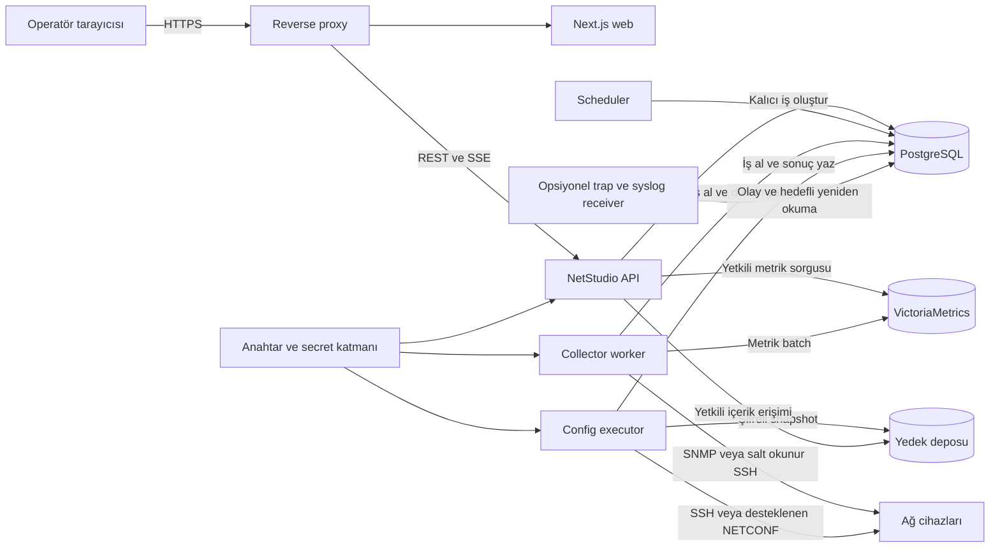
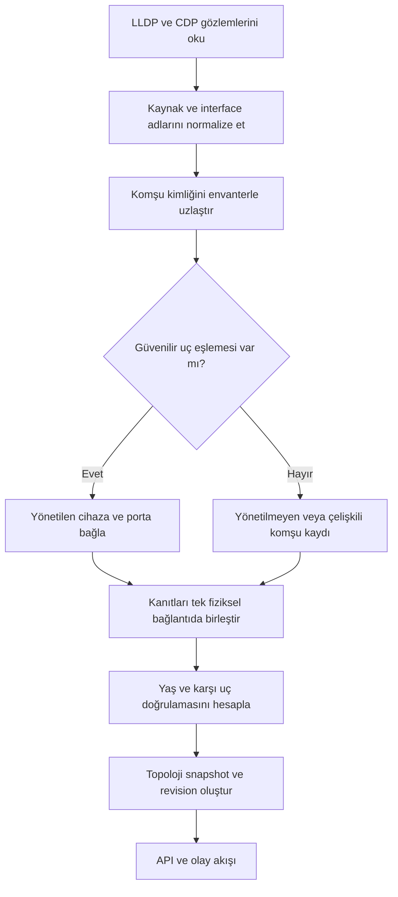
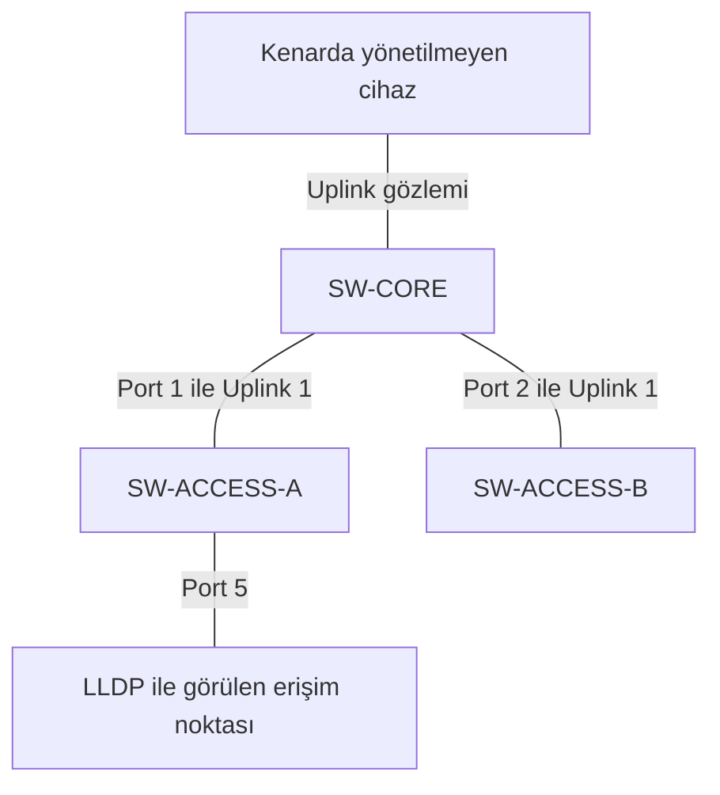
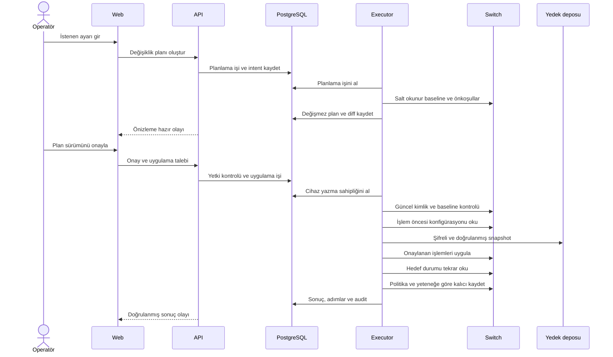
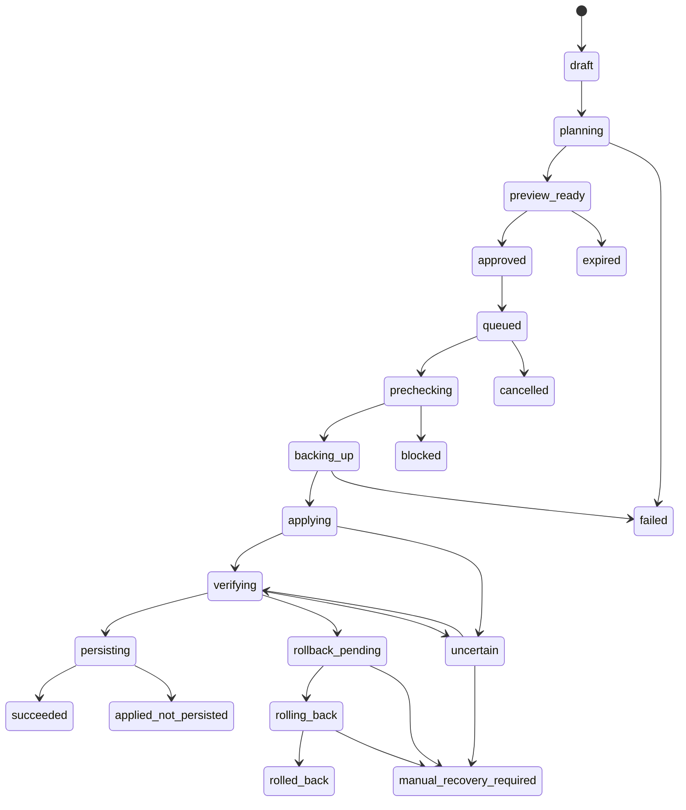
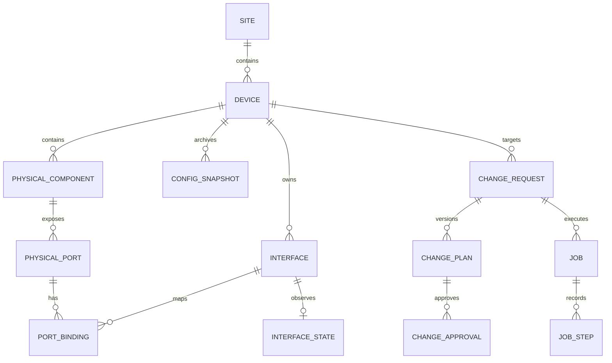
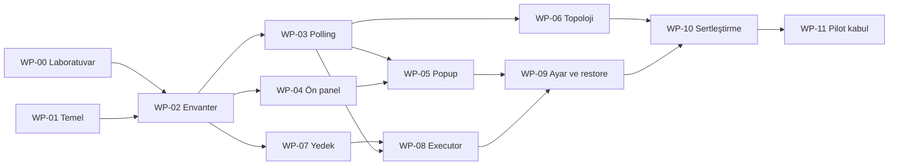

# NetStudio
## Teknik Mimari ve Uygulama Raporu

| Belge alanı | Değer |
|---|---|
| Ürün | **NetStudio** |
| Depo adı önerisi | `netstudio` |
| Belge sürümü | `1.0.0 — geliştirme başlangıç tasarımı` |
| Tarih | 26 Eylül 2026 |
| Hedef kullanıcı | Ağ yöneticisi, sistem yöneticisi, operasyon ekibi |
| İlk cihaz kapsamı | Pilot ortamda doğrulanacak Cisco IOS / IOS XE switchleri |
| Dağıtım yaklaşımı | Kurum içinde, bağımsız web uygulaması |
| Belgenin niteliği | Uygulama gereksinimleri, mimari kararlar, veri/API sözleşmeleri ve geliştirme planı |

> **Kapsam notu:** Bu belge çalışan bir uygulama, cihaz üzerinde test edilmiş sürücü veya tamamlanmış kaynak kod teslimi değildir. Geliştirme ekibinin uygulayacağı teknik plandır. Gerçek cihaz modelleri, işletim sistemi sürümleri ve cihaz adedi henüz verilmediğinden destek ve kapasite başlıkları açıkça belirtilmiş başlangıç varsayımlarına dayanır. Örnek IP adresleri, cihazlar, sayılar ve ekran içerikleri temsildir.

> **Ürün kararı:** NetStudio kendi arayüzüne, API'sine, envanterine, toplama süreçlerine, yedekleme sistemine ve değişiklik iş akışına sahip olacaktır. LibreNMS, Netdisco veya Oxidized kurulumu zorunlu değildir. SSH, SNMP, grafik çizimi ve veri saklama gibi temel işler için mevcut açık kaynak bileşenlerden yararlanılır. Başka bir ürünün bulutuna veya OpenSentra kurulumuna bağımlılık oluşturulmaz.

---

## İçindekiler

1. [Ürün amacı ve temel kararlar](#bolum-1)
2. [Kapsam, öncelikler ve kullanıcı senaryoları](#bolum-2)
3. [Mimari ve teknoloji seçimi](#bolum-3)
4. [Cihaz desteği ve yetenek modeli](#bolum-4)
5. [Envanter, keşif ve cihaz kimliği](#bolum-5)
6. [Veri toplama ve durum doğruluğu](#bolum-6)
7. [Grafik topoloji](#bolum-7)
8. [Etkileşimli switch ön paneli](#bolum-8)
9. [Port detay popup'ı ve grafikler](#bolum-9)
10. [Konfigürasyon yönetimi](#bolum-10)
11. [Güvenli değişiklik yürütme](#bolum-11)
12. [Yedekleme, karşılaştırma ve geri yükleme](#bolum-12)
13. [Alarm ve olay yönetimi](#bolum-13)
14. [Veri modeli](#bolum-14)
15. [API sözleşmeleri](#bolum-15)
16. [Olay akışı, önbellek ve arayüz performansı](#bolum-16)
17. [Güvenlik ve erişim kontrolü](#bolum-17)
18. [İş kuyruğu, eşzamanlılık ve hata kurtarma](#bolum-18)
19. [Kurulum, dağıtım ve işletim](#bolum-19)
20. [Kapasite hedefleri ve ölçüm planı](#bolum-20)
21. [Depo yapısı ve geliştirme kuralları](#bolum-21)
22. [Geliştirme iş paketleri ve teslim kapıları](#bolum-22)
23. [Test senaryoları ve kabul kriterleri](#bolum-23)
24. [Riskler ve açık kararlar](#bolum-24)
25. [İlk geliştirme talimatı](#bolum-25)
26. [Teknik kaynaklar](#bolum-26)

---

<a id="bolum-1"></a>

## 1. Ürün amacı ve temel kararlar

### 1.1 Amaç

NetStudio, ağ cihazlarının günlük yönetimini tek bir web arayüzünde birleştirecektir:

- **Gör:** Cihazları, bağlantıları, switch ön panelini, port durumlarını ve zaman serisi grafiklerini incele.
- **Yönet:** Yetkili kullanıcıların cihaz ayarlarını doğrulanabilir bir değişiklik planı üzerinden uygulamasını sağla.
- **Koru:** Konfigürasyonları düzenli yedekle, değişiklikleri karşılaştır ve kontrollü geri yükleme sun.

İlk somut kullanım: Yönetici topolojide bir Cisco switch seçer, switchin gerçek port envanterine uygun ön paneline geçer, porta tıklar, portun durumu ve trafik geçmişini görür; yetkisi varsa açıklamasını veya access VLAN'ını değiştirir. Sistem işlemi uygulamadan önce yedek ve değişiklik önizlemesi oluşturur, işlemden sonra cihazı yeniden okuyarak sonucu denetler.

### 1.2 Bağlayıcı tasarım kararları

| Kimlik | Karar | Gerekçe |
|---|---|---|
| ADR-001 | Bağımsız ürün; tek kurumlu ilk kurulum | İlk sürümde gereksiz entegrasyon ve müşteri izolasyonu karmaşıklığını azaltmak |
| ADR-002 | Modüler monolit API + ayrı collector/executor süreçleri | Alan modelini ortak tutarken uzun cihaz işlemlerini HTTP isteklerinden ayırmak |
| ADR-003 | İlk eklenen cihaz varsayılan salt okunur | Envanter ve cihaz desteği doğrulanmadan üretim ağına yazmayı önlemek |
| ADR-004 | Okuma desteği ile yazma desteği ayrı kaydedilir | Bir cihazdan bilgi alınabilmesi, ona güvenle ayar uygulanabileceği anlamına gelmez |
| ADR-005 | Port çizimi statik 24/48 kutu değil, model ve envanter tabanlıdır | Fiziksel portları, uplinkleri, modülleri ve stack üyelerini doğru göstermek |
| ADR-006 | Ham veri, normalize veri, görüntüleme durumu ve istenen ayar ayrılır | Eksik verinin gerçek durum veya başarılı konfigürasyon gibi görünmesini önlemek |
| ADR-007 | Her yazma işlemi değişmez bir plan ve kalıcı iş üzerinden yürür | Onaylanan içerikle uygulanan içeriğin aynı olmasını sağlamak |
| ADR-008 | Geri alma bir cihaz yeteneğidir; evrensel garanti değildir | SSH kopması veya kısmi uygulama durumunda yanlış güven hissi vermemek |
| ADR-009 | Parolalar tarayıcıya, kaynak koda, imaja veya işlem loglarına girmez | Cihaz yönetim yetkisinin sızmasını önlemek |
| ADR-010 | PostgreSQL işlem/iş kayıtları; ayrı zaman serisi deposu | Yüksek hacimli metrik yazımını kontrol verisinden ayırmak |
| ADR-011 | Renk tek başına anlam taşımaz | Port durumlarının metin, ikon ve erişilebilir etiketlerle de anlaşılması |
| ADR-012 | Gerçek cihaz testinden geçmeyen özellik kapalıdır | Sürücü veya parser varlığını üretim uyumluluğu gibi sunmamak |

### 1.3 Başlangıç varsayımları

İlk hedef bir kurumda yaklaşık **10–100 yönetilen switch**, tek merkezi kurulum ve yönetim ağına erişebilen bir collector grubudur. Bu aralık doğrulanmış kapasite beyanı değildir. Daha büyük kurulumlar için aynı sınırlar üzerinde ayrıca yük testi yapılır.

Cisco IOS / IOS XE önceliklidir. NX-OS, SG/CBS, farklı üreticiler, çok kurumlu SaaS ve uzak collector mimarisi sonraki aşamalardır. Donanım ailesi henüz bilinmediği için ilk sprintte eldeki gerçek cihazlarla destek matrisi doldurulur.

Projenin lisansı henüz seçilmemiştir. Dağıtım öncesinde proje lisansı, bağımlılık lisansları ve model şablonlarının kullanım koşulları ayrı bir karar kaydında kesinleştirilecektir.

<a id="bolum-2"></a>

## 2. Kapsam, öncelikler ve kullanıcı senaryoları

### 2.1 İlk sürüm gereksinimleri

`P0`: İlk üretim sürümünün çıkış koşulu. `P1`: İlk genişleme. `P2`: İleri özellik.

| Gereksinim | Öncelik | Teslim edilecek davranış |
|---|---|---|
| FR-001 Cihaz envanteri | P0 | Manuel ekleme, CSV içe aktarma, cihaz doğrulama, model/sürüm/seri bilgisi |
| FR-002 Erişim profilleri | P0 | SNMPv3 ve SSH kimlik bilgilerini güvenli kasada saklama; ayrı okuma/yazma hesabı |
| FR-003 Durum toplama | P0 | Port admin/oper durumu, sayaçlar, desteklenen cihaz sağlık bilgileri |
| FR-004 Ön panel | P0 | Keşfedilen fiziksel portlara uygun çizim, durum renkleri, port seçimi |
| FR-005 Port popup | P0 | Durum, trafik, VLAN, komşu, hata ve yetkili ayar işlemleri |
| FR-006 Topoloji | P0 | LLDP/CDP kaynaklı bağlantılar; veri kaynağı ve güncellik göstergesi |
| FR-007 Yedekleme | P0 | Planlı ve manuel yedek, ham/maskelemiş içerik ayrımı, sürüm karşılaştırma |
| FR-008 Konfigürasyon | P0 | Doğrulanmış platformda port açıklaması, admin durumu ve access VLAN değişikliği |
| FR-009 Güvenli iş akışı | P0 | Yedek, önkoşul kontrolü, diff, onay, cihaz kilidi, doğrulama ve audit |
| FR-010 Kontrollü geri yükleme | P0 | En az bir pilot modelde test edilmiş geri yükleme yöntemi; diğerlerinde kapalı |
| FR-011 Alarm | P0 | Cihaz erişimi, beklenen aktif portun düşmesi, yedek hatası, veri eskimesi |
| FR-012 RBAC | P0 | Site/cihaz kapsamlı yetki; kritik işlem ve yedek dışa aktarma izinlerinin ayrılması |
| FR-013 Dağıtım | P0 | Docker Compose tabanlı kurulum, migration, sağlık kontrolleri ve kurtarma runbook'u |
| FR-014 Gelişmiş port ayarları | P1 | Trunk, native/allowed VLAN, PoE, voice VLAN; ayrı model testleriyle |
| FR-015 Toplu değişiklik | P1 | Cihaz bazlı sonuç, canary, batch sınırı ve başarısızlıkta durdurma |
| FR-016 İleri ağ ayarları | P2 | LAG, STP, SPAN, ACL, routing; birbirinden bağımsız sürücü yetenekleri |

**P0 içindeki konfigürasyon kapsamı dar fakat gerçektir.** Ürün sadece izleme ve yedek görüntüleme ekranı olarak tamamlanmış sayılmaz. Buna karşılık bütün cihaz ayarlarını destekliyormuş gibi genel bir "Konfigürasyonu uygula" düğmesi de sunulmaz.

### 2.2 İlk sürümün dışında

Firmware yükseltme, otomatik fabrika ayarına döndürme, genel amaçlı web SSH terminali, kör konfigürasyon push, otomatik topoloji düzeltme, yapay zekâ tarafından doğrudan cihaz değişikliği, ağdaki bilinmeyen cihazlara varsayılan parola deneme ve lisans yönetimi ilk sürüme alınmayacaktır.

### 2.3 Ana kullanıcı akışları

**UC-01 — Cihazı sisteme alma:** Yönetici cihaz IP'sini ve erişim profilini seçer. Bağlantı test edilir; SSH host key doğrulanır; model, işletim sistemi, fiziksel envanter ve yetenekler okunur. Cihaz salt okunur olarak kaydedilir. Yazma erişimi ancak test edilmiş sürücü ve açık yönetici kararıyla açılır.

**UC-02 — Port inceleme:** Kullanıcı switchi açar. Port sayısı ve yerleşimi envanterden üretilir. Porta tıkladığında popup anında mevcut veriyi gösterir; her bölümün son okunma zamanı görünür. Yeni veri beklenirken eski veri silinmez, eskimiş olduğu belirtilir.

**UC-03 — Port VLAN değiştirme:** Kullanıcı VLAN seçer. Sistem portun fiziksel kimliğini, mevcut modunu, LAG üyeliğini, koruma etiketlerini ve VLAN varlığını denetler. Önizleme onaylanır; uygulama öncesi yeni yedek alınır; değişiklik uygulanır ve cihazdan okunarak doğrulanır.

**UC-04 — Yedek karşılaştırma:** İki yedek seçilir. Yan yana veya satır içi fark gösterilir. İçerik varsayılan maskelemiştir. Ham içerik açma/dışa aktarma ayrıca yetkilendirilir ve kaydedilir.

**UC-05 — Ağ bağlantısını inceleme:** Topolojide bir link seçilir. Her iki uç, port kimlikleri, son LLDP/CDP kanıtı ve varsa LAG üyeliği görülür. Bilinmeyen uç "yönetilmeyen komşu" olarak kalır; otomatik yönetilen cihaz sayılmaz.

<a id="bolum-3"></a>

## 3. Mimari ve teknoloji seçimi

### 3.1 Önerilen teknoloji seti

| Katman | Seçim | Sorumluluk |
|---|---|---|
| Web | Next.js + React + TypeScript | Sayfalar, kullanıcı oturumu arayüzü ve görsel bileşenler |
| API istemcisi | OpenAPI'den üretilen TypeScript istemcisi | Python ve frontend sözleşmelerinin ayrışmasını azaltmak |
| Veri önbelleği | TanStack Query | Sunucu verisi, tazelik ve olay bazlı invalidation |
| Topoloji | React Flow + ELK.js | Etkileşimli düğüm/link görünümü ve yerleşim |
| Switch ön paneli | React + SVG; HTML etkileşim katmanı | Model tabanlı port çizimi ve erişilebilir seçim |
| Zaman serisi grafikleri | Apache ECharts | Trafik, hata, PoE ve cihaz sağlık grafikleri |
| API | Python + FastAPI + Pydantic | Yetki, envanter, planlama, iş durumları, REST/SSE |
| Cihaz iletişimi | Netmiko + PySNMP | SSH oturumları ve SNMP okuma; platform adaptörleri üzerinden |
| CLI ayrıştırma | NTC Templates / TextFSM + test edilmiş özel parser'lar | CLI çıktısını normalize alan modeline dönüştürme |
| Veritabanı | PostgreSQL + SQLAlchemy + Alembic | Kalıcı iş, envanter, durum, audit ve metadata |
| Metrik deposu | VictoriaMetrics single-node | Port ve cihaz zaman serileri |
| Yedek deposu | Şifreli dosya deposu; soyut storage interface | İlk sürümde yerel kalıcı volume; ileride S3 uyumlu hedef |
| İş yönetimi | PostgreSQL tabanlı kalıcı iş kuyruğu | Ayrı scheduler, collector ve executor süreçleri |
| Giriş katmanı | Nginx veya Caddy; tek seçimle standardizasyon | HTTPS, aynı origin `/api`, SSE geçişi |
| Test | pytest, Vitest, Playwright | Sürücü, alan modeli, API ve görsel/etkileşim testleri |

Bileşenlerin bu rapordaki rolleri tasarım tercihidir. Netmiko platform listesi farklı Cisco ailelerini ayrı ele alır; PySNMP SNMP ve asenkron I/O sağlar; NTC Templates CLI çıktısı ayrıştırmaya yöneliktir. Bunların varlığı NetStudio'nun ilgili cihazı doğruladığı anlamına gelmez. [S01], [S02][S03]

React Flow ile ELK.js birlikte kullanılabilir. Topoloji yerleşimi ve çizimi ayrı sorumluluklardır. ECharts zaman serisi ekranları için önerilmiştir. [S04], [S06]

### 3.2 Neden Redis/Celery ilk aşamada zorunlu değil?

İlk sürümde iş metadata'sı ve kontrol verisi zaten PostgreSQL'de olduğundan ayrı bir broker şart koşulmaz. İş talebi ve audit aynı transaction içinde kaydedilebilir. Queue tüketimi kısa `FOR UPDATE SKIP LOCKED` işlemleriyle yapılır. Bu mekanizma genel sorgu tutarlılığı için değil, kuyruk tüketimindeki kilit çakışmalarını azaltmak için uygundur. [S07]

Bu tercih ücretsiz bir güvenilirlik garantisi değildir: lease, heartbeat, yeniden deneme sınıfları, zaman aşımı, idempotency ve belirsiz sonuç kurtarması uygulama tarafından yazılacaktır. Daha sonra broker eklense bile işlerin gerçek durumu PostgreSQL'de kalır.

### 3.3 Bileşen mimarisi



Bu çizim bir uygulama bileşen grafiğidir; formal UML iddiası taşımaz. Tarayıcı cihazlarla veya veritabanlarıyla doğrudan konuşmaz. Bir sayfanın açılması doğrudan SSH komutu çalıştırmaz. API cihaz durumunun son snapshot'ını döndürür; elle yenileme de yalnızca kalıcı okuma işi oluşturur.

### 3.4 Ortak kod, ayrı çalışma süreçleri

API, scheduler, collector ve executor aynı Python alan modellerini kullanabilir; ancak ayrı process/container olarak çalışırlar. SSH'nin uzun sürmesi API event loop'unu bekletmemelidir. Netmiko gibi bloklayan işler sınırlı worker/process havuzuna alınır. FastAPI `BackgroundTasks` kalıcı cihaz değişiklik kuyruğunun yerine kullanılmaz; süreç yeniden başladığında görev devamlılığı bu yardımcıyla sağlanmış kabul edilmez. [S08]

<a id="bolum-4"></a>

## 4. Cihaz desteği ve yetenek modeli

### 4.1 Destek matrisi

Destek tanımı şu bileşim üzerinden yapılacaktır:

```text
üretici + ürün ailesi + model/PID + işletim sistemi ailesi
+ test edilen sürüm aralığı + sürücü sürümü + özellik
```

| Platform | Başlangıç kararı | Yazma durumu |
|---|---|---|
| Cisco IOS | Öncelikli; pilotta model ve sürüm doğrulaması | Sadece doğrulanmış işlemler |
| Cisco IOS XE | Öncelikli; pilotta model ve sürüm doğrulaması | SSH; NETCONF sonradan capability ile |
| Cisco NX-OS | Ayrı sürücü ve test paketi | İlk sürümde varsayılan kapalı |
| Cisco SG / CBS | Ayrı cihaz ailesi | IOS komutları ile yönetilmeyecek |
| Diğer üreticiler | Adaptör mimarisi açık | Yeni sürücü ve laboratuvar testi gerekir |
| Tanınmayan model | Generic salt okunur görünüm | Açıkça doğrulanmadıkça kapalı |

### 4.2 Yetenek nesnesi

Yetenekler tek `supported=true` bayrağına indirgenmez. Örnek API kaydı:

```json
{
  "device_id": "dev-lab-01",
  "driver_id": "cisco_iosxe",
  "driver_version": "0.1.0",
  "support_status": "lab_validated_subset",
  "features": {
    "interfaces.read": {
      "support": "supported",
      "validation": "lab_validated",
      "transport": "snmp",
      "effective_allowed": true
    },
    "interface.access_vlan.set": {
      "support": "supported",
      "validation": "lab_validated",
      "transport": "ssh",
      "effective_allowed": false,
      "denied_reason": "device_read_only"
    },
    "poe.read": {
      "support": "unknown",
      "validation": "not_tested",
      "effective_allowed": false
    },
    "config.confirmed_commit": {
      "support": "unsupported",
      "validation": "not_applicable",
      "effective_allowed": false
    }
  }
}
```

`effective_allowed`, cihaz capability'si kadar kullanıcı iznine, bakım penceresine, port korumasına ve veri güncelliğine bağlıdır; kalıcı teknik destek kaydıyla karıştırılmaz. API her mutation'da bu hesabı yeniden yapar.

### 4.3 Sürücü sözleşmesi

```python
from typing import Protocol

class DeviceDriver(Protocol):
    """İmzalar mimari sözleşmedir; alan tipleri projede ayrıca tanımlanacaktır."""

    def discover_identity(self, session: "DeviceSession") -> "DeviceIdentity": ...
    def discover_capabilities(self, session: "DeviceSession") -> "CapabilitySet": ...
    def read_inventory(self, session: "DeviceSession") -> "InventoryResult": ...
    def read_interfaces(self, session: "DeviceSession") -> "InterfaceReadResult": ...
    def read_neighbors(self, session: "DeviceSession") -> "NeighborReadResult": ...
    def read_config(self, session: "DeviceSession", kind: str) -> "ConfigReadResult": ...
    def build_plan(self, intent: "ChangeIntent", baseline: "Baseline") -> "ChangePlan": ...
    def precheck(self, session: "DeviceSession", plan: "ChangePlan") -> "CheckResult": ...
    def apply(self, session: "DeviceSession", plan: "ChangePlan") -> "ApplyResult": ...
    def verify(self, session: "DeviceSession", plan: "ChangePlan") -> "VerifyResult": ...
    def persist(self, session: "DeviceSession", plan: "ChangePlan") -> "PersistResult": ...
    def rollback(self, session: "DeviceSession", plan: "ChangePlan") -> "RollbackResult": ...
```

Desteklenmeyen metot boş başarılı sonuç döndürmez; yapılandırılmış `UnsupportedCapability` hatası verir. `build_plan` cihazı değiştiremez. Her işlem için gerçek CLI komutları sürücü içindedir; frontend'den ham komut gelmez.

### 4.4 Parser güvenilirliği

Parser sonucu şu durumları ayırmalıdır: `success`, `partial`, `unsupported`, `permission_denied`, `timeout`, `parse_error`. Çıktısı anlaşılamayan VLAN alanı `1`, PoE değeri `0 W` veya port durumu `down` ile doldurulmaz.

Test fixture'ları platform, model, OS sürümü, komut, parser sürümü ve beklenen normalize JSON içerir. Firmware değiştiğinde yeniden capability kontrolü yapılır; beklenmeyen çıktıda ilgili yazma özelliği askıya alınabilir. Kimlik bilgileri fixture'lara konulmaz.

<a id="bolum-5"></a>

## 5. Envanter, keşif ve cihaz kimliği

### 5.1 Keşif yaklaşımı

İlk sürüm manuel cihaz ekleme ve kontrollü CSV içe aktarma ile başlar. CIDR taraması P1'dir; yalnızca yetkilendirilmiş yönetim ağlarında, adres/adet/süre sınırıyla çalışır. LLDP/CDP'de görülen her IP'ye otomatik bağlantı kurulmaz.

Cihaz ekleme sırası:

1. Yönetim adresini ve izinli ağ kapsamını doğrula.
2. SSH host key veya SNMP engine kimliğini doğrulama sürecine al.
3. Erişim profilini kullanarak salt okunur bağlantı kur.
4. Üretici, OS, model, seri, fiziksel envanter ve interface listesini oku.
5. Yetenekleri ve parser sonuçlarını kaydet.
6. Cihazı salt okunur kaydet; periyodik toplama planını başlat.
7. Doğrulanmış sürücü yoksa genel görünüm göster ve yazmayı kapalı tut.

### 5.2 Kimlikler

`device_id` uygulamanın kalıcı UUID'sidir; IP adresi değildir. Yönetim adresi değişebilir. Stack için yönetilen mantıksal cihaz ve fiziksel üyeler ayrı kayıtlardır. Üye seri numarası ve donanım konumu korunur; yalnızca stack üye numarasına güvenilmez.

`interface_id` da uygulama UUID'sidir. `ifIndex` bir toplama bağlamındaki indeks olarak tutulur. Yeniden başlatma sonrasında değişebileceği için geçmiş metriklerin ve grafik portların tek kalıcı anahtarı olamaz. [S09]

Eşleme kanıtları: fiziksel üye/slot/port bilgisi, normalize interface adı, seri numarası, mevcut model şablonu ve donanım envanteri. Çelişkide otomatik birleştirme yapılmaz; `identity_conflict` açılır ve ilgili portta yazma durdurulur.

### 5.3 Fiziksel port ile interface ayrımı

Aşağıdaki nesneler ayrı modellenir:

- `physical_components`: şasi, stack üyesi, modül, PSU, fan, transceiver.
- `physical_ports`: RJ45 soket, SFP kafesi, yönetim portu gibi fiziksel bağlantı noktaları.
- `interfaces`: Ethernet interface, SVI, loopback, port-channel ve alt interface.
- `port_bindings`: bir fiziksel port ile bir veya birden fazla mantıksal interface arasındaki sürümlü bağ.

ENTITY-MIB, fiziksel envanter ve başka MIB nesnelerine eşleme için kullanılabilecek yapılar tanımlar; cihazın bunları sunması ayrıca doğrulanacaktır. [S10]

**Zorunlu sonuç:** `Vlan10`, `Loopback0` ve `Port-channel1` ön panelde ekstra RJ45 soket olarak çizilmez. Breakout'ta bir kafesin alt kanalları, combo portta alternatif medya ilişkisi korunur. Cihaz tarafından raporlanmayan console/USB soketlerinin durumu uydurulmaz.

<a id="bolum-6"></a>

## 6. Veri toplama ve durum doğruluğu

### 6.1 Kaynak önceliği

| Veri | İlk tercih | Kontrollü alternatif |
|---|---|---|
| Admin/oper, sayaçlar, hız | SNMP IF-MIB | Sürücüye özel salt okunur CLI |
| Model, seri, modüller | SNMP sistem/ENTITY-MIB | CLI envanter |
| LLDP/CDP komşuları | Desteklenen MIB'ler | CLI komşu çıktısı |
| VLAN/mode/konfigürasyon | Sürücü CLI veya desteklenen yapılandırılmış protokol | Destekleniyorsa platform MIB'leri |
| PoE ve sensörler | Doğrulanmış cihaz MIB'i | Doğrulanmış CLI parser |
| Config snapshot | SSH veya test edilmiş yapılandırılmış kaynak | Özellik yoksa unavailable |

SNMPv3 kullanımı varsayılandır; kimlik doğrulama ve gizlilik profili desteklenen güvenli algoritmalarla kurulacaktır. SNMPv2c ancak izole yönetim ağında açık risk kabulüyle ve salt okunur olarak etkinleştirilebilir. USM güvenlik modeli SNMPv3 için standartlaştırılmıştır. [S11]

### 6.2 Başlangıç toplama aralıkları

Bunlar ölçülerek değiştirilecek mühendislik varsayımlarıdır, ürün garantisi değildir.

| Veri grubu | Başlangıç aralığı | Kısıt |
|---|---|---|
| Port admin/oper ve temel sayaçlar | 30 saniye | Tek cihaz için batch okuma; port başına ayrı SSH yok |
| Cihaz CPU/bellek/sıcaklık/PoE bütçesi | 60 saniye | Yalnızca desteklenen alanlar |
| LLDP/CDP topolojisi | 120 saniye | Kısmi/başarısız okuma eski bağlantıyı doğrulanmış kayıp saymaz |
| MAC/ARP inceleme verisi | 300 saniye veya talep üzerine | Büyük tablolar sınırlandırılır; P1 zenginleştirme |
| VLAN ve port ayar snapshot'ı | 300 saniye | Cihaz yüküne göre daha seyrek olabilir |
| Donanım envanteri | 6 saat; ayrıca reboot/modül olayı | Kimlik değişiminde yeniden eşleme |
| Running config değişiklik kontrolü | 6 saat | Yazma öncesi/sonrası ayrıca snapshot |
| Planlı yedek | Günde bir | Site saat dilimi; dağıtılmış başlama ve jitter |
| Hızlandırılmış inceleme | En az 5 saniye; en fazla 2 dakika | Talep bazlı, bütçeli, yalnızca gerekli metrikler |

Aynı cihaza bakan on kullanıcı on ayrı polling döngüsü oluşturmaz. Hızlandırılmış okuma talepleri birleştirilir. Zamanlayıcı ±%10 jitter, cihaz/site bazlı concurrency sınırı ve timeout sonrası kontrollü backoff uygular.

### 6.3 Gözlem sözleşmesi

Her önemli alan için değer yanında kaynak ve güncellik taşınır:

```typescript
type ReadQuality =
  | "ok"
  | "partial"
  | "unsupported"
  | "permission_denied"
  | "timeout"
  | "parse_error"
  | "unknown";

type Observation<T> = {
  value: T | null;
  observedAt: string | null;
  receivedAt: string;
  staleAfterSeconds: number;
  source: "snmp" | "ssh" | "netconf" | "manual";
  quality: ReadQuality;
  pollId: string;
};
```

`fresh/stale` değeri son başarılı gözlem ve ilgili veri grubunun eşiğiyle hesaplanır. Cihazın CPU değeri güncel diye portun VLAN bilgisinin güncel olduğu varsayılmaz. Son okuma başarısızsa önceki başarılı değer korunabilir; ancak başarısız deneme ve veri yaşı ayrı gösterilir.

### 6.4 Cihaz erişim durumu

`online`, `degraded`, `unreachable`, `unknown`, `maintenance` durumları tanımlanır. ICMP tek başına karar vermez. SNMP çalışıyor ama SSH reddediliyorsa cihaz "kapalı" değil, yönetim kabiliyeti kısıtlıdır. Collector'ın tüm cihazlara erişimini kaybetmesi ayrı alarm üretir; hepsinin fiziksel arızalı olduğu iddia edilmez.

### 6.5 Sayaçlar ve trafik hızı

Tercih `ifHCInOctets` / `ifHCOutOctets` yüksek kapasiteli sayaçlarıdır. Sayaç süreklilik bilgisi ve agent yeniden başlama kontrolü yapılmalıdır. RFC 2863, `ifCounterDiscontinuityTime` değiştiğinde iki örnek arasındaki farkın atılmasını öngörür. [S09]

```text
rx_bps = 8 × (rx_octets_t2 - rx_octets_t1) / elapsed_seconds
tx_bps = 8 × (tx_octets_t2 - tx_octets_t1) / elapsed_seconds
rx_utilization_pct = 100 × rx_bps / negotiated_speed_bps
tx_utilization_pct = 100 × tx_bps / negotiated_speed_bps
```

Uygulama kuralları:

- Fark hesabı Python tamsayılarıyla, mümkün olduğunca toplama noktasında yapılır. Ham 64-bit sayaç JSON'a gerekiyorsa decimal string olarak yazılır; JavaScript `number` hassasiyetine güvenilmez.
- İlk örnekte hız `null` olur. Eksik örneğe `0` yazılmaz.
- Collector yeniden başladıysa veya monoton zaman temeli kaybolduysa yeni baseline alınır.
- Reboot, sayaç sıfırlanması, interface eşlemesinin değişmesi veya ölçüm aralığının geçersiz olması durumunda grafik kesintisi oluşur.
- 32-bit sayaçta sarma belirsizliği kontrol edilir. `8 × 2^32 / link_speed_bps` teorik sarma süresidir; birden fazla sarma olasılığında hız hesaplanmaz. Sadece modulo uygulayarak sahte düşük trafik üretilmez.
- Full-duplex bağlantıda RX ve TX kullanım oranları ayrıdır; toplamı tek yön kapasitesine bölünmez.
- Hız bilinmiyorsa bps gösterilir, yüzde boş kalır. Fiziksel hızın üzerinde hesaplanan sonuç sessizce %100'e kırpılmak yerine veri kalite uyarısına girer.
- Cihaz toplamında LAG ile fiziksel üyeleri iki kez sayma önlenir. Toplamın kapsamı, örneğin "seçilen uplinklerin toplamı", açık gösterilir.

### 6.6 Metrik saklama

Collector, süreklilik denetiminden geçmiş hız/gauge değerlerini zaman serisi deposuna batch olarak gönderir. İsteğe bağlı ham sayaçlar teşhis için ayrıca tutulabilir; ana grafiklerin hızı tek standart collector hesabından gelir.

Örnek metrikler:

```text
netstudio_interface_rx_bits_per_second{device_id="dev-lab-01",interface_id="if-01"}
netstudio_interface_tx_bits_per_second{device_id="dev-lab-01",interface_id="if-01"}
netstudio_interface_rx_errors_per_second{device_id="dev-lab-01",interface_id="if-01"}
netstudio_interface_tx_errors_per_second{device_id="dev-lab-01",interface_id="if-01"}
netstudio_interface_poe_power_watts{device_id="dev-lab-01",interface_id="if-01"}
netstudio_device_cpu_usage_percent{device_id="dev-lab-01"}
```

Metric label'larına parola, interface description, MAC listesi, config metni veya serbest kullanıcı girdisi konulmaz. Etiketler kararlı ID'lerle sınırlandırılır. Zaman damgalı gönderim ve query-range API'si için VictoriaMetrics'in belgelenmiş arayüzleri kullanılır. [S12]

MVP'de `/api/v1/import/prometheus` üzerinden açık zaman damgalı batch gönderimi seçilir; aynı anda ikinci bir remote-write hattı kurulmaz. Kuyruk kesintisinde sınırlı yerel spool kullanılabilir. Gönderim başarısı yalnızca HTTP koduyla değil, entegrasyon testindeki örnek sorgu ve ingest hata metrikleriyle de denetlenir. Spool taşarsa veri kaybı ölçülür; eski örnekler yeni zamanla gönderilmez.

<a id="bolum-7"></a>

## 7. Grafik topoloji

### 7.1 Görünümün amacı

Topoloji, **hangi cihazın hangi port üzerinden hangi komşuya bağlı olduğuna ilişkin gözlemleri** gösterir. Tam ağ haritası veya kesin trafik yolu olduğu iddia edilmez. LLDP/CDP kapalı olabilir; yönetilmeyen cihazlar arada bulunabilir; komşu kayıtları eski olabilir. LLDP, komşu tanıtımlarını ve yaşlandırmayı kullanır; Cisco dokümanı chassis/port kimliğini ve TTL davranışını açıklar. [S13]

İlk görünüm fiziksel bağlantı odaklıdır. LAG ilişkileri ayrı katman olarak açılır. Routing yolu, STP'nin VLAN/instance bazlı aktif yolu ve uygulama trafiği yolu ilk sürümde hesaplanmış gibi çizilmez.

### 7.2 Topoloji veri üretimi



Aynı bağlantının iki uçtan görülmesi iki kablo olarak çizilmez. Normalize edilmiş uç çifti üzerinden kararlı bir `link_id` oluşturulur. LLDP ile CDP kanıtları aynı bağlantının kanıt listesine eklenir. Hostname tek başına kimlik birleştirme anahtarı değildir.

### 7.3 Bağlantı kanıt modeli

Her bağlantıda şu bilgiler bulunur:

| Alan | Açıklama |
|---|---|
| `a_device_id`, `a_interface_id` | Birinci uç; bilinmiyorsa çözümlenmemiş kimlik bilgisi |
| `b_device_id`, `b_interface_id` | İkinci uç |
| `evidence[]` | LLDP, CDP veya manuel gözlem kayıtları |
| `observed_at`, `expires_at` | Gözlem ve kaynağın öngördüğü geçerlilik zamanı |
| `verification` | `two_sided`, `one_sided`, `manual`, `conflicting` |
| `freshness` | `fresh`, `stale`, `unknown` |
| `link_state` | `up`, `down`, `unknown`; kanıttan ayrı işletim durumu |
| `lag_id` | Doğrulanmışsa mantıksal bağlantı grubu |
| `last_complete_poll_id` | Eksik okuma ile gerçek komşu kaybını ayırma |

Bunlar doğruluk olasılığı değildir; "çift taraflı gözlem" bir kanıt sınıfıdır. Yüzde biçiminde uydurma güven puanı üretilmez.

Kaynak kalan holdtime/TTL veriyorsa bitiş zamanı bu kalan süreyle hesaplanır; her poll'da tam ilan TTL'i yeniden başlatılarak eski kanıt yapay biçimde tazelenmez. Kalan süre bilinmiyorsa uygulamanın ayrı gözlem/güncellik politikası açıkça gösterilir.

Başarısız SNMP/SSH okuması komşu silme olayı değildir. Başarılı ve eksiksiz yeni okumada komşunun görünmemesi kaynak TTL/holdtime ve grace politikasıyla değerlendirilir. Eski bağlantı önce kesik çizgiyle gösterilir; güncel bağlantı listesinden çıkarıldığında geçmiş kaydı korunur.

MAC/FDB tablosundan bir uç cihazın arkasında bulunduğu anlaşılabilir; fakat bu bilgi tek başına doğrudan fiziksel kabloyu kanıtlamaz. Bu tür ilişkiler P1'de `inferred` katmanında, fiziksel linklerden ayrı gösterilir. Manuel bağlantı eklemek gerçek cihazda ayar değişikliği yapmaz. Düğümler arasında sürükleyerek çizgi çekme yalnızca planlama/not katmanıdır; fiziksel kablo takılmış veya VLAN yolu kurulmuş sayılmaz.

### 7.4 Etkileşim tasarımı

Masaüstü çalışma alanı: dar sol envanter ağacı, merkezde topoloji, sağda seçili nesnenin inceleme paneli. Üst çubukta site filtresi, arama, güncellik göstergesi, düzenle, görünümü sıfırla ve lejant bulunur. Görsel alan gereksiz KPI kartlarıyla daraltılmaz.

- Cihaza tek tıklama sağ inceleme panelini açar; "Ön paneli aç" işlemi cihaz ekranına gider.
- Linke tıklama iki ucun port adlarını, hızlarını ve kanıtlarını gösterir.
- Yakınlaştırma, sürükleme, fit-to-view, arama ve seçili cihazın komşuluğuna odaklanma desteklenir.
- Site/rack grupları açılıp kapanabilir. Yönetilmeyen cihazlar ve eski linkler filtrelenebilir.
- URL içinde site, seçili cihaz/link ve filtre saklanır; kimlik bilgileri saklanmaz.
- Boş alana tıklama seçimi kaldırır; Escape inceleme panelini kapatır.
- Topoloji verisini yenilemek düğümlerin yerleşimini yeniden rastgele düzenlemez.
- Mobilde site veya seçilen cihazın komşuluk görünümü açılır; ağın tamamı okunmaz boyuta küçültülmez. İnceleme paneli bottom sheet olur; arama/liste alternatifi bulunur.

### 7.5 Yerleşim algoritması

Önerilen varsayılan: ELK layered, dik açılı bağlantılar, gerçek düğüm ölçüleri ve port bağlantı noktaları. Hiyerarşi bilinmiyorsa düzen yalnızca görsel sıralamadır; "core" rolü otomatik atanmış gerçek gibi gösterilmez. Kullanıcı rolleri varsa katmanlamaya ipucu olarak kullanılır.

ELK karmaşıklığı ihtiyaçtan büyük kalırsa basit pilot için Dagre fallback mümkündür. İlk renderer yine React Flow olur. Büyük düz ağlarda odaklanmış alt grafik, site gruplama ve arama tercih edilir; her şeyi tek dev canvas'a sıkıştırmak çözüm sayılmaz.

Yerleşim Web Worker'da hesaplanır. Kullanıcı tarafından sabitlenmiş düğümler, düğüm sırası ve grup tercihleri saklanır. Konum güncellemesi `layout_revision` ile çakışma kontrolüne girer. Seçili düğüm metrikleri değişti diye auto-layout çalıştırılmaz. React Flow performans rehberindeki gereksiz yeniden render'ı azaltma yaklaşımı dikkate alınır. [S05]

### 7.6 Temsili topoloji

Aşağıdaki çizim test senaryosudur; gerçek kurulumun keşfedilmiş topolojisi değildir.



İhracat P1'de SVG/PNG ve normalize JSON olarak eklenebilir. Grafik çıktılarında tarih, filtre kapsamı, lejant ve "gözlem tabanlı topoloji" notu bulunur. İçe alınan SVG/şablonlarda script, dış URL ve aktif içerik kabul edilmez.

<a id="bolum-8"></a>

## 8. Etkileşimli switch ön paneli

### 8.1 Temel gereksinim

**Cihazda kaç fiziksel veri portu ve uplink varsa, panel bunları doğru kimliklerle temsil etmelidir.** Port sayısı cihaz adına bakılarak sabit atanmaz. Yerleşim doğrulanmışsa fiziksel konuma uygun çizilir; doğrulanmamışsa açıkça "Şematik görünüm — fiziksel yerleşim doğrulanmadı" yazılır.

İki görünüm seviyesi vardır:

| Seviye | Ne zaman? | Davranış |
|---|---|---|
| `model_verified` | Model, modül ve revizyon için doğrulanmış şablon varsa | Fiziksel sıra, port etiketleri ve uplink bölgeleri şablona uygun |
| `schematic` | Envanter var, fiziksel yerleşim şablonu yoksa | Sadece keşfedilmiş fiziksel portları doğal sayısal sırayla göster |

Sadece sayının doğru olması fiziksel yerleşimin doğru olduğu anlamına gelmez. Model şablonu eksikse "birebir cihaz çizimi" ifadesi kullanılmaz. Veri tablosu görünümü her zaman alternatif olarak sunulur.

### 8.2 Model tanımı

Şablonlar `device-models/` altında sürümlenir. Aşağıdaki tanım **üreticiden bağımsız test fixture'ıdır**; belirli bir Cisco ürününe ait doğrulanmış panel değildir.

```json
{
  "schema_version": 1,
  "model_key": "generic-lab-24rj45-4sfp",
  "rendering_mode": "schematic",
  "chassis": {"view_box": [0, 0, 1200, 220]},
  "port_groups": [
    {
      "id": "access",
      "connector": "rj45",
      "count": 24,
      "rows": 2,
      "columns": 12,
      "row_labels": [
        [1, 3, 5, 7, 9, 11, 13, 15, 17, 19, 21, 23],
        [2, 4, 6, 8, 10, 12, 14, 16, 18, 20, 22, 24]
      ],
      "origin": [130, 60],
      "port_size": [48, 40],
      "gap": [10, 12]
    },
    {
      "id": "uplink",
      "connector": "sfp",
      "count": 4,
      "rows": 2,
      "columns": 2,
      "row_labels": [["U1", "U3"], ["U2", "U4"]],
      "origin": [930, 60],
      "port_size": [62, 40],
      "gap": [12, 12]
    }
  ],
  "binding_strategy": "explicit_inventory_mapping",
  "unknown_ports_policy": "show_unmapped_section"
}
```

`row_labels` fiziksel etiketlerdir; API interface ID'si değildir. Her soketin `physical_port_id` ile bağlanması ayrıca yapılır. `ifIndex=24` ifadesi, 24 numaralı soket olarak yorumlanmaz.

### 8.3 Envanter ve şablon uzlaştırma

Önce gerçek fiziksel envanter okunur, sonra şablon seçilir. Şablon ile cihaz arasında sayısal veya kimliksel uyuşmazlık varsa panel uyarı gösterir. Eksik portlar sessizce atılmaz; fazla interface'ler rastgele sokete bağlanmaz. Eşlenmeyen nesneler ayrı listelenir.

Stack görünümünde her üye ayrı kasa satırıdır. Üyenin mevcut numarası, kalıcı fiziksel kimliği, seri bilgisi ve rolü gösterilir. Boş modül slotu bağlantısız Ethernet portu gibi görünmez. Yönetim portu varsa ayrı bölgede ve farklı rol etiketiyle çizilir.

Breakout, combo port veya hot-swap desteklenmiyorsa modelde açık `unsupported_layout_feature` bulunur. Bu donanımda salt okunur tablo kullanılabilir; yanlış fiziksel eşleme üzerinden konfigürasyon düğmesi açılmaz.

### 8.4 Port durum renkleri

Renkler aşağıdaki tasarım token'larından gelir. Bunlar ürün tasarım önerisidir; son tema için kontrast ve renk görme farklılığı testleri yapılır.

| Durum | Önerilen görünüm | Metin/ikon | Anlam |
|---|---|---|---|
| Taze `oper=up` | Yeşil `#16A34A` | `UP`, bağlantı ikonu | Fiziksel link var; bütün VLAN'ların iletimde olduğunu garanti etmez |
| Taze `admin=up`, `oper=down` | Nötr gri `#64748B`, boş soket | `DOWN`, boş halka | Link yok; kullanılmayan port olabilir |
| Taze `admin=down` | Koyu gri `#475569`, kilit | `ADMIN DOWN` | Yönetimsel kapalı |
| Doğrulanmış güncel fault / err-disabled | Kırmızı `#DC2626` | `FAULT`, ünlem | Kaynak tarafından raporlanmış hata |
| Testing/dormant/diğer geçiş durumu | Kehribar `#D97706` | Durumun gerçek adı | Ayrı işlem durumu; otomatik arıza demek değil |
| Eskimiş veya bilinmeyen veri | Taralı/desenli gri | `STALE` veya `?` ve veri yaşı | Güncel durum bilinmiyor |
| Seçili port | Mavi `#2563EB` dış kontur | Seçim çerçevesi | İşletim durumu değil, arayüz seçimi |

PoE, trunk, LAG ve STP bilgileri dolgu rengini değiştiren rakip durumlar değildir; ayrı rozet/ikonlardır. Port `UP` iken bir STP instance'ında bloklu olabilir. Popup VLAN/instance detayını gösterir. Boş portlar sırf `down` olduğu için kırmızı alarm oluşturmaz.

Durum çözümleme sırası: **veri güncelliği → kimlik/eşleme güvenilirliği → güncel admin/oper bilgisi → açık fault bilgisi → ek rozetler**. Eski `UP` bilgisi cihaz erişilemez olduğunda parlak yeşil güncel bilgi gibi kalmaz; son bilinen değer ayrıntıda tutulabilir.

### 8.5 Ön panel etkileşimleri

Port üzerine gelince küçük tooltip: gerçek interface adı, admin/oper, hız ve veri yaşı. Tıklanınca ayrıntılı modal popup açılır. Klavyede ok tuşlarıyla fiziksel sıra takip edilir; Enter/Space portu açar. Dokunmatik hedefler görsel porttan daha geniş olabilir, ancak komşu port alanlarıyla çakışmaz.

Tıklama hiçbir konfigürasyon komutu çalıştırmaz. Port durumunun yenilenmesi seçimi kaybettirmez. Açık popup'a gelen yeni ölçüm, kullanıcının düzenlemekte olduğu form alanını üzerine yazarak değiştirmez; baseline değişikliği uyarısı verir.

Toplu port seçimi P1'dir. Çoklu seçimde yapılabilecek ortak işlemler ve her portun gerçek kimliği listelenir. Fiziksel soket koordinatı hiçbir zaman konfigürasyon hedefi olarak gönderilmez.

### 8.6 Şematik ekran taslağı

```text
NetStudio / Cihazlar / SW-ACCESS-A
Model: Pilot cihaz    Yönetim: 192.0.2.10    Son veri: 12 sn önce
Görünüm: Şematik      Yazma: Kapalı        24 veri portu + 4 uplink

  [01] [03] [05] [07] [09] [11] [13] [15] [17] [19] [21] [23]   [U1] [U3]
  [02] [04] [06] [08] [10] [12] [14] [16] [18] [20] [22] [24]   [U2] [U4]

  Lejant: UP / DOWN / ADMIN DOWN / FAULT / STALE
  Her soket: durum rengi + metin/ikon + gerektiğinde PoE/LAG rozeti

  Sekmeler: Genel | Portlar | VLAN | Topoloji | Yedekler | Değişiklikler | Olaylar
```

Bu metin taslağı yalnızca yerleşimi açıklar. Çalışan görsel ekran veya gerçek cihaz verisi değildir.

<a id="bolum-9"></a>

## 9. Port detay popup'ı ve grafikler

### 9.1 Popup düzeni

Masaüstünde ortalanmış geniş modal, küçük ekranlarda tam ekran dialog kullanılır. Başlıkta cihaz adı, gerçek interface adı ve fiziksel port etiketi bulunur. `Esc` kapatır, odak dialog içinde kalır ve kapanınca seçilen porta döner. Bu davranış W3C modal dialog örüntüsüne uygun tasarlanacaktır. [S14]

| Bölüm | Gösterilecek bilgiler |
|---|---|
| Özet | Admin/oper, açıklama, link hızı, duplex, son değişim, son okuma |
| Trafik | RX/TX bps, kullanım yüzdesi, seçili aralık ve veri kesintileri |
| Hatalar | Error/discard oranları, destek varsa CRC; mutlak sayaç ve hız ayrımı |
| Ağ ayarları | Access/trunk/routed modu, access/native/voice VLAN, allowed VLAN kümesi |
| Komşular | LLDP/CDP cihazı, karşı port, gözlem kaynağı ve yaşı |
| PoE | Destek, yönetimsel durum, güç verme durumu, ölçülen tüketim ve limit |
| LAG/STP | Üyelik, mantıksal interface, VLAN/instance bazlı durum |
| Optik | Destek varsa modül kimliği, RX/TX optik güç ve sıcaklık |
| Olaylar | Link değişimleri, alarmlar ve bu portu etkileyen değişiklikler |
| Ayarlar | Yetkili ve doğrulanmış işlemler; salt okunur kullanıcıda pasif |

Desteklenmeyen alan `Desteklenmiyor`; okunamayan alan `Okunamadı`; ölçüm yapılmayan alan `Henüz veri yok` olarak görünür. Sıfır güç veya sıfır trafik yalnızca gerçekten ölçülmüşse gösterilir.

### 9.2 Formlar

Port açıklaması, admin durumu ve access VLAN için ayrı intent türleri kullanılır. Form girişleri düzenlenirken önceki değer, istenen değer, etkilenen cihaz/port ve değişiklik gerekçesi gösterilir.

"Kaydet" doğrudan ayar yazmaz; **Değişikliği önizle** işlemini başlatır. Önizleme penceresinde baseline, cihaz komut/işlem özeti, riskler, geri alma türü ve yedek durumu bulunur. Uygulama sonucu gelmeden port yeşile çevrilmez veya ayar başarıyla değişmiş gibi kalıcı gösterilmez.

PoE'yi kes/aç, porta `shutdown` uygula, uplink/trunk değiştir gibi işlemlerde kesinti etkisi görünür. Destek olsa bile korunan port için normal operatör işlemi reddedilebilir.

### 9.3 Grafik davranışı

Başlangıç aralıkları `15 dk / 1 sa / 24 sa / 7 gün / özel` olarak sunulur. X ekseni zaman, Y ekseni açık birimdir. RX ve TX ayrı çizgilerle, renk dışında çizgi/etiket farkıyla ayırt edilir. CPU, sıcaklık ve trafik tek belirsiz eksende karıştırılmaz.

API ekran genişliği ve istenen zaman aralığına göre nokta bütçesi uygular; hedef en fazla yaklaşık 800–1.200 nokta/seri. Bu sorgu/çizim azaltmasıdır; depodaki ham verinin otomatik fiziksel downsampling'i olduğu iddia edilmez.

Eksik örnekler çizgi boşluğu olarak görünür; yapay sıfır veya doğrusal doldurma yapılmaz. Ortalama değer kullanılan grafiklerde kısa piklerin kaybolabileceği belirtilir; uzun aralıklarda ortalama ve maksimum ayrı seriler/özetler olabilir. UTC saklanır; kullanıcı saat dilimi, başlangıçta Europe/Istanbul, ekranda açıkça gösterilir.

<a id="bolum-10"></a>

## 10. Konfigürasyon yönetimi

### 10.1 Desired state yaklaşımı

Kullanıcı doğrudan CLI metni değil, doğrulanmış bir **değişiklik isteği — intent** oluşturur. Sürücü isteği platforma uygun komutlara veya yapılandırılmış protokol işlemlerine çevirir.

```json
{
  "intent_type": "interface.access_vlan.set",
  "device_id": "dev-lab-01",
  "interface_id": "if-01",
  "expected_interface_revision": 17,
  "parameters": {"vlan_id": 30},
  "reason": "Portu yetkili kullanıcı VLAN grubuna taşıma",
  "persistence_policy": "save_after_verify"
}
```

Örnek intent uygulanabilir komut değildir. API ID'leri çözümleyip cihaz kimliğini, physical binding'i ve güncel baseline'ı doğrular.

### 10.2 P0 işlemleri

| İşlem | Zorunlu önkoşullar | İşlem sonrası doğrulama |
|---|---|---|
| Açıklama değiştirme | Geçerli uzunluk/karakter, doğru interface, test edilmiş sürücü | Normalize açıklama hedef değere eşit |
| Port admin durumu | Port korunmuyor; etki onayı; hedef mevcut | Admin durum hedef değerde; oper sonucu ayrıca raporlanır |
| Access VLAN değiştirme | Port access; VLAN mevcut; LAG üyesi değil; korunan port değil | Port mode ve access VLAN hedef durumda |
| Yedeği geri yükleme | Model/sürüm/yöntem uyumlu; özel yetki; bakım ve geri dönüş planı | Tanımlı config ve erişim kontrolleri |

Access VLAN işlemi trunk veya routed portu sessizce access'e dönüştürmez. VLAN yoksa otomatik global VLAN oluşturmaz; ayrı intent gerekir. LAG üyesinde fiziksel porta tek başına ayar basılmaz. Dinamik atanmış VLAN veya platform politikası belirlenemiyorsa değişiklik engellenir.

Admin `up` hedefinin başarılı olması, kablo takılı değilken oper `up` olacağı anlamına gelmez. Doğrulama hedef konfigürasyonu ve işletim gözlemini ayrı raporlar.

### 10.3 Korunan nesneler

`management`, `uplink`, `trunk`, `lag_member`, `span_destination`, `critical_endpoint`, `do_not_modify` gibi koruma etiketleri bulunur. Otomatik çıkarımlar kanıtı ve güncelliğiyle saklanır; yönetici manuel koruma ekleyebilir.

Topolojiden yönetim erişiminin hangi porttan geçtiği kesin belirlenemeyebilir. Bu nedenle otomatik etki tahmini tek güvenlik mekanizması değildir. Yönetim IP/VLAN/gateway, AAA ve uplink ayarları ilk sürümde genel port formundan değiştirilemez. Böyle özellikler ileride ayrı yüksek riskli iş akışına alınır.

### 10.4 Planın değişmezliği

Plan şunları içerir: hedef kimlikler, mevcut değerler, istenen değerler, sürücü/parser sürümü, baselinedan üretilmiş parmak izi, ilgili global bağımlılıklar, işlem listesi, doğrulama planı, geri alma sınıfı, onay şartı, bitiş süresi ve risk gerekçeleri.

`plan_hash`, bu içeriğin deterministik kanonik temsilinden üretilir. Kullanıcı onayı belirli plan sürümüne bağlıdır. Plan değişirse önceki onay geçersizdir. Uygulama anında cihaz state/config baseline'ı değişmişse `409 BASELINE_CHANGED` ile yeni önizleme gerekir.

MVP önizleme geçerlilik önerisi 5 dakikadır; bu güvenlik kontrolünün yerine geçmez. Onaydan hemen sonra da cihaz başkası tarafından değiştirilebileceği için uygulama öncesi yeniden okuma zorunludur.

### 10.5 Ham komut güvenliği

UI'den gelen açıklama gibi metinler shell veya CLI satırlarını kıracak kontrol karakterleri içeremez. Satır sonu, terminal kontrol dizileri ve ayraçlar sürücü kurallarına göre reddedilir. Sadece string birleştirme veya `shell=True` ile komut oluşturulmaz. Kullanıcı interface adını serbest metinle belirleyemez; sunucudaki doğrulanmış ID'den çözülür.

Genel CLI editörü ilk sürümde yoktur. İleride eklense bile farklı izin, ayrı risk sınıfı ve daha güçlü audit gerektirir; form tabanlı güvenli değişikliklerle aynı güven düzeyinde sunulmaz.

<a id="bolum-11"></a>

## 11. Güvenli değişiklik yürütme

### 11.1 Temel sıra



Şema başarı yolunu gösterir. Hata, sahiplik kaybı ve geri alma yolları aşağıdaki durum modelinde ayrıca ele alınır. Pre-change backup yazılamıyorsa veya açılıp doğrulanamıyorsa varsayılan davranış **değişikliği durdurmaktır**.

### 11.2 Durum makinesi



`uncertain → verifying` geçişi yalnızca güvenli yeniden bağlantı ve salt okunur uzlaştırma sonrasında mümkündür; aynı komutları yeniden göndermek değildir. `cancelled`, başlamamış işe uygulanır. Devam eden işi iptal etmek daha önce cihaza gönderilmiş komutları geri almış sayılmaz.

### 11.3 Doğrulama katmanları

1. **Transport:** Komut/protokol cevabı alındı mı? Yetki veya sözdizimi hatası var mı?
2. **Konfigürasyon:** Hedef ayar cihazın mevcut konfigürasyonunda gerçekten var mı?
3. **İşletim:** Beklenen admin/oper ve ilgili kontrol metrikleri ne gösteriyor?
4. **Erişim:** Yönetim kanalları ve kritik önceden tanımlı kontroller erişilebilir mi?
5. **Kalıcılık:** Seçilen politika gerektiriyorsa hedef ayar startup/kalıcı konfigürasyona geçti mi?

CLI'nin hata metni vermemesi tek başına başarı değildir. Config save başarısızsa `applied_not_persisted` döndürülür; ne tam başarılı ne de hiç uygulanmamış gibi gösterilir. Bu durumda cihazda değişiklik aktif olabilir.

### 11.4 Kalıcılık ve dış değişiklikler

Varsayılan P0 politika `save_after_verify` önerilir. Running config'in startup'a kaydı, aynı anda başka yöneticilerin yaptığı kayıt dışı değişiklikleri de kalıcılaştırabilir. Bu etki önizlemede belirtilir.

İşlem öncesi running/startup farkı varsa politika yeni işleme izin vermeyebilir veya özel onay gerektirebilir. Uygulama sonrası, kayıt öncesi beklenmeyen başka config değişikliği görüldüğünde otomatik save durdurulur. Tam global kilit sağlanamayan CLI platformlarında dış yöneticilerle yarış tamamen ortadan kaldırılamaz; bakım disiplini ve cihaz AAA kayıtlarıyla desteklenir.

### 11.5 Geri alma sınıfları

| Sınıf | Kullanım | Sınırlama |
|---|---|---|
| `native_confirmed_commit` | Cihazın bildirdiği ve test edilmiş NETCONF yetenekleri | Candidate/confirmed-commit doğrulanmalı; startup kaydı ayrıca ele alınmalı |
| `native_checkpoint_replace` | Platforma özgü test edilmiş checkpoint/replace | Model ve sürüme bağlı; genel IOS davranışı varsayılmaz |
| `compensating_change` | Sınırlı intent için eski hedef değerini geri uygulama | Atomik değildir; yan etkileri tamamen geri almayabilir |
| `manual_recovery` | Uygun otomatik mekanizma yok veya erişim kayıp | Operatör/OOB müdahalesi gerekir |

NETCONF candidate ve confirmed-commit yetenekleri capability ile tanımlanır; yalnızca NETCONF portunun açık olması yeterli değildir. Cisco IOS XE dokümanında confirmed commit açıklanırken RESTCONF'un bunu desteklemediği belirtilir. Bu nedenle RESTCONF erişimi aynı geri alma garantisi gibi sunulmaz. [S15], [S16]

Cihaz-native otomatik geri dönüş süresi, tüm doğrulama ve iletişim marjını içerecek şekilde sürücü tarafından belirlenir. Confirm, kontroller bitmeden gönderilmez. Worker yeniden başladığında token/session durumunun güvenli uzlaştırılması mümkün değilse işlem belirsiz kalır.

Otomatik reload zamanlamak veya her hatada `copy startup-config running-config` kullanmak genel rollback stratejisi değildir. Erişilemeyen cihaza merkezi sunucudan geri alma komutu gönderilemeyeceği açık kabul edilir. Yüksek riskli işlemlerde out-of-band erişim veya cihaz-native geri dönüş olmadan yazma kapatılabilir.

### 11.6 Toplu değişiklikler — P1

Önce bir canary cihaz, sonra küçük batch'ler uygulanır. Her cihazın kendi yedeği, planı, kilidi ve sonucu vardır. Batch başarısızlık eşiğine ulaştığında başlamamış işler durur. Ağ genelinde dağıtık atomik transaction varmış gibi "hepsi ya da hiçbiri" garantisi verilmez.

<a id="bolum-12"></a>

## 12. Yedekleme, karşılaştırma ve geri yükleme

### 12.1 Yedek türleri

`running`, `startup`, `pre_change`, `post_change` ve `manual` neden/kapsamları ayrı kaydedilir. `pre_change` bir içerik formatı değil, snapshot alma nedenidir; gerçek config türü ayrıca tutulur. Startup okunamıyorsa başarılı boş dosya üretilmez.

Yedek, cihazın görülebilen konfigürasyon snapshot'ıdır. OS imajı, özel anahtarlar, sertifikalar, lisanslar, VLAN veritabanı veya donanıma özel dosyalar otomatik olarak tam kurtarma paketine dahil sayılmaz. Tam cihaz kurtarma gereksinimi platform runbook'unda ayrıca listelenir.

### 12.2 Alma süreci

1. Cihaz kimliği ve sürücü doğrulanır.
2. Parser'a girmeden önce tam çıktı alındığı, sayfalama/prompt/izin hatası bulunmadığı denetlenir.
3. Ham config yalnızca yetkili worker belleğinde işlenir.
4. Kaynak türü, zaman, cihaz/sürücü/OS bilgisi ve bütünlük metadatası eklenir.
5. Şifrelenmiş blob geçici dosyaya yazılır, atomik olarak final konumuna alınır.
6. Açma ve bütünlük kontrolü yapılır; ancak sonra `backup_success` kaydı kesinleşir.
7. Maskelemiş görünüm ayrı üretilir; normal config diff ekranı bu görünümü kullanır.
8. Aynı içerik tekrar alınmış olsa bile başarılı backup run ve tazelik kaydı tutulur.

### 12.3 İçerik türleri

| İçerik | Kullanım | Erişim |
|---|---|---|
| Ham, şifreli config | Yetkili kurtarma ve tam inceleme | Ayrı yüksek yetki |
| Normalize içerik/parmak izi | Gürültüsüz değişiklik algılama | Sunucu içinde; hassas veri olarak |
| Maskelemiş görünüm | Varsayılan UI ve karşılaştırma | Config okuma yetkisi |
| Metadata | Zaman, cihaz, durum, boyut, sürüm | Normal yetkili cihaz kullanıcıları |

Normalize etme işlemi yalnızca sürücüce tanımlı dinamik satırları ele alır. ACL sırasını, policy sırasını veya anlamlı komut sırasını sıralayarak değiştirmez. Ham çıktı korunur. Maskeleme geri yüklemeye uygun içerik üretmez.

### 12.4 Şifreleme ve anahtar yönetimi

Her blob için rastgele veri anahtarı, doğrulanmış bir AEAD kütüphanesi ve örneğin AES-256-GCM kullanılması önerilir. Nonce yeniden kullanımı engellenir; `device_id`, config türü ve snapshot ID'si ek doğrulama verisine bağlanır. Veri anahtarı, host secret/KMS katmanındaki ana anahtarla sarılarak saklanır.

Bu bir kendi kriptografisini geliştirme projesi değildir. Anahtar sürümü, rotasyon, erişim kaydı ve kurtarma testi zorunludur. Anahtarın tek kopyası uygulama veritabanında veya aynı backup arşivinde tutulmaz. Secret yaşam döngüsü için OWASP önerileri dikkate alınır. [S17]

Ham config Git deposuna veya Docker imajına yazılmaz. Şifreli blob bütünlük doğrulaması ile hash'in rolleri ayrıdır: hash tek başına kötü niyetli değişikliğe karşı kaynak doğrulama garantisi sayılmaz. Audit ve manifest'in korunması ayrıca tasarlanır.

### 12.5 Saklama politikası

Başlangıç önerisi: 30 günlük günlük yedek, 12 aylık ay sonu yedeği ve son 100 değişiklik snapshot'ı. Bu ürün politikasıdır, mevzuat gereği değildir. Kurum ihtiyacına göre değiştirilir.

Aktif değişikliğin veya çözülmemiş olayın referans verdiği snapshot retention ile silinmez. Fiziksel blob deduplikasyonu varsa reference count kontrol edilir. Aynı host üzerindeki yedek tek başına felaket kurtarma değildir; ayrı güvenilir hedefe şifreli kopya önerilir.

### 12.6 Geri yükleme iş akışı

Geri yükleme bir dosyayı switch'e kör gönderme işlemi değildir; `config.restore` değişiklik planıdır. Cihaz kimliği, model/OS uyumu, hedef datastore, restore yöntemi, etki alanı ve OOB gereksinimi gösterilir. Eski config başka cihazdan geliyorsa seri/IP/AAA/hostname gibi hassas farklar özel onaya tabidir; MVP'de cihazlar arası tam restore kapalı tutulur. Eski yedeklerin artık geçersiz parola veya eski SSH/AAA ayarları içerebileceği ayrıca kontrol edilir; yönetim kimlik bilgilerinin geri alınması açık risk olarak gösterilir.

Restore öncesi yeni yedek alınır. Cihaz-native replace ile merge aynı davranış değildir; yöntem açık etiketlenir. Merge ile dosyada olmayan eski komutların silineceği varsayılmaz. Test edilmiş restore yöntemi yoksa UI yalnızca yedeği yetkili dışa aktarır ve manuel runbook sunar.

**P0 çıkış şartı:** En az bir gerçek pilot platformda yedek alma, değişiklik, geri yükleme ve yeniden okuma ile doğrulama döngüsü tamamlanmış olmalıdır.

<a id="bolum-13"></a>

## 13. Alarm ve olay yönetimi

### 13.1 Alarm kuralları

| Alarm | Başlangıç politikası | Gürültü kontrolü |
|---|---|---|
| Cihaz erişilemiyor | Birden fazla ardışık yönetim kontrolü başarısız | Collector/site erişim problemi ayrıca korele edilir |
| Beklenen aktif port down | `expected_up=true` ve taze gözlem | Boş access portlarında varsayılan kapalı |
| Port fault/err-disabled | Güncel doğrulanmış cihaz durumu | Fault sebebi varsa gösterilir |
| Yedek başarısız/eski | Son deneme başarısız veya politika süresi aşılmış | Tekrar eden olaylar tek alarmda birleştirilir |
| Veri eskidi | Gözlem grubu tazelik eşiğini aşmış | Cihaz ve collector veri eskimesi ayrılır |
| Yüksek kullanım/hata | En az birkaç ardışık geçerli pencere | Histerezis; eksik veride otomatik iyileşti denmez |
| Plan dışı config değişimi | Son baseline ile anlamlı fark | Normalizasyon ve uygulama işi korelasyonu |
| İş sonucu belirsiz | SSH/sahiplik kaybı veya doğrulanamayan sonuç | Cihazda yeni yazma engellenir |

Aralık, eşik ve önem seviyeleri kurum politikasıdır. Örneğin başlangıçta 3 ardışık başarısız kontrol ve 2 başarılı kontrolden sonra iyileşme kullanılabilir; polling süresiyle birlikte gösterilir. Alarm zamanı ile gerçek fiziksel olay zamanı aynı olmayabilir.

### 13.2 Olay yaşam döngüsü

`open → acknowledged → resolved` akışı bulunur. `acknowledged` sorunun düzeldiği anlamına gelmez. Maintenance modu bildirimleri baskılayabilir; ham ölçümler ve audit silinmez. `device_id + interface_id + rule_id` gibi kararlı anahtarlarla deduplikasyon yapılır.

SNMP trap/syslog P1 hızlandırıcısıdır. Gelen mesaj güvenilir mutlak gerçek veya doğrudan konfigürasyon tetikleyicisi değildir. Kaynak doğrulama, rate limit ve sanitize işleminden sonra hedefli yeniden okuma planlanır. Mesaj gelmemesi sistemin sağlıklı olduğunu kanıtlamaz.

Bildirimler ilk aşamada uygulama içinde; e-posta/webhook P1 olarak eklenebilir. Webhook hedefleri SSRF ve secret sızıntısı açısından ayrıca denetlenir.

<a id="bolum-14"></a>

## 14. Veri modeli

### 14.1 Ana tablolar

| Tablo | Önemli alanlar / işlev |
|---|---|
| `sites` | Ad, saat dilimi, yönetim ağı izinleri, bakım politikası |
| `devices` | UUID, site, yönetim adresi, kimlik, OS/model, driver, read_only, revision |
| `device_addresses` | Güncel ve önceki yönetim adresleri; IP değişim geçmişi |
| `credential_profiles` | Şifreli secret referansı, tür, sürüm, izin verilen kullanım |
| `device_capabilities` | Özellik, teknik destek, test durumu, transport, kanıt ve sürüm |
| `physical_components` | Şasi/üye/modül, seri, parent ilişkisi, donanım konumu |
| `physical_ports` | Fiziksel soket kimliği, component, konektör, etiket ve rol |
| `interfaces` | Kalıcı UUID, cihaz, ad, güncel ifIndex, tür ve identity revision |
| `port_bindings` | Physical port/interface ilişkisi, kanal, kanıt ve geçerlilik aralığı |
| `interface_state` | Son normalize durum ve alan gruplarının gözlem metadatası |
| `vlans` / `interface_vlan_state` | VLAN envanteri, mode, access/native/allowed/voice bilgisi |
| `lag_memberships` | Mantıksal interface ve fiziksel üyelerin gözlem tabanlı ilişkisi |
| `neighbor_observations` | Kaynak gözlemler, chassis/port alt türleri, TTL ve poll bütünlüğü |
| `topology_links` | Normalize uçlar, verification, freshness ve kanıt referansları |
| `topology_layouts` | Kullanıcı/site kapsamlı konumlar, pin bilgisi, layout revision |
| `config_snapshots` | Tür, blob referansı, hash, key version, driver ve bütünlük durumu |
| `backup_runs` / `backup_policies` | Başarılı/başarısız denemeler, schedule ve retention |
| `change_requests` | Intent, gerekçe, kullanıcı, state, revision |
| `change_plans` | Değişmez plan sürümü, baseline, plan hash ve geri dönüş planı |
| `change_approvals` | Plan hash, onaylayan, zaman, yetki bağlamı |
| `jobs` / `job_steps` | Kalıcı iş, lease, heartbeat, denemeler ve adım sonuçları |
| `device_operation_state` | Yazma sahibi, generation ve reconciliation/quarantine durumu |
| `alerts` / `events` | İşletim alarmları ve cihaz olayları |
| `users` / `roles` / `scope_grants` | Kullanıcılar ve site/cihaz kapsamlı izinler |
| `audit_log` | Değiştirilmeyen uygulama audit kaydı; dış bütünlük desteği |
| `outbox_events` | Transaction ile üretilen yeniden oynatılabilir kontrol olayları |

İlk kurulum tek kurum içindir. Site scope'ları müşteri/tenant izolasyonu iddiası taşımaz. SaaS eklendiğinde veri modelinden TSDB ve secret katmanına kadar bağımsız bir izolasyon tasarımı gerekir; yalnızca `tenant_id` eklemek yeterli sayılmaz.

### 14.2 Çekirdek ilişki diyagramı



Bu ERD çekirdek ilişkileri gösterir; tüm tabloları tek okunmaz şemaya sığdırmaya çalışmaz. Migrations bütün FK, unique ve check kısıtlarını ayrıca tanımlar.

### 14.3 Zorunlu veri kuralları

- Bütün zamanlar UTC `timestamptz`; kullanıcı saat dilimi yalnızca sunum ve schedule yorumunda kullanılır.
- `device_id`/`interface_id` kalıcıdır; envanterde görülmeyen nesneler hemen fiziksel olarak silinmez.
- Tek aktif identity binding için uygun unique/partial index bulunur. Breakout ve combo ilişkileri yanlışlıkla bire bir kısıta zorlanmaz.
- Plan sürümü immutable'dır. Onay, `change_request` adına değil belirli `change_plan` hash'ine bağlanır.
- Audit ve config metadata'da sır içeren serbest alan kullanılmaz. Ayrıntılı transcript ayrı şifreli ve süreli depoya gider.
- `jobs` için durum, `next_run_at`, öncelik ve cihaz bazlı indeksler bulunur. Ağ işlemi süresince DB transaction açık tutulmaz.
- Büyük event/audit tabloları ölçüme göre zaman partition'larına alınır; ilişkisel veritabanına yüksek frekanslı tüm metrik örnekleri yazılmaz.
- Son gözlem zamanı bir alan grubu için batch tutulabilir; eski başarısız verinin timestamp'i başarıyla okunmuş gibi ilerletilmez.
- Snapshot referansı silinmeden retention güvenliği kontrol edilir; ilgili işi veya onayı geçmişten koparan hard-delete yapılmaz.

### 14.4 Durum verisi ile zaman serisi verisi

PostgreSQL cihazın güncel görünümünü ve işin gerçek sonucunu tutar. VictoriaMetrics grafik zaman serilerini tutar. İkisi arasında dağıtık ACID transaction varmış gibi davranılmaz.

Bir poll sonucu PostgreSQL'e yazılıp TSDB'ye gönderilememişse envanter güncel, grafik eksik olabilir. Bu durum ingest metrikleri ve grafik veri kalite bilgisiyle görünür olur. TSDB yazıldı ama state transaction başarısızsa aynı poll'un kimliğiyle uzlaştırma yapılır; snapshot zamanı uydurulmaz.

<a id="bolum-15"></a>

## 15. API sözleşmeleri

### 15.1 Genel kurallar

Kök yol `/api/v1` olacaktır. Aşağıdaki endpoint'ler **tasarlanan API'dir; mevcut çalışan servisler değildir**.

UUID'ler opaque kimliktir. Liste uçları cursor pagination kullanır; varsayılan 50, başlangıç üst sınırı 200 kayıt önerilir. Filtreler sunucuda doğrulanır. Büyük config/metrik yanıtları için ayrı boyut/nokta sınırları bulunur. Mutation işlemlerinde CSRF, yetki, idempotency ve gerektiğinde `If-Match` kontrolü yapılır.

| Metot | Yol | Amaç |
|---|---|---|
| POST | `/auth/login` | Yerel oturum açma; rate limit ve MFA politikası |
| POST | `/auth/logout` | Sunucu tarafında oturumu sonlandırma |
| GET | `/auth/me` | Kullanıcı ve etkili yetki özeti |
| GET / POST | `/devices` | Yetkili cihaz listesi / cihaz ekleme |
| GET / PATCH | `/devices/{id}` | Envanter ayrıntısı / uygulama metadata'sını düzenleme |
| POST | `/devices/{id}/connection-tests` | Kalıcı salt okunur bağlantı test işi |
| POST | `/devices/{id}/discoveries` | Envanter ve capability yenileme işi |
| GET | `/devices/{id}/capabilities` | Teknik destek ve etkili işlem izinleri |
| GET | `/devices/{id}/panel` | Physical layout, bindings, port state snapshot |
| GET | `/devices/{id}/interfaces` | Fiziksel ve mantıksal interface listesi |
| GET | `/interfaces/{id}` | Popup ayrıntısı ve alan bazlı güncellik |
| POST | `/interfaces/{id}/refreshes` | Birleştirilebilir salt okunur yenileme işi |
| GET | `/interfaces/{id}/metrics` | İzinli metrik adı, aralık ve nokta bütçesiyle grafik |
| GET | `/devices/{id}/vlans` | Gözlemlenmiş VLAN ve port mode verisi |
| GET | `/topology` | Scope ve snapshot revision ile grafik modeli |
| GET | `/topology/links/{id}` | Link uçları ve gözlem kanıtları |
| PATCH | `/topology/layouts/{id}` | Sadece görsel konum/pin; gerçek ağ ayarı değil |
| GET / POST | `/devices/{id}/backups` | Yedek metadata listesi / manuel yedek işi |
| GET | `/backups/{id}/content` | Varsayılan maskelemiş görünüm |
| POST | `/backup-comparisons` | İki yetkili snapshot arasında sınırlı diff |
| POST | `/backups/{id}/exports` | Audit'li yetkili dışa aktarma; tür açık seçilir |
| POST | `/changes` | Intent kaydı ve planlama işi oluşturma |
| GET | `/changes/{id}` | Plan, onay, risk ve durum |
| POST | `/changes/{id}/approve` | Belirli plan hash'ini onaylama |
| POST | `/changes/{id}/execute` | Yeniden yetki kontrolüyle uygulama işi oluşturma |
| POST | `/changes/{id}/cancel` | Başlamamış işi iptal; uygulanmış işlemi geri almaz |
| GET | `/jobs/{id}` | Adımlar ve sonuç; secret içermeyen çıktı |
| GET | `/alerts` | Yetkili alarm listesi |
| POST | `/alerts/{id}/acknowledge` | Alarmı kabul etme |
| GET | `/audit` | Scope filtreli denetim kaydı |
| GET | `/events/stream` | Yetkili SSE kontrol olayları |

Cihaz üzerinde VLAN değiştirmek için `/devices/{id}` PATCH kullanılmaz; bu endpoint yalnızca uygulama envanter metadata'sıdır. Gerçek cihaz değişiklikleri yalnızca `/changes` iş akışından geçer. Yedek restore da `/changes` altında `config.restore` intent'idir; gizli ikinci bir yazma yolu bulunmaz.

### 15.2 Port detay yanıtı örneği

```json
{
  "id": "if-01",
  "device_id": "dev-lab-01",
  "name": "GigabitEthernet1/0/1",
  "interface_revision": 17,
  "physical_port_id": "physical-01",
  "binding_revision": 3,
  "layout_confidence": "schematic",
  "state": {
    "admin": "up",
    "oper": "up",
    "fault": null,
    "speed_bps": 1000000000,
    "duplex": "full",
    "observed_at": "2026-09-26T18:00:00Z",
    "stale_after_seconds": 90,
    "source": "snmp",
    "quality": "ok"
  },
  "switchport": {
    "mode": "access",
    "access_vlan": 20,
    "observed_at": "2026-09-26T17:58:00Z",
    "stale_after_seconds": 900,
    "source": "ssh",
    "quality": "ok"
  },
  "poe": {
    "supported": null,
    "power_watts": null,
    "quality": "unknown"
  },
  "allowed_actions": ["inspect", "refresh"],
  "action_denials": {
    "interface.access_vlan.set": "device_read_only"
  }
}
```

Örnek saatlerin mevcut zamanı temsil ettiği varsayılmaz. Frontend tazeliği server time referansı ve alan grubunun eşiğiyle hesaplar. Sayaç değeri eklenecekse büyük tamsayıların JSON temsili ayrıca tanımlanır.

### 15.3 Planlama ve uygulama yanıtı

`POST /changes` HTTP 202 döndürür. Örnek:

```json
{
  "change_id": "chg-01",
  "planning_job_id": "job-plan-01",
  "status": "planning",
  "status_url": "/api/v1/changes/chg-01"
}
```

Önizleme tamamlandığında:

```json
{
  "change_id": "chg-01",
  "status": "preview_ready",
  "plan_version": 1,
  "plan_hash": "EXAMPLE_HASH_NOT_FOR_EXECUTION",
  "baseline_revision": 17,
  "binding_revision": 3,
  "diff": [{"field": "access_vlan", "before": 20, "after": 30}],
  "risk": "medium",
  "rollback_class": "compensating_change",
  "requires_pre_change_backup": true,
  "requires_separate_approver": false,
  "persistence_policy": "save_after_verify",
  "warnings": [
    "Bağlı uç cihazın erişimi kesilebilir.",
    "Telafi değişikliği atomik geri alma garantisi değildir."
  ]
}
```

İşlem tekrarı için `(actor, endpoint/action, Idempotency-Key)` ve request body hash'i birlikte saklanır. Aynı anahtar farklı içerikle gelirse `409` döner. Anahtarın tekrar kullanımı uygulama isteğinin tekilleşmesini sağlar; SSH komutunun ağ üzerinde exactly-once işlendiğini garanti etmez.

### 15.4 Hata sözleşmesi

```json
{
  "error": {
    "code": "BASELINE_CHANGED",
    "message": "Cihaz durumu önizleme sonrasında değişti. Yeni plan oluşturulmalıdır.",
    "correlation_id": "corr-example-01",
    "retryable": false,
    "details": {
      "change_id": "chg-01",
      "expected_revision": 17,
      "actual_revision": 18
    }
  }
}
```

Tanımlanacak kodlar: `UNSUPPORTED_CAPABILITY`, `DEVICE_READ_ONLY`, `PERMISSION_DENIED`, `SCOPE_DENIED`, `HOST_KEY_CHANGED`, `IDENTITY_CONFLICT`, `BASELINE_CHANGED`, `PLAN_EXPIRED`, `DEVICE_BUSY`, `BACKUP_FAILED`, `PARTIAL_APPLY`, `RESULT_UNCERTAIN`, `SAVE_FAILED`, `RECONCILIATION_REQUIRED`, `RATE_LIMITED`.

`401` oturum, `403` yetki, `409` çakışma, `422` doğrulama ve `429` limit için kullanılır. Cihazda asenkron oluşan hata ilgili job sonucunda bulunur; başarısız iş HTTP isteği alındı diye başarılı gösterilmez.

<a id="bolum-16"></a>

## 16. Olay akışı, önbellek ve arayüz performansı

### 16.1 Snapshot + delta

İlk ekran yüklemesi REST snapshot ile yapılır. Sonraki kontrol değişiklikleri SSE ile taşınır. Olay verisi yetki filtresinden geçer; hangi site/cihazı görebildiği yeniden kontrol edilir.

```text
id: evt-000042
event: interface.updated
data: {"entity_id":"if-01","revision":18,"changed_fields":["oper"]}
```

Örnekteki `id` kalıcı replay cursor'ını temsil eder; her olay bloğu boş satırla sonlandırılır. Konfigürasyon tam içeriği, parola veya secret olay payload'ına girmez.

Uygulamada kullanılacak olaylar: `device.updated`, `interface.updated`, `topology.changed`, `backup.completed`, `change.updated`, `alert.updated`, `collector.health_changed`.

### 16.2 Güvenilirlik

- Kontrol değişikliği ve `outbox_events` aynı DB transaction içinde yazılır.
- PostgreSQL `LISTEN/NOTIFY` yalnızca uyandırma sinyali olarak kullanılabilir; kalıcı olay deposu değildir.
- `Last-Event-ID` ile yeniden bağlantı yapılır. Replay süresi dolmuşsa istemci snapshot yeniler.
- Entity revision sırası bozulursa eski delta uygulanmaz. Aralıkta olay kaybı varsa ilgili kaynak yeniden çekilir.
- Oturum kapatıldığında veya yetki daraldığında mevcut stream kapatılır; reconnect yeni scope ile açılır.
- 15 saniyelik heartbeat önerilir; proxy buffering kapalı ve idle timeout uygun olmalıdır.
- Metrik değerinin her örneği kalıcı SSE olayı yapılmaz. Yalnızca görüntülenen kaynaklar için birleştirilmiş refresh ipuçları kullanılır; grafik geçmişi REST üzerinden alınır.

### 16.3 İstemci önbelleği

Önerilen başlangıç query staleTime değerleri: envanter 5 dakika, model şablonu 1 saat, port state 15 saniye, port config 60 saniye. Bunlar **istek önbelleği** süreleridir; ölçümün gerçek veri yaşını gizlemez. API gözlem metadata'sı her durumda gösterilir.

TanStack Query'nin stale/refetch davranışı açık yapılandırılacaktır; varsayılanların uygulama ihtiyaçlarına otomatik uyduğu varsayılmaz. [S18]

Port popup'ı panelde bulunan özet veriyi hemen gösterebilir; büyük grafik, config ve neighbor ayrıntıları gerektiğinde yüklenir. API tablosu ve panel aynı `interface_id` kaynaklarını kullanır. Değişiklik başarıyla doğrulandıktan sonra ilgili query invalidation yapılır; uygulama öncesi iyimser başarı rengi verilmez.

### 16.4 Render bütçesi

`DeviceFrontPanel`, `PortGlyph`, `PortStatusBadge`, `PortDetailDialog`, `TopologyCanvas` ve `MetricChart` ayrı bileşenlerdir. Düğümler/portlar seçici güncellenir; tek port değişince bütün uygulama yeniden render edilmez. Büyük kütüphaneler ilgili route/component sınırında yüklenir. Gizli sekmedeki grafik polling'i durur veya seyrekleşir.

Topoloji tüm cihaz/port detayını node içine gömmez. Derin detay popup'a taşınır. 48 portlu switchlerde kullanılabilirliği korumak için minimum görsel port boyutu, yatay scroll ve kompakt tablo alternatifi tanımlanır; ekranı sığdırmak uğruna etiketler okunmaz hale getirilmez.

<a id="bolum-17"></a>

## 17. Güvenlik ve erişim kontrolü

### 17.1 Tehdit sınırı

NetStudio ağ cihazlarına yüksek yetkili erişim tutabilir. Uygulama ele geçirilirse yönetim ağı risk altına girebilir. Güvenlik, yalnızca giriş ekranına parola eklemek değildir: secret saklama, scope kontrolü, cihaz hedef doğrulaması, komut sınırlandırma, kayıt güvenliği ve uygulama izolasyonu birlikte ele alınır.

### 17.2 Rol ve izin modeli

| Rol şablonu | Başlangıç yetkileri | Varsayılan verilmeyen yetkiler |
|---|---|---|
| Viewer | Yetkili cihazlarda envanter, durum, grafik ve topoloji | Config içeriği, yazma, secret ve ham yedek |
| Operator | Viewer + alarm kabulü ve kontrollü yenileme | Cihaz ayarı yazma |
| Network Engineer | Scope içinde izinli intent planlama/uygulama; maskelemiş config | Kullanıcı/secret yönetimi ve sınırsız restore |
| Approver | İzinli risk sınıfındaki planları onaylama | Kendi kritik planını ikinci kişi olarak onaylama |
| Backup Operator | Yedek politikası, metadata ve izinli şifreli export | Ham sır içeren config export ve cihaz yazma |
| Administrator | Kullanıcı, site, erişim politikası ve secret profil yönetimi | Ağ yazma yetkisi ayrıca atanır; otomatik sınırsız cihaz işlemi yok |

Roller başlangıç şablonlarıdır; uygulama `device.read`, `config.read_redacted`, `config.export_raw`, `change.execute`, `restore.execute`, `credential.manage` gibi ince izinleri denetler. Scope site ve gerektiğinde cihaz seviyesindedir.

Yüksek riskli işlemde ayrı onaylayıcı zorunlu tutulabilir. Yetki yalnızca plan oluştururken değil, onayda, execute çağrısında ve worker işe başlarken yeniden kontrol edilir. Kullanıcının yetkisi geri alındıysa sıradaki iş uygulanmaz.

### 17.3 Secret ve erişim kanalları

Okuma hesabı ile yazma hesabı mümkün olduğunda ayrılır. Secret profile erişimi göreve göre sınırlandırılır. SSH host key doğrulaması varsayılandır; key değişirse bağlantı durdurulur. İlk kayıt fingerprint onayı güvenilir cihaz/console kanalıyla yapılır; otomatik `trust any host` üretim varsayılanı olamaz.

SNMPv3 profilinde username yanında auth/priv ayarları güvenli saklanır. SNMPv2c ve eski SSH algoritmaları ayrı legacy istisnasıdır; otomatik olarak daha zayıf protokole düşülmez. Güçlü destekli algoritmalar cihazın gerçek capability'siyle seçilir.

Cihaz parolaları web API tarafından tekrar plaintext olarak kullanıcıya gösterilmez. Profil güncellenebilir; saklı değerler maskelenir. Worker secret'ı yalnızca ihtiyaç anında alır; transcript, hata mesajı ve telemetry içinde redaksiyon testleri uygulanır.

### 17.4 Ağ ve uygulama koruması

HTTPS zorunlu; yönetim arayüzü internet üzerinde doğrudan yayınlanmaz. Secure/HttpOnly/SameSite cookie oturumları, CSRF kontrolü, giriş rate limit'i, MFA ve kontrollü oturum süresi bulunur. OIDC entegrasyonu P1 olabilir; OIDC olmadığında yerel hesaplar da güvenli çalışmalıdır.

Tarayıcıdan serbest IP/URL üzerinden sunucuya istek yaptıran genel proxy endpoint'i açılmaz. Cihaz bağlantısından **hemen önce** site allowlist'i, adres türü ve kayıtlı cihaz kimliği doğrulanır. Hostname kullanılırsa DNS sonucunun değişmesi/rebinding senaryosu ayrıca kontrol edilir. Kullanıcı izin vermedikçe loopback, bulut metadata adresleri ve uygulamanın iç servis ağı hedef olamaz.

TSDB ve PostgreSQL dışa açılmaz. API genel PromQL/MetricsQL metni kabul etmez; izinli metrik ve cihaz kapsamından sunucuda query üretir. Tek düğümlü metrik deposunun kendiliğinden tenant/RBAC izolasyonu sağladığı varsayılmaz.

LLDP açıklaması, syslog metni, interface açıklaması ve config içeriği güvenilmeyen input'tur. HTML olarak render edilmez; uzunluk ve kontrol karakterleri sınırlandırılır. CSV/formula injection, terminal escape dizileri ve SVG aktif içerik test edilir.

### 17.5 Audit ve uygulama tedarik zinciri

Audit kaydı kullanıcı, site/cihaz/interface, plan hash, önce/sonra maskelemiş özet, yedek referansı, sonuç, hata kodu, zaman ve correlation ID içerir. Uygulama rolü audit üzerinde UPDATE/DELETE yapamaz. Ancak DB yöneticisine karşı mutlak değişmezlik iddiası kurulmaz; dış append-only hedef veya imzalı hash zinciriyle ek doğrulama tasarlanabilir.

Bağımlılıklar lockfile ile, container imajları digest ile sabitlenir. SBOM, secret scan, lisans envanteri ve zafiyet taraması CI sürecine girer. Çalışma anında internetteki en yeni parser/template dosyası otomatik indirilmez. Sürücü ve model şablonu güncellemeleri testli sürüm paketiyle dağıtılır.

<a id="bolum-18"></a>

## 18. İş kuyruğu, eşzamanlılık ve hata kurtarma

### 18.1 Kuyruk ayrımı

Mantıksal iş türleri: `poll`, `discover`, `plan_change`, `backup`, `execute_change`, `verify_change`, `reconcile`, `retention`. Collector işleri ile konfigürasyon işleri farklı worker havuzlarına gider. Yazma ihtiyacı olmayan worker'lara cihaz yazma kimlik bilgisi verilmez.

Job kaydı; `id`, `type`, `device_id`, `status`, `priority`, `next_run_at`, `attempt`, `max_attempts`, `lease_owner`, `lease_expires_at`, `heartbeat_at`, `idempotency_key`, `payload_ref` ve `result_code` taşır.

### 18.2 İş alma

Aşağıdaki SQL kalıcı kuyruğun claim mantığını gösteren taslaktır; tablo şeması ve parametreler migrations ile tamamlanacaktır:

```sql
WITH candidate AS (
    SELECT id
    FROM jobs
    WHERE status = 'queued'
      AND next_run_at <= now()
      AND type = ANY(:allowed_job_types)
    ORDER BY priority DESC, next_run_at, id
    FOR UPDATE SKIP LOCKED
    LIMIT 1
)
UPDATE jobs AS j
SET status = 'leased',
    lease_owner = :worker_id,
    lease_expires_at = now() + interval '60 seconds',
    heartbeat_at = now()
FROM candidate
WHERE j.id = candidate.id
RETURNING j.*;
```

Claim transaction'ı hemen commit edilir; SSH bitene kadar satır kilidi tutulmaz. Heartbeat örneğin 10 saniyede bir yenilenir. Lease ve heartbeat süreleri gerçek cihaz gecikmesine göre test edilir.

### 18.3 Cihaz başına yazma güvenliği

Aynı cihaza aynı anda en fazla bir yazma işi uygulanır. Backup ve planning okumaları, yazma sırasındaki ara konfigürasyonu kalıcı doğru baseline gibi kaydetmemek için koordine edilir. SNMP okumaları düşük yükle devam edebilir; ağır CLI okumaları yazmaya öncelik verir.

`device_operation_state` içinde sahip iş/worker, generation, durum ve reconciliation gereği tutulur. Generation token uygulama içindeki eski worker'ın yeni sonuç yazmasını engeller; **SSH cihazı bu token'ı doğrulamadığı için tek başına dış cihazda fencing garantisi değildir**.

Bu nedenle executor sahipliğini kaybederse yeni komut göndermeyi durdurur. Cihaz `reconciliation_required` olarak karantinaya alınır. Lease süresi doldu diye ikinci worker aynı komutları otomatik tekrarlamaz. Eski oturumun sonlandığı doğrulanır; cihaz durumu salt okunur yeniden incelenir; gerekiyorsa operatör onayı alınır. Cihaz-native NETCONF kilidi varsa ayrıca kullanılır; başka CLI erişimlerini bütünüyle bloke ettiği varsayılmaz.

### 18.4 Yeniden deneme sınıfları

| İş sınıfı | Retry politikası |
|---|---|
| Salt okunur poll | Sınırlı retry + jitter/backoff |
| Keşif | İdempotent metadata güncellemesi; eksik sonuçları silme yok |
| Backup okuma | Yazmayla çakışmıyorsa sınırlı retry |
| Plan oluşturma | Salt okunur yeni baseline ile yeniden planlama mümkün |
| Başlamamış yazma işi | Önkoşullar ve onay geçerli olduğu sürece tekrar kuyruğa alınabilir |
| Cihaza komut gönderilmiş yazma | Otomatik kör retry yok; önce reconciliation |
| Config save belirsiz | Salt okunur kalıcılık kontrolü; başarısızlığı açık göster |
| Rollback belirsiz | Manuel kurtarma; varsayılan yeni yazma kapalı |

### 18.5 Çökme senaryoları

Worker komutu gönderdikten sonra DB'ye sonucu yazamadan ölürse sistem `failed` ve "cihaza dokunulmadı" dememelidir. Job adımlarında `command_send_started`, `response_received`, `verification_completed` gibi sınırlar secret içermeyen metadata olarak saklanır. İşin nihai durumu gözlenen kanıtla belirlenir.

PostgreSQL kesintisinde yeni yazma başlatılmaz. İş devam ederken sahiplik ve audit yazımı kaybolursa yeni komut gönderimi durdurulur; cihaz-native güvenli geri dönüş varsa kendi mekanizması çalışabilir. Uygulama yeniden kalkınca outstanding işler reconciliation kuyruğuna gider.

TSDB kesintisi config planlamasını otomatik başarısız yapmak zorunda değildir; ancak planın doğrulaması ihtiyaç duyduğu güncel gözlemleri alamıyorsa yazma yapılmaz. Backup deposu veya secret katmanı erişilemiyorsa değişiklik varsayılan engellenir.

<a id="bolum-19"></a>

## 19. Kurulum, dağıtım ve işletim

### 19.1 Paketleme

Tek repo ve tek sürüm paketi, ayrı çalışma container'larıyla dağıtılır. API, collector ve executor aynı backend imajını farklı entrypoint ile kullanabilir. Web ayrı imajdır. İlk sürümde Kubernetes zorunlu değildir.

```text
netstudio-proxy
netstudio-web
netstudio-api
netstudio-scheduler
netstudio-collector
netstudio-executor
postgres
victoriametrics
```

Trap/syslog receiver ve uzak collector P1 profilidir. Tek container içinde tüm servisleri çalıştırma ilk tercih değildir; servis izolasyonu ve ayrı restart davranışı korunur. Kullanıcı açısından kurulum tek Compose paketidir.

### 19.2 Ağ sınırları

Dışa açılacak ana servis HTTPS 443'tür. API, web, PostgreSQL ve metrik deposu yalnızca iç ağdadır. Collector ve executor yönetim ağına çıkabilir; web container'ının cihaz ağına doğrudan erişmesi gerekmez.

Cihaz tarafında kullanılan protokol portları profilde tanımlanır; tipik SSH 22/TCP, SNMP 161/UDP ve etkinse NETCONF 830/TCP için yönetim ACL'leri ayarlanır. SNMP trap gerekiyorsa host 162/UDP, container içinde ayrı ayrıcalıksız portla eşlenebilir. Syslog TLS ayrı P1 kararıdır.

Container'lar root olmayan kullanıcıyla, gereksiz capability'ler kaldırılmış şekilde çalışır. Salt SNMP/SSH için Docker socket, privileged mode veya host network zorunlu değildir. ICMP gerekirse ayrı izin/uygulama kararı verilir; port tarama gerekçesiyle tüm container'a geniş yetki verilmez.

### 19.3 Yapılandırma dosyası

Ürünün genel ayarları tek `config.toml` içinde tutulabilir; secret dosyaları ayrıdır. Ortam değişkeni override desteği olabilir, ancak üretim parolaları source veya imaja gömülmez.

```toml
[application]
name = "NetStudio"
mode = "production"
default_timezone = "Europe/Istanbul"

[security]
default_device_read_only = true
require_pre_change_backup = true
allow_legacy_snmp_v2c = false
allow_arbitrary_cli = false
master_key_file = "/run/secrets/netstudio_master_key"

[polling]
interface_interval_seconds = 30
health_interval_seconds = 60
neighbor_interval_seconds = 120
jitter_percent = 10
max_concurrent_devices = 10

[changes]
preview_ttl_seconds = 300
device_write_concurrency = 1
quarantine_on_uncertain_result = true

[backup]
storage_root = "/var/lib/netstudio/backups"
daily_retention_days = 30
monthly_retention_months = 12

[metrics]
retention_days = 30
max_points_per_series = 1200

[network]
# Dokümantasyon adresidir; kurulumda kurumun gerçek yönetim ağları girilir.
allowed_management_networks = ["192.0.2.0/24"]
```

Bu örnek tüm bağlantı alanlarını içeren hazır kurulum dosyası değildir; uygulama ayar şemasının hedefidir. DB ve metrik bağlantı adresleri, TLS ayarları ve secret referansları kurulum sihirbazında doğrulanır.

### 19.4 İlk kurulum sihirbazı

Sihirbaz erişim URL'si/TLS, kurum/site, saat dilimi, güvenilir yönetim ağları, ilk yönetici/MFA, anahtar kurtarma prosedürü ve ilk salt okunur cihaz eklemeyi kapsar. Varsayılan ortak admin parolası yoktur. Başlatma token'ı tek kullanımlı ve süreli olur.

İlk kurulumda "test cihazı" ve "production cihaz" ayrımı yapılır. Demo modu ayrı profil/veritabanıyla çalışır, sürekli görünen **DEMO — gerçek cihaz verisi değil** etiketi taşır ve gerçek IP'lere bağlantı kuramaz. Demo için üretilmiş yeşil portlar normal üretim ekranına sızmaz.

### 19.5 Güncelleme

Güncelleme sırası: aktif yazma işlerini drain et, yeni yazmayı kapat, DB/konfigürasyon/anahtar kurtarma hazırlığını doğrula, migration uygula, servisleri yenile, smoke test yap, okumayı doğrula, sonra yazmayı aç.

Migration'larda mümkün olduğunca expand/contract uygulanır. Container imajını eski sürüme döndürmek schema downgrade'in güvenli olduğu anlamına gelmez. Geri dönüş prosedürü paket sürümüyle test edilmelidir. Otomatik güncelleme mevcut cihaz değişikliğini yarıda kesemez.

### 19.6 Uygulamanın kendi yedeği ve kurtarması

Cihaz config yedekleri ile NetStudio uygulamasının yedeği farklıdır. Uygulama kurtarma seti PostgreSQL, şifreli snapshot blob'ları, model/sürücü sürümleri, ayarlar ve ayrı korunan anahtar kurtarma materyalini içerir. Metrik deposunun yedeği veya kabul edilen veri kaybı politikası ayrıca belirlenir.

Başlangıç işletim hedefi olarak kontrol verisinde 24 saat RPO ve 4 saat RTO belirlenebilir; bunlar test edilmemiş hedeflerdir. Kesin değerler iş ihtiyacı ve kurtarma tatbikatıyla onaylanır. Aktif iş ve snapshot referansları tutarlı kontrol edilir. Restore edilmiş ortam otomatik olarak yarım kalmış yazma işlerini tekrar çalıştırmaz; önce reconciliation gerekir.

Single-node PostgreSQL ve VictoriaMetrics içeren bu dağıtım **yüksek erişilebilirlik garantili değildir**. HA gereksinimi ayrı topoloji, veri replikasyonu ve hata testi ister.

### 19.7 Uygulama gözlemlenebilirliği

Uygulamanın `/health/live`, `/health/ready` ve iç `/metrics` arayüzleri bulunur. API readiness ile executor'ın yazmaya hazır olma durumu ayrı değerlendirilir. Secret açma veya backup deposu bozuksa UI okunabilir kalabilir; fakat yazma hazır gösterilmez.

Ölçümler: queue depth/age, poll gecikmesi/başarısızlığı, cihaz başına oturum sayısı, snapshot gecikmesi, parse hataları, TSDB ingest hataları, spool boyutu, backup başarısı, restore testi yaşı, config job süreleri, belirsiz iş sayısı ve SSE istemci sayısı. Loglar yapılandırılmış JSON ve correlation ID içerir; credential/transcript düz metin loglanmaz.

<a id="bolum-20"></a>

## 20. Kapasite hedefleri ve ölçüm planı

### 20.1 Örnek metrik yükü

Varsayım: her cihazda 48 veri portu ve 4 uplink olmak üzere 52 izlenen interface; interface başına 12 zaman serisi; 30 saniye örnekleme. Bu gerçek cihaz envanteri değildir.

```text
aktif_seri = cihaz_adedi × interface_adedi × seri_adedi
örnek_saniye = aktif_seri / örnekleme_aralığı
günlük_örnek = örnek_saniye × 86.400
```

| Cihaz | Aktif seri | Örnek/saniye | Örnek/gün |
|---:|---:|---:|---:|
| 10 | 6.240 | 208 | 17.971.200 |
| 50 | 31.200 | 1.040 | 89.856.000 |
| 100 | 62.400 | 2.080 | 179.712.000 |

Cihaz sağlık serileri ve label değişimlerinden doğan yeni seriler dahil değildir. 100 cihaz örneğinde 30 gün yaklaşık 5,39 milyar örnektir. Depolama ihtiyacı sıkıştırma, cardinality, yazma biçimi ve indekslere bağlıdır; örnek sayısından kanıtsız sabit GB sonucu çıkarılmaz.

Disk kapasitesi en az 24–72 saatlik temsilî yükle ölçülür; kullanım eğrisinden retention ve büyüme payı hesaplanır. Disk doluluğunda eski kritik yedekler sessizce silinmez; uyarı ve kontrollü yazma engeli uygulanır.

### 20.2 Referans ortam

Geliştirme/laboratuvar başlangıcı için 4 vCPU, 8 GB RAM ve SSD; geniş pilot performans testleri için 8 vCPU, 16 GB RAM ve ayrılmış SSD alanı önerilir. Bunlar doğrulanmış minimum veya 100 cihaz/30 gün depolama garantisi değildir. Nihai sizing cihaz çıktıları, polling süreleri ve test sonuçlarıyla yapılır.

### 20.3 Performans hedefleri

Aşağıdaki değerler laboratuvarda ölçülecek hedeflerdir; bu raporda başarılmış sayılmaz.

| Alan | Kabul hedefi ve koşul |
|---|---|
| Port popup ilk görünüm | Cache'de bulunan özet için p95 < 150 ms; ağdan ayrıntı gelişi ayrı ölçülür |
| Envanter/state API | 100 cihazlık referans veri ve sayfalı sorguda p95 < 500 ms |
| 48+4 port çizimi | Referans masaüstünde port seçimi akıcı; tek port değişimi yalnız ilgili alanları render eder |
| Stack görünümü | 4 × (48+4) = 208 fiziksel portlu fixture üzerinde etkileşim testi |
| Topoloji | 100 node / 300 edge fixture; kullanılabilir ilk görünüm hedefi < 2 s |
| Olay yayımı | DB'ye commit edilmiş kontrol olayının aktif UI'ya ulaşması p95 < 2 s |
| Poll tazeliği | 30 s profilinde sağlıklı laboratuvar koşulunda p95 gözlem yaşı < 45 s |
| Konfigürasyon doğruluğu | Test edilmiş intent'lerde yanlış porta uygulama: 0; belirsiz durumda yanlış başarı: 0 |
| Dayanıklılık | En az 72 saat temsilî pilot yükünde kontrolsüz bellek/queue artışı yok |

Fiziksel olayın oluşması ile UI'da görünmesi, polling aralığı ve iletişim gecikmesine bağlıdır. "2 saniyede canlı" ifadesi yalnız commit sonrası olay yayımına ait olabilir; cihazdaki gerçek değişimden itibaren aynı süre garanti edilmez.

### 20.4 Ölçek büyütme yolu

Önce ölçüm, sonra genişleme: polling bütçesi ayarla; ağır CLI okumalarını seyrekleştir; collector sayısını artır; DB indekslerini düzelt; topolojiyi site/komşuluk görünümüne böl; metrik retention ve sorgu noktalarını sınırla. Collector'lar aynı cihazları rastgele iki kez toplamamalıdır; cihaz görev sahipliği kullanılır.

Uzak site collector'ı P1/P2'de mTLS, kayıt/onay akışı, çevrimdışı buffer ve site bazlı yetkiyle tasarlanır. Uzak collector'ın kesinti sırasında yetkisiz/eskimiş planla yazması engellenir. Mikroservis sayısını artırmak ilk performans düzeltmesi değildir.

<a id="bolum-21"></a>

## 21. Depo yapısı ve geliştirme kuralları

### 21.1 Önerilen monorepo

```text
netstudio/
├── README.md
├── SECURITY.md
├── LICENSE                         # Lisans kararı sonrasında
├── docs/
│   ├── netstudio-uygulama-raporu.md
│   ├── architecture/
│   ├── adr/
│   ├── device-support-matrix.md
│   ├── threat-model.md
│   ├── api/
│   └── runbooks/
├── apps/
│   └── web/
│       ├── app/
│       └── src/
│           ├── features/devices/
│           ├── features/front-panel/
│           ├── features/port-dialog/
│           ├── features/topology/
│           ├── features/configuration/
│           ├── features/backups/
│           ├── features/alerts/
│           └── features/auth/
├── services/
│   └── backend/
│       ├── pyproject.toml
│       ├── src/netstudio/
│       │   ├── api/
│       │   ├── domain/
│       │   ├── inventory/
│       │   ├── collectors/
│       │   ├── drivers/
│       │   │   ├── base.py
│       │   │   ├── cisco_ios/
│       │   │   ├── cisco_iosxe/
│       │   │   └── generic_readonly/
│       │   ├── planning/
│       │   ├── execution/
│       │   ├── backups/
│       │   ├── topology/
│       │   ├── metrics/
│       │   ├── jobs/
│       │   ├── security/
│       │   ├── persistence/
│       │   └── entrypoints/
│       └── migrations/
├── packages/
│   ├── api-client/                  # OpenAPI'den üretilir
│   ├── ui/
│   └── model-schema/
├── device-models/
│   ├── generic/
│   └── cisco/
├── tests/
│   ├── fixtures/sanitized/
│   ├── unit/
│   ├── integration/
│   ├── contracts/
│   ├── e2e/
│   ├── visual/
│   ├── load/
│   └── hardware-in-loop/
├── deploy/
│   ├── compose.yaml
│   ├── config.example.toml
│   └── images/
├── scripts/
└── .github/workflows/
```

### 21.2 Kaynak kod kuralları

TypeScript strict ve Python tip kontrolü zorunludur. OpenAPI üretimi CI'da fark kontrolüne girer. Domain katmanı frontend bileşenlerine ve vendor CLI metinlerine bağımlı olmaz. Driver output'ları normalize domain modeline çevrilmeden UI'ya aktarılmaz.

API route'larında doğrudan SSH komutu çalıştırılmaz. Credential erişimi merkezi servis üzerinden yapılır. Mutation endpoint'leri değişiklik planını atlayamaz. Ham config ve ağ erişimi içeren modüller için güvenlik code review gerekir.

Model şablonlarının schema validation'ı, port binding testleri ve görsel snapshot'ları bulunur. Port kimliği için array index veya ekrandaki sıra kullanılmaz. Sunucudan gelen HTML/SVG doğrudan DOM'a güvenilir olarak eklenmez.

### 21.3 Sürümleme

Ürün, API şeması, sürücü ve model şablonları ayrı sürüm bilgisi taşır. Test edilmiş cihaz matrisi sürüm paketine dahildir. Geçmiş bir planın hangi driver ile oluşturulduğu bilinir; driver güncellenmişse eski plan otomatik uygulanmaz.

CI'da lint, typecheck, unit, contract, API integration, migration smoke, frontend E2E ve secret scan kapıları vardır. Fiziksel cihaz testleri yalnız ayrılmış laboratuvar runner'ında ve yetkili cihaz listesiyle çalışır. Üretim cihazlarına CI üzerinden varsayılan erişim verilmez.

<a id="bolum-22"></a>

## 22. Geliştirme iş paketleri ve teslim kapıları

Bu bölüm takvim taahhüdü değildir. İş paketleri bağımlılık ve çıkış kriterleriyle planlanmıştır. Ekip hızına göre sprintlere dağıtılır; güvenli yazma, doğrulanmış okuma ve yedek altyapısından önce üretime alınmaz.

### WP-00 — Cihaz laboratuvarı ve kapsam kesinleştirme

**İşler:** Gerçek model/OS listesini çıkar; okuma/yazma hesaplarını ayır; yönetim/OOB erişimini kur; maskelenmiş CLI/SNMP fixture'ları oluştur; hedef özellikleri destek matrisine işle.

**Teslim:** `device-support-matrix.md`, laboratuvar bağlantı runbook'u, en az bir fiziksel pilot cihazın anonimleştirilmiş envanteri.

**Çıkış:** Hangi modelde hangi okuma/yazma işleminin deneneceği belli; gerçek modeller yoksa yalnız demo/salt okunur geliştirme devam eder, üretim yazması açılamaz.

### WP-01 — Repo, servis iskeleti ve güvenlik temeli

**İşler:** Monorepo, FastAPI/Next.js, PostgreSQL migration, giriş/oturum, RBAC/scope, secret interface, HTTPS proxy, health endpoint'leri ve CI.

**Teslim:** Oturum açılabilen, cihaz içermeyen gerçek servis iskeleti.

**Çıkış:** Yetkisiz API/SSE erişimi engelli; secret'lar log ve frontend bundle'ında yok; demo profili üretimden ayrılmış.

### WP-02 — Cihaz envanteri ve sürücü sözleşmesi

**İşler:** Manuel cihaz ekleme, bağlantı test işi, SSH host key onayı, SNMPv3 profil, kimlik/capability keşfi, IOS/IOS XE ve generic read-only adaptörleri.

**Teslim:** Gerçek cihazın model/OS/seri ve interface envanterini gösteren API ve cihaz listesi.

**Çıkış:** Desteklenmeyen komut/alan başarıya çevrilmiyor; ifIndex değişim testi geçiyor.

### WP-03 — Polling, state ve metrik deposu

**İşler:** Kalıcı kuyruk, scheduler, collector worker, batch SNMP, counter-rate hesabı, field freshness, TSDB ingest, temel cihaz/port grafikleri.

**Teslim:** Gerçek ölçümden trafik grafiği, poll sağlık görünümü ve stale state.

**Çıkış:** Reboot, sayaç reseti ve okuma kesintisi sahte trafik üretmiyor; art arda okumalar cihazı aşırı yüklemiyor.

### WP-04 — Fiziksel port modeli ve ön panel

**İşler:** Physical component/port/interface ayrımı, binding revision, model schema, generic şablonlar, ilk doğrulanmış Cisco şablonu, renk/ikon lejantı ve klavye erişimi.

**Teslim:** Keşfedilmiş port sayısına uygun ön panel; desteklenmeyen modelde şematik ve tablo görünümü.

**Çıkış:** SVI/LAG soket olarak çizilmiyor; her porta tıklama doğru interface ID'sine gidiyor; 24/48+uplink ve stack fixture'ları geçiyor.

### WP-05 — Port popup ve inceleme deneyimi

**İşler:** Özet/traffic/config/neighbors/events sekmeleri, responsive dialog, alan bazlı veri yaşı, dinamik grafik çözünürlüğü ve query cache.

**Teslim:** Port tıklanınca ayrıntılı popup; durum yenilenirken seçim ve form state'i korunur.

**Çıkış:** Desteklenmeyen PoE/sensör boş veya açıklamalı; modal odak ve kapanış testleri geçiyor; trafik boşlukları çizgide görünüyor.

### WP-06 — Grafik topoloji

**İşler:** LLDP/CDP toplama, kimlik uzlaştırma, kanıt birleştirme, TTL/stale, React Flow, ELK yerleşimi, filtreler, pin ve layout persistence.

**Teslim:** Gerçek gözlemlerden cihaz-port bağlantı grafiği.

**Çıkış:** Çift taraflı LLDP/CDP aynı kabloyu çoğaltmıyor; başarısız poll bağlantıları topluca silmiyor; refresh yerleşimi bozmuyor.

### WP-07 — Yedekleme ve karşılaştırma

**İşler:** Şifreli blob store, günlük/manual/pre-change yedek, content validation, redaction, diff, retention, metadata ve backup run ayrımı.

**Teslim:** Gerçek config yedeği ve maskelemiş diff ekranı.

**Çıkış:** Boş/yarım çıktı başarı sayılmıyor; blob açma/bütünlük testi var; raw export yetki ve audit testleri geçiyor.

### WP-08 — Planlama, onay ve executor

**İşler:** Intent schema, immutable plan/hash, risk kuralları, baseline/binding karşılaştırması, cihaz yazma sahipliği, adım kaydı, idempotency ve reconciliation.

**Teslim:** Önce yalnız açıklama değiştirme intent'i üzerinden uçtan uca gerçek değişiklik.

**Çıkış:** Pre-change backup, diff onayı, apply/verify/persist ve yanlış baseline engeli çalışıyor. SSH kopmasında yanlış başarı veya kör retry yok.

### WP-09 — P0 port ayarları ve kontrollü restore

**İşler:** Access VLAN ve admin durum intent'leri, korunan portlar, LAG/trunk engelleri, running/startup fark yönetimi, bir platformda restore ve rollback/compensation testleri.

**Teslim:** Dar kapsamlı fakat gerçek konfigürasyon yönetimi ve test edilmiş geri yükleme.

**Çıkış:** Yanlış porta uygulama yok; bütün cihazlarda rollback varmış gibi davranılmıyor; `applied_not_persisted` ve `manual_recovery_required` UI'da anlaşılır.

### WP-10 — Alarm, operasyon ve sertleştirme

**İşler:** Alarm kuralları, maintenance, audit sorgusu, backup/eski veri alarmları, uygulama metrikleri, update/drain, DB/secret/TSDB kesinti testleri.

**Teslim:** İşletilebilir kurulum paketi ve kurtarma runbook'ları.

**Çıkış:** Sır sızıntısı taraması temiz; sistem yedek/restore tatbikatı ve scope izolasyonu testleri geçiyor.

### WP-11 — Pilot kabul ve üretim kapısı

**İşler:** 72 saat soak test, fiziksel cihaz fixture doğrulaması, UI performans ölçümleri, destek matrisi yayını ve kullanıcı kabul senaryosu.

**Teslim:** Sürüm adayı, ölçülmüş test raporu, SBOM, known limitations ve release notes.

**Çıkış:** Bölüm 23'teki P0 kontrolleri geçmiş; başarısız veya doğrulanmamış cihaz özellikleri kapalı.

### 22.1 Bağımlılık diyagramı



### 22.2 Ekip çalışması

İki geliştirici varsa biri backend/cihaz sürücüleri/iş yürütme, diğeri frontend/ön panel/topoloji üzerinde çalışabilir. Ortak ilk çıktı API/domain sözleşmesidir. Ekran ile backend bağımsız ve uyumsuz alan adları üretmez; contract tests merge kapısı olur.

Güvenli yazma, secret ve restore modülleri çapraz code review ister. Görsel demo tamamlandı diye ürün tamamlanmış kabul edilmez. Her iş paketi kendi test kanıtıyla kapanır.

<a id="bolum-23"></a>

## 23. Test senaryoları ve kabul kriterleri

### 23.1 Test katmanları

Unit testleri normalizasyon, rate hesabı, renk/durum çözümleme, intent validation, hash ve policy mantığını kapsar. Integration testleri gerçek PostgreSQL/TSDB ve test SSH/SNMP uçlarıyla çalışır. Contract testleri OpenAPI/TypeScript model uyumunu kontrol eder. Playwright kullanıcı akışlarını ve rol sınırlarını doğrular. Görsel regression testleri port yerleşimi ve topoloji kararlılığını denetler.

Simülatör veya CLI fixture testinin geçmesi fiziksel cihaz desteği sayılmaz. PoE, stack, optik modül, physical binding ve üretim konfigürasyonu davranışları için gerçek donanım testleri gerekir. Lisanslı cihaz imajları izinsiz dağıtım paketine eklenmez.

### 23.2 P0 kabul matrisi

| Test ID | Senaryo | Beklenen sonuç |
|---|---|---|
| AT-001 | 24 RJ45 + 4 uplink envanteri | 28 fiziksel veri soketi; doğru rol grupları |
| AT-002 | 48 RJ45 + 4 uplink envanteri | 52 fiziksel veri soketi; popup hedefleri doğru |
| AT-003 | SVI, loopback ve port-channel mevcut | Ön panel fiziksel port sayısı artmaz |
| AT-004 | Şablon yok veya model eşleşmiyor | Şematik etiketi; eşlenmeyen nesneler görünür; riskli yazma kapalı |
| AT-005 | Stack üye numarası değişiyor | Seri/fiziksel kimlik korunur veya conflict açılır; yanlış binding yok |
| AT-006 | Cihaz reboot ve ifIndex değişimi | Interface kimliği uzlaştırılır; sayaç baseline yenilenir |
| AT-007 | Her port sırayla tıklanıyor | Popup, doğru cihaz ve interface ID'sini gösterir |
| AT-008 | Admin down / boş port / fault | Farklı metin/ikon; boş port otomatik kırmızı alarm değil |
| AT-009 | Veri toplama kesiliyor | Eski yeşil state güncel görünmez; STALE ve yaş gösterilir |
| AT-010 | Sıfır trafik ile eksik veri | Sıfır çizgi ile veri boşluğu ayırt edilir |
| AT-011 | Counter reset veya 32-bit çoklu sarma riski | Sahte trafik piki/düşük hız üretilmez |
| AT-012 | SNMP çalışıyor, SSH reddediliyor | Cihaz offline değil; konfigürasyon kabiliyeti degraded |
| AT-013 | Aynı link iki uçtan LLDP ve CDP ile görülüyor | Tek link, birden fazla kanıt |
| AT-014 | Komşu sorgusu timeout oluyor | Bütün linkler doğrulanmış kayıp olarak silinmez |
| AT-015 | Neighbor ID/hostname çelişkisi | Yanlış otomatik cihaz birleştirmesi yapılmaz |
| AT-016 | Backup çıktısı boş, yarım veya yetkisiz | Backup başarısız; önceki sağlıklı yedek korunur |
| AT-017 | İki aynı içerikli günlük backup | İçerik dedupe olabilir; son başarılı alma zamanı ilerler |
| AT-018 | Bozuk ciphertext veya yanlış anahtar | Açma/bütünlük başarısız; başarılı restore planı oluşmaz |
| AT-019 | Viewer ham config/export endpoint'ini çağırıyor | Yetkisiz; içerik ve secret sızmaz |
| AT-020 | Port açıklaması değişikliği | Backup + onay + gerçek cihaz apply/verify/persist tamam |
| AT-021 | Port access VLAN değişikliği | Hedef VLAN cihazdan yeniden okunarak doğrulanır |
| AT-022 | Trunk/LAG/korunan portta access VLAN intent | Otomatik mode değiştirme yok; güvenli ret |
| AT-023 | Önizlemeden sonra dış config değişimi | Plan geçersiz; yeni önizleme istenir |
| AT-024 | Önizlemeden sonra physical binding değişimi | Yanlış porta uygulama önlenir |
| AT-025 | Aynı execute isteği tekrar gönderiliyor | Tek job; farklı payload aynı anahtarla gelirse çakışma |
| AT-026 | Aynı cihaza iki kullanıcı yazıyor | Eşzamanlı uygulama yok; sıradaki iş yeni baseline ile kontrol |
| AT-027 | Komut gönderildi, SSH yanıtı kayboldu | `uncertain`; otomatik tekrar yok; yeni yazma karantinada |
| AT-028 | Executor sahiplik/DB bağlantısını kaybediyor | Stale worker sonucu kabul edilmez; yeni yazma reconcile bekler |
| AT-029 | Config uygulandı, startup save başarısız | `applied_not_persisted`; UI doğru etkiyi açıklar |
| AT-030 | Destekli platformda native geri dönüş testi | Cihaz ve uygulama sonucu okunarak doğrulanır |
| AT-031 | Native rollback desteklenmiyor | Compensating/manual sınıfı açık; evrensel garanti yok |
| AT-032 | Test edilmiş backup restore | Eski ayar gerçekten geri gelir; erişim ve hedef config doğrulanır |
| AT-033 | Yetki execute öncesi geri alınıyor | Kuyruktaki iş yeni yetkiyle durdurulur |
| AT-034 | SSE replay/gap/reconnect | Sıra kaybında snapshot; yetkisiz cihaz olayı yok |
| AT-035 | Modal klavye ve mobil kullanım | Odak, Escape, geri dönüş ve okunabilir detay geçer |
| AT-036 | Collector/TSDB/backup deposu kesintisi | Durumlar ayrı; sahte sağlıklı veri veya yazma başarısı yok |
| AT-037 | Secret içeren CLI/config/exception | Log, fixture, UI ve audit'te uygunsuz plaintext yok |
| AT-038 | Uygulama yedekten geri kuruluyor | Cihaz snapshot'ları açılır; yarım işler otomatik tekrar uygulanmaz |

AT-001/002'de sayılar ilgili fixture'lara aittir; bütün 24/48 portlu Cisco modelleri aynı uplink sayısına sahiptir anlamına gelmez. Model katalog testi gerçek cihazın teknik envanteriyle ayrıca eşleştirilir.

### 23.3 Tek uçtan uca kabul senaryosu

1. Yetkili pilot Cisco switch salt okunur eklenir.
2. Cihazın model/OS/interface envanteri görülür; doğru fiziksel panel açılır.
3. Komşu switch ile bağlantı topolojide belirir; link uçları doğru portlara gider.
4. Kablo takma/çıkarma testinde port state'i polling bütçesi içinde güncellenir.
5. Porta tıklanır; trafik grafiği ve gerçek config alanları incelenir.
6. Manuel backup alınır; UI maskelemiş içeriği gösterir.
7. Test edilmiş yazma capability'si açılır; güvenli access portunda açıklama/VLAN değişiklik planı hazırlanır.
8. Kullanıcı farkı onaylar; yedek, uygulama, doğrulama ve kalıcılık sonucu görünür.
9. Önceki ve sonraki config karşılaştırılır; audit doğru kişiyi ve planı gösterir.
10. Test edilmiş yöntemle eski ayar geri yüklenir ve cihazdan yeniden okunur.
11. Ağ/worker kesinti senaryosu uygulanır; yanlış başarı ve otomatik komut tekrarı olmadığı görülür.

Bu senaryo tamamlanmadan "görsel konfigürasyon ve yedekleme platformu hazır" kabulü yapılmaz.

### 23.4 Genel Definition of Done

Bir özellik ancak kod, tip/sözleşme testleri, hata senaryoları, yetki kontrolü, gözlemlenebilirlik ve kullanıcı ekranındaki veri kalitesi davranışıyla birlikte tamamdır. Cihaza yazan özelliklerde fiziksel laboratuvar kanıtı, rollback/manuel kurtarma sınırı ve destek matrisi kaydı da gerekir.

<a id="bolum-24"></a>

## 24. Riskler ve açık kararlar

| Risk / belirsizlik | Etki | Önlem / karar noktası |
|---|---|---|
| Gerçek model ve OS'lerin henüz bilinmemesi | Parser, port layout ve yazma desteği değişir | WP-00 envanter; production support iddiası yok |
| CLI çıktılarının sürüme göre değişmesi | Yanlış ayrıştırma ve yanlış plan | Fixture matrisi, typed parser sonucu, fail-closed |
| Fiziksel port eşlemesinin hatalı olması | Yanlış porta konfigürasyon | UUID/binding revision, donanım testleri, generic fallback |
| Yönetim erişiminin kesilmesi | Cihazın uzak yönetimi kaybolabilir | Korunan portlar, OOB, native geri dönüş varsa test, sınırlı P0 |
| Credential/backup sızıntısı | Ağ yönetim yetkileri açığa çıkar | Secret kasası, AEAD, scope, ham export ayrımı, redaksiyon |
| Harici yöneticilerin eşzamanlı CLI kullanımı | Baseline ve kalıcı config yarışı | Yeniden okuma, bakım politikası, sürücü-native kilit imkânları |
| Sayaç/veri eskimesinin yanlış sunulması | Hatalı operasyon kararı | Field freshness, unknown state, discontinuity testleri |
| LLDP/CDP eksik veya eski | Yanlış topoloji algısı | Kanıt türü, yaş, unresolved uçlar, fiziksel yol iddiası yok |
| Süresiz özellik genişlemesi | İlk sürümün tamamlanamaması | P0/P1/P2 sınırı ve teslim kapıları |
| Metrik cardinality/depolama artışı | Disk ve sorgu sorunu | Kararlı label, retention, ölçülmüş sizing |
| Anahtarın kaybı | Şifreli yedeklerin kullanılamaması | Ayrı kurtarma materyali ve restore tatbikatı |
| Lisans/marka/model çizimi koşulları | Dağıtım kısıtları olabilir | Lisans kararı, SBOM ve özgün/izinli model şablonları |

Ürün adı **NetStudio** olarak kararlaştırılmıştır. Marka/alan adı uygunluğu bu teknik raporun kapsamında doğrulanmamıştır. Cisco model görselleri yerine ilk aşamada özgün şematik SVG kullanılması önerilir; gerçek ürün görünümü iddiası yalnız doğrulanmış şablona dayanır.

Açık kararlar geliştirmeyi bütünüyle durdurmaz: model bilinmediğinde demo ve salt okunur adaptör geliştirilir; ancak gerçek cihaz desteği ve üretim yazma yetkisi kanıt olmadan açılmaz. Lisans seçimi ve gerçek envanter testleri dağıtım kapısıdır.

<a id="bolum-25"></a>

## 25. İlk geliştirme talimatı

Aşağıdaki bölüm doğrudan geliştirme aracına veya ekibe başlangıç görev metni olarak verilebilir. Tek çalışmada bütün platformu bitirmiş gibi üretim etiketi basmak yerine aşamalı ve testli dikey dilimler hedeflenir.

```text
PROJE: NetStudio

Bu repoda bağımsız bir ağ cihazı izleme, görsel port yönetimi,
konfigürasyon planlama ve yedekleme uygulaması geliştir.
Bu teknik raporu kapsam ve güvenlik sözleşmesi olarak kullan.

İLK DİKEY DİLİM:
1. Next.js/TypeScript web ve FastAPI/Python backend kur.
2. PostgreSQL migrations, kullanıcı oturumu, RBAC/site scope ve secret
   interface'ini oluştur. Varsayılan ortak parola veya gömülü secret ekleme.
3. DeviceDriver sözleşmesi, generic_readonly ve test fixture adaptörü oluştur.
4. Gerçek cihaz ekleme/bağlantı testi için kalıcı job yolu kur;
   API request handler içinde doğrudan SSH çalıştırma.
5. Physical component, physical port, interface ve port binding modellerini ayır.
6. Keşfedilmiş fiziksel portlara göre SVG ön panel üret.
   SVI/loopback/port-channel nesnelerini soket sayma.
7. Port tıklamasında erişilebilir modal aç; status, source, observed_at,
   freshness ve desteklenmeyen alanları doğru göster.
8. 24+4 ve 48+4 portlu TEMSİLİ fixture'lar oluştur; gerçek Cisco model
   desteği olduğunu iddia etme. Demo profili gerçek ağ bağlantısı kuramasın.
9. Unit, API contract ve Playwright testleriyle doğru port-ID eşlemesini doğrula.
10. README'de kurulum, çalışan kapsam, eksikler ve test sonucunu açıkça yaz.

SONRAKİ DİKEY DİLİMLER:
- SNMP polling + doğru counter-rate + zaman serisi grafikler.
- LLDP/CDP kanıtlarıyla kararlı topoloji.
- Şifreli backup + diff + backup bütünlük doğrulaması.
- Önce açıklama değişikliği için immutable plan -> onay -> pre-change backup
  -> cihaz yazma sahipliği -> apply -> verify -> persist -> audit akışı.
- Test edilmiş platformda access VLAN/admin state ve kontrollü restore.

DEĞİŞTİRİLEMEZ SINIRLAR:
- Varsayılan salt okunur cihaz kaydı.
- Model/sürüm bazında doğrulanmayan yazma capability'si kapalı.
- Kullanıcıdan gelen ham CLI metnini çalıştırma.
- Uplink/trunk/LAG/management korumalarını atlama.
- ifIndex'i veya ekrandaki array index'i kalıcı port kimliği sayma.
- Eksik/stale veriyi sıfır veya sağlıklı duruma dönüştürme.
- Config yedeği ve doğrulama olmadan başarılı değişiklik bildirimi üretme.
- SSH veya worker kaybında belirsiz işi kör biçimde yeniden deneme.
- Secret, ham config veya gerçek credential'ı log/fixture/bundle'a yazma.
- Gerçek cihaz testi olmadan simulated sonucu production desteği sayma.

HER TESLİMDE RAPORLA:
- Değişen dosyalar ve uygulanan gereksinim kimlikleri.
- Çalıştırılan testler ve gerçek sonuçları.
- Mock/demo ile gerçek cihazdan çalışan akışların ayrımı.
- Desteklenmeyen özellikler, riskler ve sıradaki dikey dilim.
```

<a id="bolum-26"></a>

## 26. Teknik kaynaklar

Kaynaklar 26 Eylül 2026 tarihinde incelenen birincil teknik dokümanlardır. Kaynakta yazan protokol/kütüphane davranışı ile bu raporun mimari tercihleri aynı şey değildir. Performans rakamları, polling süreleri, kapasite hedefleri, ürün modülleri ve sprint kapsamları NetStudio için önerilen tasarım değerleridir.

| Ref. | Kaynak | Raporda kullanıldığı konu |
|---|---|---|
| [S01] | Netmiko — Supported Platforms | Cisco platformlarının ayrı desteklenmesi |
| [S02] | PySNMP — Resmî proje deposu | SNMP ve asenkron I/O iletişim katmanı |
| [S03] | NTC Templates — Resmî proje deposu | CLI çıktılarının TextFSM ile ayrıştırılması |
| [S04] | React Flow — Layouting | React Flow ve ELK.js yerleşim yaklaşımı |
| [S05] | React Flow — Performance | Grafik bileşenlerinde render maliyeti |
| [S06] | Apache ECharts — Resmî proje sitesi | Zaman serisi grafik bileşeni |
| [S07] | PostgreSQL — SELECT / locking clause | Kuyruk tüketiminde SKIP LOCKED |
| [S08] | FastAPI — Background Tasks | HTTP süreci yardımcı işleri ve ayrı worker sınırı |
| [S09] | IETF RFC 2863 — Interfaces Group MIB | Interface kimliği, sayaçlar ve discontinuity |
| [S10] | IETF RFC 6933 — Entity MIB v4 | Fiziksel envanter ve interface eşlemesi |
| [S11] | IETF RFC 3414 — SNMP USM | SNMPv3 kullanıcı tabanlı güvenlik modeli |
| [S12] | VictoriaMetrics — API examples | Metrik ingest ve query arayüzleri |
| [S13] | Cisco — Configuring LLDP | Komşu kimliği, LLDP ve yaşlandırma davranışı |
| [S14] | W3C WAI-ARIA — Dialog Modal Pattern | Popup odak, klavye ve modal etkileşimi |
| [S15] | IETF RFC 6241 — NETCONF | Candidate, capabilities ve confirmed commit |
| [S16] | Cisco IOS XE 17.18 — NETCONF Protocol | Ürüne özgü candidate/confirmed commit ve RESTCONF sınırı |
| [S17] | OWASP — Secrets Management Cheat Sheet | Secret erişimi, rotasyon ve yaşam döngüsü |
| [S18] | TanStack Query — Important Defaults | Query tazeliği ve yeniden çekme davranışı |

[S01]: https://github.com/ktbyers/netmiko/blob/develop/PLATFORMS.md
[S02]: https://github.com/lextudio/pysnmp
[S03]: https://github.com/networktocode/ntc-templates
[S04]: https://reactflow.dev/learn/layouting/layouting
[S05]: https://reactflow.dev/learn/advanced-use/performance
[S06]: https://echarts.apache.org/en/index.html
[S07]: https://www.postgresql.org/docs/current/sql-select.html
[S08]: https://fastapi.tiangolo.com/tutorial/background-tasks/
[S09]: https://www.rfc-editor.org/rfc/rfc2863.html
[S10]: https://www.rfc-editor.org/rfc/rfc6933.html
[S11]: https://www.rfc-editor.org/rfc/rfc3414.html
[S12]: https://docs.victoriametrics.com/victoriametrics/url-examples/
[S13]: https://www.cisco.com/c/en/us/td/docs/iosxr/ncs5000/interfaces/77x/b-interfaces-hardware-component-cg-ncs5000-77x/configuring-lldp.html
[S14]: https://www.w3.org/WAI/ARIA/apg/patterns/dialog-modal/
[S15]: https://www.rfc-editor.org/rfc/rfc6241.html
[S16]: https://www.cisco.com/c/en/us/td/docs/ios-xml/ios/prog/configuration/1718/b-1718-programmability-cg/m_1718_prog_yang_netconf.html
[S17]: https://cheatsheetseries.owasp.org/cheatsheets/Secrets_Management_Cheat_Sheet.html
[S18]: https://tanstack.com/query/latest/docs/framework/react/guides/important-defaults

---

**Hedef ürün tanımı:** NetStudio; ağ cihazlarını gözlemleyen, fiziksel portlarını doğru kimlikle görselleştiren, konfigürasyonlarını yedekleyen ve yalnızca doğrulanmış değişiklikleri kontrollü biçimde uygulayan bağımsız bir yönetim platformudur.
